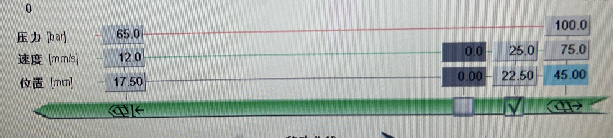
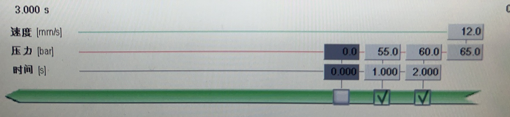
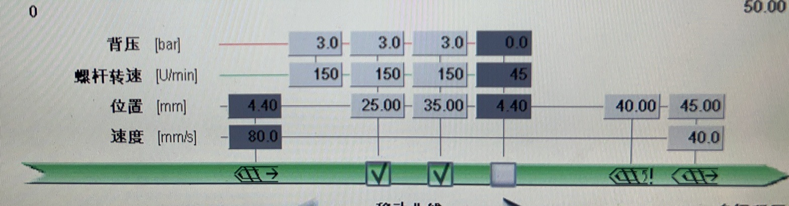
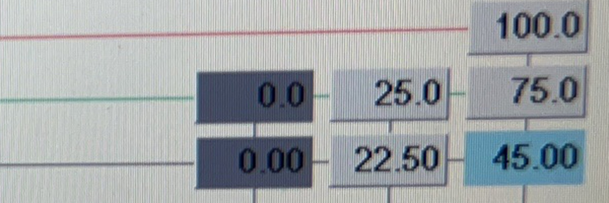
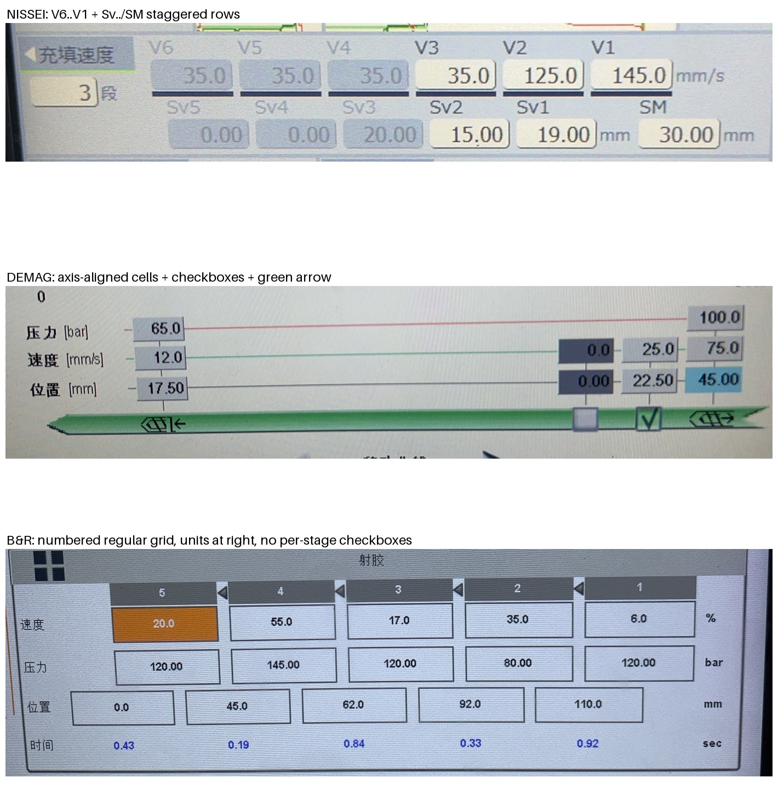
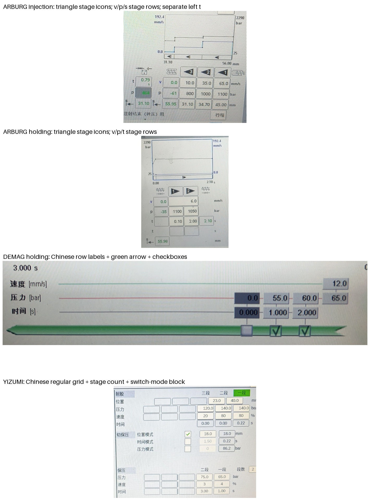

# 德马格页面结构与跨品牌交叉检查

日期：2026-10-29
范围：只观察真实样本、生成证据裁剪，不修改识别代码或共用模板。结论仅覆盖下列样本，未证明同品牌其他控制器或其他页面世代均兼容。

## 1. 原图与证据索引

### 德马格

- D1 多级射胶：`datasets/hmi/raw/legacy/samples_v2/德马格_A01_TX22063_100-17017_20260722_rec14_射出_00.jpeg`；另一取景为 `datasets/hmi/raw/feishu/20260927/德马格/Z002/2026-08-10_recvvPK5W3XeNt_injection-holding_0.jpg`。
- D2 多级保压：`datasets/hmi/raw/legacy/samples_v2/德马格_A01_TX22063_100-17017_20260722_rec14_射出_01.jpeg`；另一取景为 `datasets/hmi/raw/feishu/20260927/德马格/Z002/2026-09-19_recvvPKhyWqjbu_injection-holding_1.jpg`。
- D3 多级预塑：`datasets/hmi/raw/legacy/samples_v2/德马格_A01_TX22063_100-17017_20260722_rec14_储料_00.jpeg`；另一取景为 `datasets/r6_demag/regression/metering.jpg`。
- D4 工艺优化：`datasets/hmi/raw/feishu/20260927/德马格/Z002/2026-09-18_recvvPKhyWxMOH_metering-cooling_0.jpg`；回归样本为 `datasets/r6_demag/regression/unsupported_optimization.jpg`。

### 交叉检查

- N1 日精 TACT5：`datasets/r6_nissei/tact5.process_settings.injection_holding_metering/development/Z078_20260910_shebao.jpg`。
- B1 伯乐 B&R：`datasets/r6_bole/cropped-layout.jpg`；熔胶对照为 `datasets/r05/b_and_r.metering.three_stage/development.jpg`。
- A1 阿博格注射：`datasets/hmi/raw/feishu/20260927/阿博格/Z068/2026-07-17_recvvPK5W3E6xD_injection-holding_0.jpg`；另一取景为 `datasets/r6_arburg/injection-regression.jpg`。
- A2 阿博格保压：`datasets/hmi/raw/feishu/20260927/阿博格/Z068/2026-07-17_recvvPK5W3E6xD_injection-holding_1.jpg`。
- A3 阿博格进料/松退/冷却：`datasets/r6_arburg/development.jpg`。
- Y1 伊之密射胶/保压：`datasets/r6_yizumi/development.jpg`；另一取景为 `datasets/r6_yizumi/retained.jpg`。
- Y2 伊之密熔胶：`datasets/r6_yizumi/metering_development.jpg`。

前序任务写“易腾迈”，仓库未找到该命名；本报告按现有 YIZUMI（伊之密）样本完成该项交叉检查，不把两个名称擅自视为同一品牌。

## 2. 德马格：品牌族特征与子页特征

D1–D3 的共同结构不是规则矩形段表，而是：左侧中文全词行标签和单位、横贯页面的细曲线/导轨、底部绿色长箭头、沿箭头位置放置的数值格，以及与可选段一一对应的复选框。灰暗格是段启用证据的辅助，不是路由的充分条件。

裁掉屏框 `Sumitomo DEMAG`、页号、标题和上方曲线后，保留下方完整设定区仍可路由到德马格页面族。绿色箭头或复选框单独出现不足以确认子页；子页必须再由行集合和独立值区确定。

### 2.1 多级射胶（D1）

足够识别的组合：

- 行集合为 `压力 [bar] / 速度 [mm/s] / 位置 [mm]`。
- 中间段格只有速度和位置两行；压力不是逐段网格，而是左侧转保压值与右侧共用射胶压力限制。
- 左侧还有一组独立的速度/位置/压力值，底部绿色箭头从右向左执行，可选段下方有复选框。

裁掉标题、品牌和曲线后，上述设定区足够识别为 DEMAG 多级射胶。若只剩速度/位置两行而看不到压力行、箭头或复选框，只能保留候选，不能确认子页。

### 2.2 多级保压（D2）

足够识别的组合：

- 行集合为 `速度 [mm/s] / 压力 [bar] / 时间 [s]`。
- 压力和时间沿绿色长箭头逐段布置；速度只有右端共用值。
- 时间轴以秒表示，执行方向从右向左，可选段下方有复选框。

它与多级射胶共享箭头骨架，但射胶有逐段位置、无逐段时间；保压有逐段时间、无逐段位置。裁掉标题后仍可凭这一差异区分子页。

### 2.3 多级预塑（D3）

足够识别的组合：

- 主段行集合为 `背压 [bar] / 螺杆转速 [U/min] / 位置 [mm]`，另有松退速度 `[mm/s]`。
- 绿色长箭头从左向右执行，可选段下方有复选框。
- 右侧有与主段网格分离的熔料结束及后抽位置/速度区。

裁掉标题、品牌和上方曲线后仍可路由到 DEMAG 多级预塑。只看到 `位置 + 速度` 而没有背压/螺杆转速或右侧松退区时，不足以区分射胶与预塑。

### 2.4 工艺优化不是多级预塑（D4）

D4 文件名含 `metering-cooling`，实际标题和结构是“工艺优化”：同一屏有上下两条绿色流程箭头、预塑/保压实际值和设定值混排，并非 D3 的多级预塑设定页。路由不得使用文件字段名代替页面类型，也不得把 D4 强送入 `templates/demag/metering.json`；没有已登记的工艺优化模板时，应返回不支持或页面未知。

## 3. 德马格裁剪边界与必须返回未知

该裁剪来自 D1。剩余数值和底色仍可辨认，但品牌、子页、段序及字段语义均不能可靠确定，必须返回未知。具体边界：

- 只剩数值格，或只剩单位组合 `bar/mm/s/mm`：品牌和页面均未知。
- 只见绿色箭头、复选框或灰暗格之一：不能确认品牌族，更不能确认子页。
- 行标签只剩一两个，且没有另一组结构佐证：页面未知。
- 箭头方向或复选框对应关系被裁掉/遮挡：可保留页面族候选，但段序、启用状态和子页语义未知，不进入字段提取。
- 射胶与保压的完整行集合不可见时，不凭某组数值大小或零值猜子页。
- D4 这类同屏多流程页不能用 D1–D3 的单一子页规则解释。

## 4. 交叉检查一：日精充填块 vs 德马格、伯乐 B&R

结论：完整局部结构可以区分；标签被 OCR 丢光后会混淆，此时必须未知。

- 日精 N1：上行是字母段号 `V6…V1` 降序，下行是 `Sv5…Sv1` 加独立 `SM`，两行错列且下行多一列。这是前序报告提出的特征，N1 原图支持。
- 德马格 D1：没有 `Vn/Svn/SM` 段标签；有中文全词行标签、沿绿色箭头布置的段格和逐段复选框。
- 伯乐 B&R B1：是规则矩形网格，列头为纯数字 `5…1`，速度/压力/位置/时间整行对齐，单位在表右，没有德马格式的逐段复选框，也没有日精的 `Sv/SM` 错列。
- 三者都可能出现位置、时间、速度、压力，故 `mm/s + mm + bar/MPa + s` 不能作为唯一路由依据。单位在此只作弱佐证。

## 5. 交叉检查二：阿博格 v/p/t 网格 vs 德马格、伊之密

结论：保留列头、行首符号和外围控件时可以区分；只剩 `v/p/t` 字母或数值格时不足以路由。

- 阿博格 A1/A2：段列头为带数字的三角形图标，行首是符号 `v/p/t/s`，绿色实际值位于阶段格左侧；没有德马格式绿色长箭头加逐段复选框。
- 德马格 D2：中文全词行标签、绿色长箭头、逐段复选框，右端独立共用速度。
- 伊之密 Y1：中文 `一段/二段/三段` 或段数框，规则矩形网格；射胶下方有 `切保压` 的位置/时间/压力模式块，保压也在同页。没有阿博格三角列头，也没有德马格长箭头段轴。
- 伊之密 Y2 熔胶页另有 `熔胶1/熔胶2/前松退/后松退` 列及位置/压力/速度/背压行；与阿博格 A3 的 `v/p/s` 加右侧松退小块不能仅靠“都有松退”互相套模板。

### 对前序阿博格描述的修正

A1 原图显示：注射阶段网格是 `v/p/s` 三行，左侧单独的 `t/p/s` 是转压实际值区，不能写成每个注射段都有 `t/v/p/位置` 四行。A2 保压才把 `t` 放进阶段网格，并可见另一个空 `t` 行及位置实际值。

因此可用的子页区别是：A1 的倒三角 `3/2/1` 加阶段 `v/p/s`，A2 的正三角 `1/2` 加阶段 `v/p/t`；A3 是正三角 `1/2`、阶段 `v/p/s`、无阶段 `t`，并有右侧松退区。三角方向、t 行和松退区要联合使用，任何一项单独被裁掉都不应强选子页。

## 6. 对现有路由登记的观察

本轮未修改这些文件，只记录缺口：

- `templates/demag/injection.json`、`holding.json`、`metering.json` 都以文字 `layout_anchors` 且 `require_anchor_match=true` 为主；标题/标签文字被裁掉时，现有登记无法表达本报告验证过的箭头、行集合和复选框结构。
- `templates/arburg/selogica_metering.json` 仅登记进料/松退/冷却文字锚点；A1/A2 的注射和保压没有对应路由模板。
- `templates/b_and_r/injection_holding.json` 和 `templates/yizumi/injection_holding.json` 也依赖文字锚点；这些文字可辅助路由，但不应覆盖相互冲突的结构证据。

建议后续实现时把路由证据分成“品牌族候选”和“子页确认”两级，并保留缺失证据。路由只选择页面模板，不读取段启用、不推断工艺语义；结构不足时返回未知，而不是用单位、数值或数据集文件名补齐。

## 7. 本轮产物

- 新增本报告。
- 在 `artifacts/page_structure_demag_crosscheck/` 生成原图局部裁剪和两张对照图。
- 未修改项目代码、模板、真值或模型。
