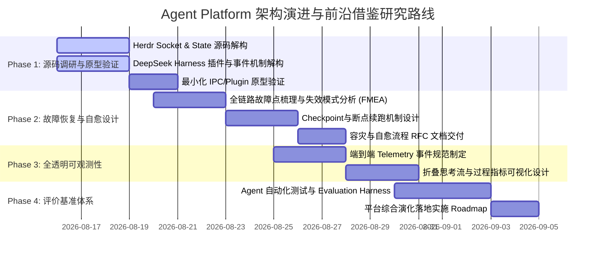

# Herdr 与 DeepSeek Harness 架构借鉴与系统韧性可观测性演进研究计划 (2026-08-16)

## 📌 背景与核心主旨

随着 Agent Platform 业务复杂度提升，多 Agent 协同流水线、长时运行任务以及分布式节点交互日益频繁，系统在底层架构与运维层面暴露出两项深层次的平台级缺口：

1. **系统设计维度的故障恢复与容灾流程（Fault Tolerance & Recovery Process）**：当前系统缺乏跨进程、跨网络、长耗时任务的中断自愈、失败隔离、断点保存与平滑续跑机制，异常时容易导致状态分裂或整轮重跑。
2. **全链路运行过程透明可观测性与自动化评价体系（Observability & Evaluation Harness）**：Agent 内部思考链路、工具调用、上下文水位及多 Agent 协作状态缺乏细粒度、结构化的透明透出，且缺乏系统化的能力与稳定性评估基准。

为此，本研究报告锚定开源社区近期高热度、极具代表性的两大架构体系——**Herdr**（Agent-Aware 终端多路复用与运行时）与 **DeepSeek Harness**（基于 Cordis 的全插件化 Agent 运行时），全面剖析其通信协作机制、插件内核与容错模式，并制定分阶段的落地研究计划。

---

## 🔍 目标开源仓库确认与基本面

| 项目名称 | 官方仓库 / 地址 | 核心定位 | 关键技术栈 |
| :--- | :--- | :--- | :--- |
| **Herdr** | [ogulcancelik/herdr](https://github.com/ogulcancelik/herdr)<br>官网：`https://herdr.dev` | Agent-Aware Terminal Multiplexer & Multi-Agent Runtime | Rust、Unix Domain Sockets / Named Pipes、TUI、NDJSON IPC |
| **DeepSeek Harness (`dsh`)** | [deepseek-ai/deepseek-harness](https://github.com/deepseek-ai/deepseek-harness)<br>NPM：`@deepseek-ai/dsh` | Plugin-First Modular Agent Runtime ("Agent = Model + Harness") | TypeScript、Cordis Meta-framework、Service Injection、Typed Event Bus |

---

## 💡 核心框架架构深剖与通信协作机制

### 1. Herdr：Agent-Aware 状态感知与多 Agent 终端协作

```mermaid
flowchart TB
    subgraph Herdr Runtime Server [Herdr Background Daemon / Server]
        SM[State Machine: working / idle / blocked / done]
        SocketServer[Local Socket Server: /tmp/herdr.sock]
        Sessions[Persistent Workspaces & Panes]
    end

    subgraph Agent Panes [Workspace Terminal Panes]
        AgentA[Coordinator Agent]
        AgentB[Worker Agent 1]
        AgentC[Worker Agent 2]
    end

    Client[TUI Client / CLI] -.->|Connect / Render| Herdr Runtime Server
    AgentA -->|1. Request Spawn Pane| SocketServer
    SocketServer -->|2. Create & Bind| AgentB
    SocketServer -->|3. Push State Changes| AgentA
    AgentA -->|4. Read Output / Inject Command| SocketServer
    SocketServer -->|5. Terminal I/O Stream| AgentC
```

#### 关键技术实现
- **Client-Server 分离与常驻会话保活**：
  - Server 作为常驻后台守护进程，管理所有 Workspace 与 Pane 终端进程。
  - 用户断开连接、关闭笔记本或 SSH 闪断时，Agent 进程保持运行不中断；Client 重新连接即可无缝恢复现场。
- **Agent 状态感知（State Awareness）**：
  - 核心状态机细分 `working`、`idle`、`blocked`（等待人工/输入）、`done`。
  - 不做盲目的字符轮询，而是结构化感知子进程和 Agent 生命周期。
- **基于 Socket API 的 Agent-to-Agent 编排与通信**：
  - 提供 Unix Domain Socket（Linux/macOS）及 Named Pipe（Windows）接口，采用 NDJSON（Newline Delimited JSON）轻量协议。
  - **协调者 Agent（Coordinator）模式**：上层 Agent 可通过 Socket API 自主 `spawn` 新 Pane/子 Agent、直接读取兄弟 Pane 的 stdout/stderr 流，并动态注入控制指令。
  - **事件订阅（Push Notification）**：Agent 可订阅状态变更事件，彻底消除被动的 `sleep` 轮询等待。

---

### 2. DeepSeek Harness (`dsh`)：Cordis 微内核与全插件化架构

```mermaid
flowchart TB
    subgraph Cordis Kernel [Cordis Meta-framework Microkernel]
        Context[Context & Service Container]
        DI[Dependency Injection: ctx.inject]
        EventBus[Typed Event Bus: emit / waterfall / parallel]
        Lifecycle[Reversible Effects / Disposable Cleaners]
    end

    subgraph Core Services [Plugin Ecosystem]
        LLM[Model Adapters Service]
        Tools[Tool Registry Service]
        Skills[Skill Registry Service]
        Session[Session & State Storage]
        Sandbox[Sandbox Execution Service]
        UI[Web / TUI / Channel Plugin]
    end

    Context --> DI
    DI --> Core Services
    Core Services --> EventBus
    Lifecycle -.->|Unload / Hot-Reload Cleanup| Core Services
```

#### 关键技术实现
- **"Everything is a Plugin" 哲学与零 Fork 税（Zero Fork-Tax）**：
  - 没有特权核心，模型适配器、工具注册表、Skill 扩展、会话存储、沙箱执行乃至前端 UI 全部作为 Service 插件挂载。
  - 开发者通过 YAML 配置文件声明组合所需插件，替换底层存储或模型时无需修改内核代码。
- **依赖注入与服务组合（Service-Based Composition）**：
  - 插件声明 `inject: ['llm', 'tools', 'sandbox']`，Cordis 自动解析拓扑依赖并保证加载时序。
- **丰富维度的类型化事件总线（Typed Event Bus）**：
  - `emit`：有序广播观察者事件（用于日志、监控、审计）。
  - `waterfall`：链式流水线传递，下一个处理器接收上一个处理器的加工结果（用于 Prompt 过滤、输出安全审查、Tool Call 拦截与重写）。
  - `parallel` / `serial`：支持并行或串行异步拦截。
- **可逆副作用（Reversible Effects）**：
  - 插件挂载的所有资源（Prompt 片段、Tool Schema、Event Listener）都会返回 Disposable 清理器，当插件卸载或热重载时自动精准回退，杜绝内存泄漏与状态脏污。

---

## 🎯 对照 AP 现有架构的技术诊断与借鉴价值

| 维度 | Agent Platform 当前现状 | Herdr 启示与借鉴 | DeepSeek Harness 启示与借鉴 |
| :--- | :--- | :--- | :--- |
| **故障恢复 (Fault Tolerance)** | • 依赖顶层 Watchdog 超时兜底<br>• 中断后需整轮重跑或人工重建 Session<br>• 缺少统一的 Checkpoint 与恢复收据 | • 常驻 Daemon 进程解耦会话与网络连接<br>• 节点/终端断连后任务继续运行<br>• 状态机驱动挂起（blocked）与唤醒 | • 插件级异常隔离（沙箱与工具错误不击穿内核）<br>• 失败拦截器链（Waterfall 错误重写与 Fallback 策略）<br>• 可逆副作用保证重试时状态干净 |
| **可观测性 (Observability)** | • 进度流解析目前分散在各 Harness 适配器<br>• 缺乏统一的思考链路、耗时与 Token 追踪看板 | • 面向 Agent 的结构化状态监控（working/idle/blocked/done）<br>• 统一多 Pane 聚合视图 | • 类型化事件总线支持挂载全局 Telemetry 插件<br>• 细粒度 Step、LLM Token、Tool Call 耗时追踪与审计 |
| **Agent 协作 (Agent-to-Agent)** | • 基于飞书房间 `@` 提及或 `$handoff` 串行转交<br>• 缺少本地进程级的直连 IPC 总线 | • Unix Socket + NDJSON 高性能轻量通信<br>• 主 Agent 可自主控制环境、切分子 Pane 并行调度 | • 基于 Context 共享与事件监听的多 Agent 协作<br>• Service 级别能力共享（跨 Agent 复用 Tool/Skill） |
| **扩展性与治理 (Extensibility)** | • Harness 逻辑在服务内单体硬编码<br>• 增删新 Agent 类型需要修改多处路由与卡片 | • 统一的 Socket 交互协议标准 | • "Everything is a Plugin" 架构<br>• 统一 Skill/Tool/Model 契约，支持动态装配与热插拔 |

---

## 🗓️ 分阶段联合研究与设计落地规划

为了将先进设计理念与 AP 平台实际需求深度结合，制定四阶段渐进式研究路线图（本阶段纯为方案研究与技术验证，不直接修改业务生产代码）：



### 阶段一：源码深度取证与最小验证（Phase 1: Deep Dive & Prototyping）
- **目标**：摸清两个仓库的实现细节与运行边界。
- **重点研究项**：
  1. **Herdr**：
     - 分析 `ogulcancelik/herdr` 的 Rust 源码，提取其 Socket API 协议规范及 Pane 状态检测逻辑。
     - 验证其在 Linux / macOS / Headless 服务器环境下的常驻稳定性。
  2. **DeepSeek Harness**：
     - 分析 `deepseek-ai/deepseek-harness` 基于 Cordis 的生命周期管理与事件流转机制。
     - 评估其工具注册、上下文注入与异常隔离策略对 AP 的可迁移性。

### 阶段二：系统级故障恢复与容灾流程设计（Phase 2: Fault Tolerance & Resilience RFC）
- **目标**：形成一套完整的平台故障应对与自愈机制设计规范。
- **核心模块**：
  1. **失效模式与影响分析（FMEA）**：覆盖进程崩溃、LLM API 超时、长任务 Watchdog 误杀、Git 冲突、沙箱权限越界等典型故障。
  2. **轻量 Checkpoint 与状态收据机制**：在每个 Step/Handoff 阶段自动落盘上下文指纹与状态快照，支持“原地重试”或“退回上一一致状态”。
  3. **受控降级与人工介入挂起（Blocked State）**：借鉴 Herdr 的 `blocked` 状态，当遇到致命不确定性时，安全挂起等待人类指令或备选 Agent 接管，而非直接抛错崩溃。

### 阶段三：全链路可观测性与透明度提升（Phase 3: Observability & Execution Transparency）
- **目标**：让 Agent 的“思考-决策-工具调用-输出”全过程对用户与系统均具备高透明度。
- **核心模块**：
  1. **结构化 Telemetry 事件体系**：统一各 Harness 进度事件，标准化输出 Token 消耗、Step 耗时、Reasoning Trace 及 Tool 调用参数/返回值。
  2. **前端与卡片折叠呈现**：在飞书与 Web 端提供清晰的“主线结论 + 展开过程详情”，彻底消除黑盒感。

### 阶段四：平台级评价与基准评测体系（Phase 4: Evaluation & Quality Harness）
- **目标**：建立 Agent Platform 自身的能力度量基准。
- **核心模块**：
  1. **自动化评测沙箱**：设计标准化测试用例库（代码编写、Bug 修复、多 Agent 协作协商、文档编写）。
  2. **多维评价指标**：任务单次通过率、人工干预次数、Token 产出比、返工率与耗时基线。

---

## 🤝 与 Pi Agent (Tester / 验证角色) 的协同讨论要点

请 `@pi-agent` 重点从 **测试验证、系统鲁棒性边界与评测设计** 维度共同审视并展开讨论：

1. **故障注入与容错验证测试场景**：
   - 如何为 Agent 协作流水线设计真实故障注入测试（如：子进程 SIGKILL、网络延迟丢包、LLM 输出截断/格式畸变）？
   - 如何验证 Checkpoint 机制的幂等性与数据一致性？
2. **Evaluation Harness 评测基准设计**：
   - 借鉴 DeepSeek Harness 的评估逻辑，如何构建 AP 平台的常态化自动化回归评测用例？
   - 评价指标（Token 效率、工具调用准确率、多轮对话一致性）的具体打分与判定规则设计。
3. **Herdr 与 DSH 原型在 AP 沙箱环境下的可执行性验证**：
   - 在我们的 Platform Local 与远程 Runner 环境中搭建最小测试环境，验证 Socket 通信与 Cordis 插件架构的集成可行性。

---

## 🧪 pi-agent 验证侧输入：故障注入矩阵、Checkpoint 验证法与评测基准设计（2026-08-16）

> 本节由验证角色基于 2026-08-15/16 S04 验收与三轮真实故障修复的一手证据补充，可直接作为 Phase 2/4 的测试设计输入。

### A. 故障注入矩阵（Fault Injection Matrix）

| # | 注入手段 | 目标能力 | 预期行为 | 现状证据 / 缺口 |
| :-: | :-- | :-- | :-- | :-- |
| 1 | `SIGKILL` runner 子进程 | 会话脱钩与自愈重连 | 平台侧 `failNodeRuns` 拒绝在途运行；节点转 offline；runner 凭证持久化支持免参重连，指数退避 1s→2s→…→30s 封顶 | ✅ 已实测（FIX 438 前后均验证）；⚠️ 缺口：pending run 的取消依赖 gateway `/run` HTTP 连接断开触发 `cancelNodeRun`，客户端半开时可能悬挂 |
| 2 | `SIGKILL` 平台侧进程（watcher/gateway） | 检查点持久化 | 游标/票据全在 DB，重启后 `eventKey` 去重、不重发回执 | ✅ FIX 435（manual 自治游标丢失致回执风暴）即真实案例，已固化为回归断言；⚠️ 缺口：`pendingRuns` 为进程内存态，崩溃即丢，无恢复收据 |
| 3 | 网络分区（双向丢包/黑洞） | 租约与活性判定 | 节点应在租约超时后被判 offline | ⚠️ **主要缺口**：当前仅 30s 心跳刷新 `lastSeen`，TCP 半开时节点永久假 online；建议平台侧 lastSeen 超时判定 + runner 侧 ping/pong 双向活性 |
| 4 | 网络延迟/抖动 | 时钟与超时容忍 | TTL 判定留容忍窗 | ✅ 配对票据 10min TTL、遥测 60s 未来时间容忍已有；建议评测中把 ±60s 偏移纳入用例 |
| 5 | NDJSON/JSON 格式畸变 | 解析容错 | 非法帧丢弃且不崩连接，正常帧继续处理 | ✅ WS handler 与 codex 遥测解析均有防御；⚠️ 缺口：静默丢弃无计数，建议 `malformed_frame_count` 指标进入 Phase 3 Telemetry |
| 6 | 分发产物损坏 | 供应链/引导容错 | 产物语法可执行 | ✅ FIX 436（shebang 被引导行挤到第 2 行致 `node -` 必崩）已修，并固化 `vm.Script` 编译级回归断言——此模式应推广到所有下发脚本 |
| 7 | 并发/重放 | 原子性与幂等 | 恰好一次消费 | ✅ 票据原子消费（`updateMany` 带 `consumedAt IS NULL` 守卫，`count===1` 才放行）、重放 409、`eventKey`/`runId` 去重均为现成范例 |

**转化为可执行用例**：矩阵每一行应固化为 `tests/fault-injection/` 下的确定性测试，注入手段优先用假对象（本仓库 `tests/remote-node-ws.test.ts` 的 FakeWebSocket 即模板——在 `handleNodeConnection` promise 未决时提前发帧，正是复现早期 hello 丢失的手段）；无法假对象化的（真 SIGKILL、真网络栈）进 Phase 1 原型环境跑。

### B. Checkpoint 幂等性与一致性验证方法（回应讨论要点 1）

Checkpoint 的正确性等价于三条可测性质，每条都有标准验证手法：

1. **恰好一次**：状态迁移必须带唯一键 + 条件守卫的原子 CAS。验证：并发双消费测试（两个事务同时竞争同一检查点，断言恰一个成功）——S04 票据兑换已按此实现并被重放用例覆盖；
2. **重放安全**：同一检查点重复推进必须零副作用。验证：同游标二次 tick 断言回执计数不增（FIX 435 的测试即此模式）；
3. **崩溃一致**：任意时点崩溃后恢复不产生重复/丢失。验证：属性测试——随机 kill 时点 × N（N≥100）循环，断言交付次数恒为 1。建议 Phase 2 的 Checkpoint RFC 直接把这三条写成验收标准。

### C. Evaluation Harness 分层设计与判定规则（回应讨论要点 2）

| 层级 | 对象 | 触发 | 判定 | 现成种子 |
| :-: | :-- | :-- | :-- | :-- |
| L0 契约 | 路由/权限/隔离/校验 | 每次 PR/CI | 100% 通过，硬门禁 | `test:auth-users`、`test:pairing`、`test:acpx-harness-options`、workflow validator |
| L1 故障注入回归 | 韧性行为 | 每次 PR/CI | 100% 通过，硬门禁 | A 节矩阵固化的假对象测试 |
| L2 任务级评测 | 端到端任务集（代码/Bug修复/多 Agent 协作/文档，各 ≥10 例） | 每日/发版前 | 统计判定：`pass@1` 不低于基线 −5pp 且无 P0 回归 | 无——Phase 4 首建；指标见下 |
| L3 长稳混沌 | 72h 轮换注入 | 每周 | MTTR ≤ 目标、无 FD/内存/连接泄漏 | 无——Phase 1 原型环境预演 |

**L2 指标与打分规则（初版）**：
- 任务单次通过率 `pass@1`（主指标）
- 人工干预次数 `HITL`（越低越好，含被 watchdog 误杀后的人工恢复）
- Token 产出比 `effective_output_tokens / total_tokens`（分母含重试与被丢弃的中间轮）
- 返工率 `failed_handoffs / total_handoffs`
- 时长基线 p50/p95（分任务类别）
- 阈值先拍定，两周后改用滚动 p50 自校准，避免“基线漂移不可发版”

**评测沙箱硬性要求**（来自本轮实测教训）：每个被测实例必须独立端口 + 独立 `HOME` + 独立构建目录——共享 `.next` 会静默打挂路由（FIX 437/439 两次复现），共享 HOME 会互相污染凭证与登录态；原始 trace 必须全量落盘供失败归因，禁止只存结论。

### D. Phase 1 原型可执行性验证清单（回应讨论要点 3）

**Herdr（Platform Local 与一台远程 Runner 各跑一轮）**：
- [ ] headless 环境下 daemon 常驻启动、socket 握手 NDJSON 收发；
- [ ] `SIGKILL` 单个 Pane 后 daemon 存活、状态机正确迁移；
- [ ] 断开 client 再重连，现场无损恢复；
- [ ] 订阅状态推送（验证无轮询延迟）。

**DeepSeek Harness**：
- [ ] 插件热重载后可逆副作用零残留（挂载 Prompt/Tool → 卸载 → 断言注册表/监听器干净）；
- [ ] `waterfall` 拦截链顺序与短路语义；
- [ ] 类型化事件总线可被外部 Telemetry 采集器全量订阅。

**集成冒烟**：两者各以最小 wrapper 暴露统一 Telemetry 事件流，验证能否被 Phase 3 事件规范直接消费——这是判定“借鉴可落地”还是“仅论文价值”的关键实验。
