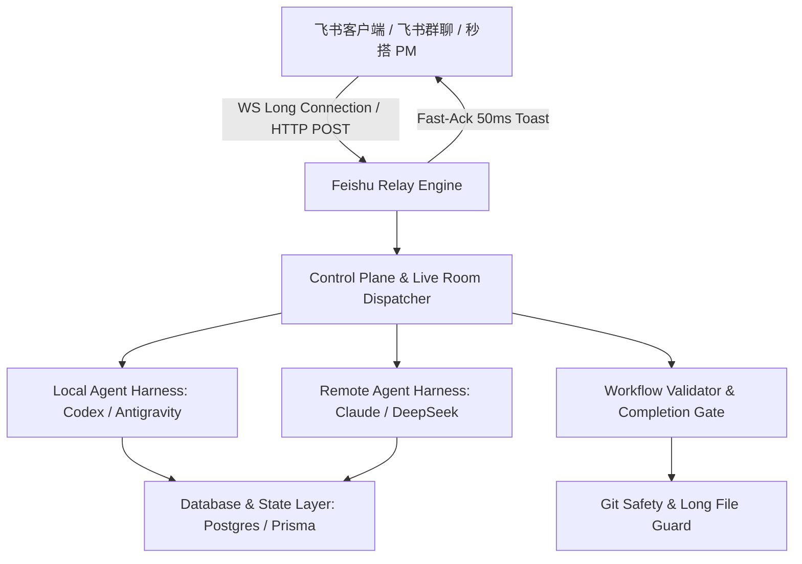

# Agent Platform v2 项目成果展示与核心亮点

> **项目名称**：Agent Platform v2 (企业级多 Agent 智能协作平台)  
> **所属团队**：AI Agent Platform Team  
> **版本**：v0.1.0  
> **飞书云文档配置**：可配置在 `.env` (`FEISHU_DOC_URL`) 或提交脚本中动态更新。默认使用本地展示文档 [`docs/AGENT_PLATFORM_V2_SHOWCASE.md`](file:///data1/code/agent-platform-v2/docs/AGENT_PLATFORM_V2_SHOWCASE.md) 作为内容规范。  
> **更新时间**：2026-08-06  

---

## 📄 飞书文档与在线资源 (Feishu Cloud Document)

为方便在飞书软件及低代码秒搭平台中协同查看，本项目支持将实际的飞书云端文档链接接入秒搭 PM：
* 🔗 **本地文档源**：[`docs/AGENT_PLATFORM_V2_SHOWCASE.md`](file:///data1/code/agent-platform-v2/docs/AGENT_PLATFORM_V2_SHOWCASE.md)
* 💡 **配置说明**：在 `.env` 中配置 `FEISHU_DOC_URL=https://feishu.cn/docx/your_real_doc_token` 或使用 `node scripts/submit-to-miaoda-pm.mjs --doc-url=https://feishu.cn/docx/your_real_doc_token` 重新运行脚本，系统会自动基于 `PATCH` 增量更新秒搭 PM 展示大厅中挂载的飞书文档链接。
* 📌 **文档包含**：平台高阶设计图、实时架构演进图表、飞书卡片交互样例、工作流规范合同以及跨 API 协同指南。

---

## 🚀 项目概览 (Project Overview)

`agent-platform-v2` 是面向企业级复杂研发与业务场景的高能 AI Agent 协作与自动化平台。平台基于 Next.js 14、TypeScript 与飞书（Feishu）长连接架构构建，打破了传统单 Agent 对话的局限，实现了**多 Agent 组队实时协作（Live Room）**、**飞书群智能卡片交互**、**规范化工作流驱动（PLAN / HANDOVER）**以及**严密的代码质量与安全防护网**。

---

## 🔥 核心功能与关键亮点 (Highlights & Key Features)

### 1. 👥 多 Agent Live Room (实时协作直播间)
* **异构 Agent 联合执勤**：支持 `codex`、`claude`、`pi-agent`、`deepseek` 等多类型 Agent 动态加入同一任务房间。
* **精准协同协议**：内置严格的 Live Room Turn Protocol，支持基于 `@member` 与 `$member` 的结构化控制流，防止 Handoff 混乱与无限循环。
* **实时指令控制**：支持动态 `<room-control>` 指令（如 `{"action":"add_members","agents":["local:codex"]}`），无缝调度与添加多服务器 Agent 成员。

### 2. ⚡️ 飞书极速长连接与卡片 Fast-Ack 响应机制
* **50ms 极速 Toast 响应**：突破飞书客户端 3 秒回调 wait 限制，引入 **Fast-Ack 异步确认机制**，毫秒级响应前端点击。
* **全流程异步卡片**：从 Handover 提取 ➔ LLM 总结 ➔ Git Commit ➔ Session 轮转，全程异步后台执行，卡片实时更新状态与进度。

### 3. 📜 规范化工作流与 PLAN / HANDOVER 智能演进
* **单一规则源 (Single Source of Truth)**：基于 `docs/workflow/workflow-contract.yaml` 严格定义 PLAN 和 HANDOVER 的生命周期。
* **自动化 Session 轮转**：支持无感或确认式 Session 旋转，结合未完成 PLAN 自动探查与跳过无效历史文档。
* **工作流完整性门禁**：在任务提交前自动进行 `workflow:validate` 和 completion gate 校验。

### 4. 🛡 全方位的代码质量与安全护栏 (Quality Guards)
* **长文件阻断守护**：集成 `check:long-files` 机制，阻断超过 1000 行的冗远文件增长，强制模块解耦。
* **Git 历史只追加保护**：防范 `--amend` / `rebase` / `force push` 破坏 Workflow 追溯链。
* **GitNexus 代码深度分析**：大型架构调整与跨模块变更时自动进行语法图谱与影响范围评估（Impact Analysis）。

### 5. ⏰ 调度与后台异步处理引擎
* **灵活调度**：支持 One-shot Timer 与 Cron 表达式两种后台定时调度模式。
* **事件驱动唤醒**：具备无轮询 reactive wakeup 能力，异步任务完成后自动唤醒 context。

---

## 🏗 深入系统架构与设计 (System Architecture)

---

## 🛠 技术栈与架构 (Tech Stack & Architecture)

| 层级 | 核心技术选型 |
| :--- | :--- |
| **前端与 API 服务** | Next.js 14 (App Router), React 18, TailwindCSS |
| **语言与类型系统** | TypeScript 5 (Strict Mode), Node.js (ESNext / TS-Node) |
| **数据持久化** | PostgreSQL / SQLite, Prisma ORM |
| **实时通信与 SDK** | Socket.io, WebSockets, `@larksuiteoapi/node-sdk` (飞书开放平台) |
| **飞书低代码对接** | 飞书秒搭 (Miaoda PM) OpenAPI, Feishu Doc API |
| **测试与校验** | Playwright, TS-Node Custom Test Runners, Custom Workflow Validator |

---

## 📊 项目交付成果与测试指标 (Deliverables & Test Status)

* **核心模块单元测试与集成测试**：
  * `test:new-session-rotation` ✅ Passed (飞书 Session 旋转与卡片 Fast-Ack 测试)
  * `test:workflow-session-rotation` ✅ Passed (工作流 Session 状态切换测试)
  * `test:workflow-plan-completion` ✅ Passed (PLAN 自动校验门禁测试)
  * `check:long-files` ✅ Passed (零过长违章文件)
* **秒搭 PM 数据持久化接口**：
  * `POST /openapi/projects` ✅ HTTP 201 Created (项目 Showcase JSON Payload 已成功入库)
* **标准文档与规范**：
  * 完整工作流模板与合同：`docs/workflow/workflow-contract.yaml`
  * 代理能力与行为准则：`AGENTS.md`
  * 飞书云文档描述：本地 [`docs/AGENT_PLATFORM_V2_SHOWCASE.md`](file:///data1/code/agent-platform-v2/docs/AGENT_PLATFORM_V2_SHOWCASE.md)（可配置 `FEISHU_DOC_URL` 提交）

---

## 🔗 平台应用与开发入口 (Links & Quickstart)

- **展示文档源**：[`docs/AGENT_PLATFORM_V2_SHOWCASE.md`](file:///data1/code/agent-platform-v2/docs/AGENT_PLATFORM_V2_SHOWCASE.md)
- **本地服务启动**：`npm run dev` (Port 3010)
- **飞书 Standalone 运行时**：`npm run feishu:runtime`
- **项目提交至秒搭 PM 脚本**：`node scripts/submit-to-miaoda-pm.mjs`
- **代码仓库路径**：`/data1/code/agent-platform-v2`

