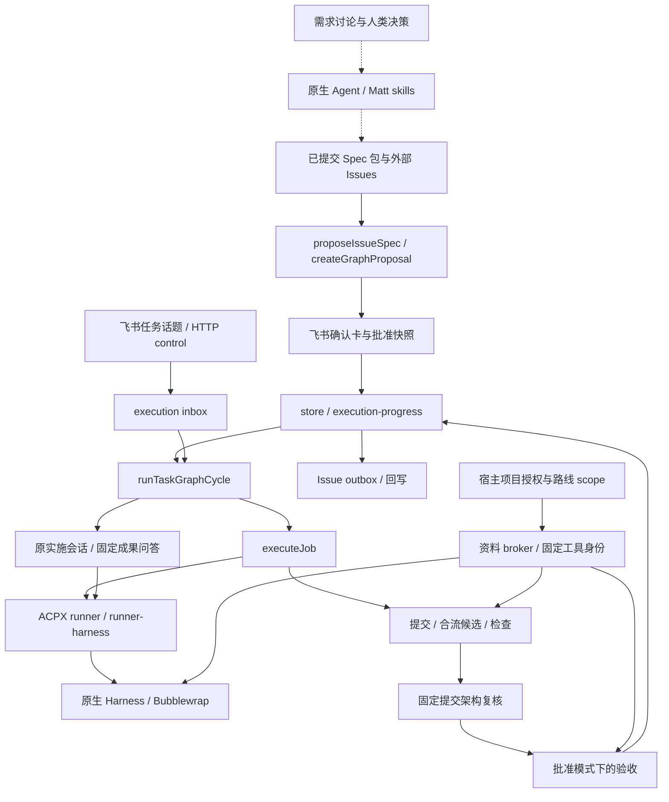

# S01：当前架构地图与 Matt/pstack 整合审计

日期：2026-10-20。源码基线：`92b03b42251939406b210ea86b7bac8838b02fce`，分支 `oss-prep`。

## 结论和范围

可以进入“建立最小边界合同”的设计讨论，但实际改动前应先定位本轮发现的会话事务超时与复核推进失败。现有批准快照、执行归属、固定提交复核和项目能力继承值得保留。优先整理会话状态转换的所有权，并保护已有协议；不宜先整体搬动 `task-graph`，也不宜增加常驻 Architect 或第二套调度器。

本片只新增审计报告、静态分析工具和证据。不改变业务代码、数据库结构、权限配置或服务，不发布 Issues、不提审路线、不接续业务任务。此 REPORT 不启动后续 Session；S02–S05 均未实施。

审计请求来自本轮用户确认。讨论稿 [towards_matt+pstack.md](towards_matt+pstack.md) 在开工时尚未入 Git，属于需求材料，不是获批的机器执行合同。其旧基线 `6f45b6d` 之后，当前已包含会话接续 `bc29293`、C01 `9f430f3`、C02 `86653fa` 和部署记录 `92b03b4`。本报告不把历史 M02 的“S01”与本次架构 S01 混为同一工作项。

依据当前 `AGENTS.md`，不创建旧式 PLAN/HANDOVER。未来代码实施若经任务图派发，仍须走 Spec、Issues、执行配置与飞书路线卡确认。本轮聊天授权没有批准未来运行时改造。

## 方法和证据等级

- 直接阅读关键源码、Prisma 模型、任务图/Issue 包规格及 C01/C02、会话接续、Gardening 的已提交证据。
- GitNexus `list_repos` 返回本仓索引停在 `05f493e`，落后基线 176 个提交。本次未使用其旧调用关系作结论，未重建、删除或更新共享索引。
- [analyze.cjs](../evidence/matt-pstack-s01/analyze.cjs) 用现有 TypeScript 解析器读取指定 Git commit 的 `src/`、`scripts/` 文件，不读取工作区半成品，不导入应用模块。完整结果见 [structure.json](../evidence/matt-pstack-s01/structure.json)。测试、配置、数据库模型和文档另行人工核查，不纳入该源码图计数。
- 图覆盖 471 个源码/脚本文件；审计筛选范围内 237 个文件、827 条静态 import/re-export 边。重点文件列出 535 条直接标识符调用候选。语法上排除显式 type-only 后，发现一个与本范围相交的 15 文件强连通分量。
- 这些数字用于定位阅读范围，不衡量质量或缺陷数量。图不解析动态 import、普通 `require`、计算属性、Prisma 别名或原始 SQL；调用候选不完成语义类型解析，也不处理全部遮蔽/同名嵌套函数。未显式标记为 type-only 的导入可能被编译器消除，因此强连通分量叫“运行时语法候选”，不是启动故障证明。唯一未解析静态相对导入是 `src/app/layout.tsx` 的 CSS，超出代码扫描扩展名。
- 下文带函数名的主链经过源码核对；“已实现”不代表真实模型每次执行了对应技能。“历史运行通过”只引用原记录，不冒充本轮重新进行生产验收。

本轮实际验证、隔离方式与未验证内容集中记录在 [verification.md](../evidence/matt-pstack-s01/verification.md)。未读取线上任务数据库来更新 Reader/Mold 的业务状态。

## 1. Architecture Map

| 现有位置 | 实际职责与关键入口 | 应保持的权威边界 |
| --- | --- | --- |
| `docs/agents/`、项目 Spec、外部 Issues | Matt 技能的项目约定；用户目标、票据正文和依赖的编写来源 | 标签不是执行授权；讨论记录不自动变成批准范围 |
| `feishu-task-graph-command.ts`、`feishu-graph-picker.ts`、`task-graph/propose-spec.ts` | 从父任务选择已提交 Spec 包、导入 Issues、生成待确认提议 | 准备路线不启动任务 |
| `task-graph/proposals.ts`、`domain.ts`、`launch.ts` | 角色/模式配置、范围与目标校验、能力范围继承、审批哈希 | 飞书身份、卡片、快照均匹配才创建运行 |
| `task-graph/store.ts`、`execution-progress.ts` | 节点 frontier、领取、交付、验收发布；执行阶段/预算转换 | 数据库事务、节点锁、claim/revision、幂等键；不是单一文件独占全部写入 |
| `task-graph/coordinator.ts` | 周期消费、实施 turn、Git 检查/集成、复核和恢复编排 | 依赖按批准完成条件释放；TaskRun 结束不是任务完成 |
| `task-graph/conversation-*` | 持久 inbox、原会话接续、steering、等待输入、固定成果问答 | 输入属于 execution；不能凭聊天越权或改写已验收成果 |
| `task-graph/writer-ownership.ts`、`phase-worker.ts`、`restart-recovery.ts` | 原生进程归属、阶段 worker、退出证明及恢复 | `unknown` 不等于退出，超时不构成接管权 |
| `task-graph/worktree.ts`、`integration-retry.ts`、`repository-lock.ts` | 工作区、受控提交、候选合流、Git ref 竞争 | 原业务仓与任务 worktree 不混同；固定候选与 CAS 保留 |
| `task-graph/check-environment.ts`、`acceptance-runtime.ts`、`review-*` | 确定性命令检查、只读复核、独立验收运行目录、结论归属 | 源码只读，输出按 attempt 隔离，模型结论绑定复核身份 |
| `project-capabilities/`、`task-graph/runtime-*` | C01/C02 授权、资料 broker、工具及 Python 身份固定 | 项目宿主授权与路线 scope 取交集；不能从仓内声明自授宿主权限 |
| `acpx/`、`harness/`、`real-agents/` | TaskRun/参与者生命周期、原生会话、具体 CLI/进程与沙箱 | 当前实现包含任务图业务接线，并非完全独立的执行基础层 |
| `task-graph/issue-source.ts`、`issue-dispatch.ts`、`issue-sync.ts` | 票据解析、来源漂移门禁、交付 outbox 回写 | 来源漂移与结果投影职责应分开；远端关闭不能放行验收 |
| `task-graph/run-reply-relay.ts`、`notifications.ts`、`reply-images.ts` | 进度卡、附件投递和回读、持久投递回执 | 展示失败不应被解释为交付失败或自动重跑实施 |
| `docs/evidence/*/gardening.md` | 根因、反例、Wire 和运行证据 | 已有个案约束；尚未形成自动教训检索/提案闭环 |

以下图中的实线表示已核对的现有控制/数据路径，虚线表示通过原生 Harness/提示词开展的前置工作，不能据此认为平台有专门的 Matt 状态机。

## 2. Workflow Trace

| 步骤 | 源码入口和实际调用 | 能证明什么、不能证明什么 |
| --- | --- | --- |
| 需求整理 | [handleFeishuTaskGraphCommand](../../src/lib/feishu-task-graph-command.ts#L37) 唤醒父任务 Agent，并提示使用 `to-spec/to-tickets`；[prepareGraphHarnessRuntime](../../src/lib/task-graph/harness-runtime.ts#L7) 为 Codex 接入只读 skills/plugins/rules | 有技能可用路径和指令；没有在平台中发现统一的 AlignmentResult 决策来源合同或逐步技能完成回执 |
| Spec 包读取 | [proposeIssueSpec](../../src/lib/task-graph/propose-spec.ts#L7) → `loadSpecPackage` → `buildIssueGraph` | Spec 包来自固定 Git 提交；新入口拒绝非 Issue-backed 包，不消费本地未提交草稿 |
| 票据依赖 | [buildIssueGraph](../../src/lib/task-graph/issue-route.ts#L11) → `readIssueRoute` → `validateTaskGraphDefinition` | goal/依赖来自 Issues；执行配置禁止自带 goal/dependsOn，避免第二编写源 |
| 待确认路线 | [createGraphProposal](../../src/lib/task-graph/proposals.ts#L94) → `inheritProjectCapabilityScopes` → `validateExecutionTargets` → 卡片 | 角色、模式、资源范围进入摘要；创建提议不派发 |
| 人确认 | [handleGraphProposalCardAction](../../src/lib/task-graph/proposals.ts#L157) → 身份/卡片/hash 校验 → `createTaskGraphRun` → `releaseReadyNodes` | 冻结快照并释放 frontier。历史运行关联另走 adoption，保留旧快照 |
| 排期领取 | [runTaskGraphCycle](../../src/lib/task-graph/coordinator.ts#L726) → `releaseReadyNodes` → `inspectIssueDispatch` → `claimNode` / `claimExecution` | 已完成前置、来源未漂移、仓库门禁和并发容量共同决定派发 |
| 实施准备 | [executeJob](../../src/lib/task-graph/coordinator.ts#L435) → `ensureIntegrationRef` / `ensureJobWorktree` → `recordExecutionDispatch` → `prepareGraphSpecInput` / `prepareUpstreamInputs` | 工作区与批准输入绑定；原仓环境复用不意味着可写共享环境 |
| 原会话实施 | `conversationInputs` → [implementationConversation](../../src/lib/task-graph/conversation-session.ts#L7) → [executeAcpxTaskRun](../../src/lib/acpx/runner.ts#L23) | 使用原 native session；无 session 时记 `conversation_session_degraded`，不伪称无损接续 |
| 启动事务 | `executeAcpxTaskRun` → `bindExecutionTaskRun` + `bindConversationInputs`，或 `bindGraphReviewTaskRun` / `bindReadOnlyConversation` | TaskRun 与输入、阶段权威同事务绑定；不允许混用多个 graph authorities |
| 实际进程 | `executeViaLocalHarness` → `prepareTaskDeclaredRuntime` / `withTaskProjectCapabilities` → Harness adapter / `wrapWithBubblewrap` | 权限、资料与工具身份传入实际沙箱，不只存在于 prompt |
| 结论与封口 | `parseImplementationResult` → 等待/回答/阻塞分支，或候选提交 → [sealConversationTurn](../../src/lib/task-graph/conversation-inbox.ts#L188) | 封口前新输入会阻止直接集成旧答复；只有 delivered 才继续交付路径 |
| 合流检查 | `integrateJobWithRetry` 的 `verify(staging)` → checkpoint 新候选 → `runChecks` → [runSandboxedGraphCheck](../../src/lib/task-graph/check-environment.ts#L17) | C02 先登记真实合流候选，再按当前 writer nonce 检查；不会拿合流前身份验证新源码 |
| 架构复核 | `verifyNodeOnce` → [runArchitectureReview](../../src/lib/task-graph/architecture-review.ts#L14) → `collectGraphReview` → ownership 校验与结果事件 | 固定提交组合、独立 TaskRun、只读目录；不是实施中 Inspector。lean/implement 及旧无配置运行并非都执行此阶段 |
| 独立验收 | `prepareAcceptanceRuntime` → 平台 integration checks；agent 模式再启动复核并 `classifyReview` → [submitNodeVerification](../../src/lib/task-graph/store.ts#L288) | automatic/agent/human 模式各有批准条件；不是所有节点都用独立模型验收 |
| 失败与恢复 | `scheduleGraphRepair`；周期中 `recoverPendingReviewRepairs` / `recoverPreparedImplementations` / `recoverGraphExecution` / `recoverGraphReview` | 范围内失败定向回修；准备回执、候选、预算和退出证据仍须匹配。缺可靠结论或越权不能自动通过 |
| 完成投影 | `submitNodeVerification` → frontier 释放；后台 [drainIssueSync](../../src/lib/task-graph/issue-sync.ts#L103) → outbox、评论、回读和关闭 | 平台先有完成事实再回写。批准的 implement 模式为 `delivered_unverified`，也可按合同放行，但必须明确未验收 |

### 用户消息和完成后的问答

[postFeishuMessageToBoundLiveRoom](../../src/lib/feishu-live-room.ts#L579) 持久化消息，再经 `receiveGraphRoomMessage` → `receiveGraphTaskMessage` 按 execution 幂等入队；重投已有消息也会补入队。HTTP 的 [queue_message/continue_session/interrupt_now](../../src/app/api/tasks/[id]/control/route.ts#L182) 对 graph 子任务同样转 inbox，不能另开实施 run。

当前实施者可原生 steering 时，由 `registerConversationSteering` / `deliverConversationSteering` 发送。拒绝投递保留下一轮处理，结果未知保留证据，不能盲目重放。正常等用户由 `reconcileConversationWaits` 在确认 writer 退出后重新排队，不扣失败预算。

`startConversationFollowups` 也由协调器周期调用。它会核对同节点 writer，再启动持有 `graphConversation` 归属的原实施者只读问答；已交付源码固定。仅在材料已补齐、原阻塞允许、身份/预算/候选均有效时，才经 `handoffConversationMaterials` 回到原实施恢复路径。父话题显式模型控制仍须检查原始人类消息和管理员权限，见 [conversation-intent.ts](../../src/lib/task-graph/conversation-intent.ts#L9)。

[relayTaskGraphRunReply](../../src/lib/task-graph/run-reply-relay.ts#L31) 读取持久 TaskRunEvent 与执行状态，在独立转发服务更新卡片。它拥有投递游标和回执，不拥有交付阶段的通过权。

## 3. 状态所有权矩阵

“统一协调器”在当前实现中是一个带共享协议的模块群，不等于一个文件。`ExecutionProgress` 存于 `TaskGraphExecution.dispatchMetadata`；节点、运行、TaskRun 与消息投递分别有生命周期，不能合并成同一个 status。

| 数据/状态 | 当前写入入口 | 约束与审计判断 |
| --- | --- | --- |
| 提议 definition/hash/status | `proposals.ts`、历史关联 worker | 待确认 CAS、卡片与人的身份；不是运行中自由改快照 |
| 运行 snapshot/hash | `store.createTaskGraphRun` | requestKey 和父任务/version 唯一；重放须与原哈希一致 |
| 节点 planned/ready/claimed | `store.releaseReadyNodes/claimNode` | 完成谓词、状态 CAS、仓库冲突门禁 |
| execution 阶段、候选、失败预算 | `execution-progress.applyExecutionOutcomeTx` | 节点锁、claimToken、expectedRevision、outcome 幂等；主要转换入口 |
| worktree/childTask/TaskRun 绑定及旧完成入口 | `store.recordExecutionDispatch/completeExecution/recordExecutionIssue/flagStaleExecutionClaim` | 版本化与旧兼容路径并存；新增调用不能随意沿用旧写入协议 |
| 输入封口、等待再排队、会话 owner | `conversation-inbox.sealConversationTurn/reconcileConversationWaits/completeConversationTurn` | 直接写 progress/status；有节点锁、当前 claim 或 owner/退出核验。协议分散属治理问题，不能据此认定安全漏洞 |
| 固定成果问答 reservation/binding | `conversation-followup.startConversationFollowups/bindReadOnlyConversation` | 节点锁、reservation、worker nonce、输入归属；不改变交付候选/预算 |
| 实施暂停和恢复 | `implementation-result.pauseGraphImplementation/scheduleImplementationRecovery` | 原节点锁、保存点与 writer 退出校验；部分状态重排直接更新，需列入边界允许清单 |
| 阶段 worker 注册/释放 | `phase-worker.ts` | nonce、claim、revision、释放标记；不能因 TaskRun 已结束就忽略阶段 worker |
| review claim、原生 review TaskRun 绑定 | `review-ownership.ts` | 固定候选和当前 claim，独立于普通会话身份 |
| 复核失败、范围内回修 | `review-publication.ts`、`repair.ts` | 正常转换调用 outcome；兼容初始化仍直接写；不能把全节点或成功兄弟盲目重排 |
| 旧记录收编与交付重分类 | `execution-progress-adoption.ts`、`reclassify-delivery.ts` | 显式兼容/授权入口，不是常规新执行路径 |
| Issue 来源漂移门禁 | `issue-dispatch.inspectIssueDispatch` | 直接将 planned/ready 节点及 execution 变为 attention；已有状态筛选，但 tracker 读取和执行决策耦合 |
| 节点验收发布、人工确认、运行汇总 | `store.submitNodeVerification/approveHumanNode/refreshTaskGraphRunStatus` | checks、review ownership、批准 reviewer/模式；通过与仅交付必须区分 |
| 资源固定与显式旧授权迁移 | `runtime-continuity.ts`、`project-capabilities/legacy-scope.ts` | 追加事件绑定 claim/资源或 scope；迁移不改原 execution 行、候选和预算 |
| 飞书投递/Issue outbox | relay、notifications、`issue-sync.ts` | 自有发送回执/游标；不反向授予业务验收通过权 |

AST 在扫描范围内共定位 158 个 `taskGraph*` 模型变更调用，其中 25 个是 execution 变更候选，分布于上述 12 个 writer 文件；全量位置与字段在 `structure.json.writes`。该列表不是“158 处越权”，也不包含间接调用或原始 SQL 的穷举证明。

### 应保留并可转化为 Wire 的不变量

1. 输入按 execution 和原始来源幂等绑定，不按“最新 TaskRun”猜归属；TaskRun 创建与输入绑定必须同事务。
2. 活跃或 unknown writer 不可接管；平台阶段 worker 与模型进程分别核验；不能用 lease 超时替代退出证明。
3. 正常等待/回答不消耗失败预算，不意味着交付；封口前纠正须进入实施处理。
4. 固定成果问答/架构审查不能修改交付源码；验收只写隔离运行目录及指定输出。
5. 完成由批准模式与证据决定。`domain.isCompletedNodeStatus` 明确含 `delivered_unverified`，因此不能新增“一律必须 agent 验收”的隐式要求。
6. 新候选、新声明或新授权不能复用不匹配的旧身份；资源撤销不得回退旧配置重新授予。
7. Issue 标签、普通评论、远端关单和消息投递成功均不能替代节点通过事实。

## 4. Capability Matrix

| 能力 | 当前判断 | 证据与边界 |
| --- | --- | --- |
| Matt 技能可访问、项目约定 | 部分实现 | Codex runtime 暴露 skills/plugins/rules；`docs/agents/` 配置 tracker/术语。不同 Harness 的配置路径不同，不能推导全部技能自动加载 |
| 需求对齐到 Spec 的来源追踪 | 部分实现 | 有父话题、Spec 与 Issues；未发现统一冻结“用户已决/未决/范围”的合同或技能执行回执 |
| Spec/Issues → 待批准路线 | 已实现 | 固定包、依赖解析、来源哈希、角色/模式、卡片确认；本轮工作流与 Issue 回归另见验证记录 |
| 状态恢复与跨仓执行 | 已实现，有范围限制 | 持久 claim/revision、writer、保存点、恢复消费者；真实 Harness 支持限于已验证后端。夹具并行不能替代生产两仓业务验收 |
| 原任务会话接续 | 已实现，有降级记录 | 持久 inbox、native session、steering 和 fixed-artifact followup；真实模型理解所有表达未被证明 |
| pstack Investigator/Architect playbook 的可审计执行 | 部分实现 | 角色提示词和个案证据存在；没有统一逐票适用技能、步骤与结果记录，不按角色名称判定已执行 |
| 固定提交独立架构复核 | 已实现，按模式启用 | commit 组合哈希、review claim、独立 TaskRun、结构化结果；lean/implement 及历史兼容可不运行 |
| 实施中 Architect Inspector | 本次未发现独立机制 | 已有确定性命令检查，未发现按增量 diff、边界合同和稳定检查点派发只读语义审查的完整链 |
| 确定性平台检查 | 已实现 | `runSandboxedGraphCheck` 实际运行 argv，有隔离输出与超时/退出处理，不依赖模型自述 |
| verify skill / 独立用户流程验收 | 部分实现 | 提示词要求寻找项目 verify skill，agent 验收有独立运行目录；检查具体项目是否执行了用户流程仍须查看原始产物 |
| C01/C02 能力继承 | 已实现，本机任务图范围 | host policy + approved scope + execution 身份；broker、工具 pin、多仓环境和迁移。普通任务/远程执行器不自动获得这套新授权 |
| Issue 完成交付回写 | 已实现 | outbox、发送意图、标记回读、关闭回读，uncertain 不盲目重发；执行标签持续投影尚未实现 |
| Gardening 个案和硬约束 | 已实现个案 | M02/runtime-continuity 已有根因、Wire、红绿和现场证据，不能贬为纯文档 |
| Gardening 自动反馈闭环 | 本次未发现完整机制 | 未发现跨个案检索、重复根因识别、提案审核及后续拦截使用记录的统一链 |

## 5. Boundary Findings

### F1：执行器与会话模块存在已确认的双向依赖

[runner.ts](../../src/lib/acpx/runner.ts#L5) 调用 `conversation-inbox` 和 `conversation-followup.bindReadOnlyConversation`；[conversation-followup.ts](../../src/lib/task-graph/conversation-followup.ts#L6) 又调用 `runner.executeAcpxTaskRun`。这是实际使用的值引用双向边，不只是类型导入。

更大的语法强连通分量还连到 `feishu-access-approval`、`feishu-live-room`、`live-room-delivery*`、`live-room-workflows` 和 `task-graph/feishu`。例如 inbox 为发进度导入 `task-graph/feishu`，该模块又导入身份审批；身份审批导入房间接线，房间接线最终到执行器。

影响是会话逻辑、进程启动与飞书身份/展示难以局部理解或替换。没有证据证明这已造成启动时异常；已有通过记录也不能消除结构耦合。后续应先拆最短的实际双向边，不能宣称搬一个函数就消除了整个强连通分量。

### F2：阶段“唯一写入”注释与现有会话协议不完全一致

[execution-progress.ts](../../src/lib/task-graph/execution-progress.ts#L158) 宣称该事务推进版本化阶段或预算；但 `conversation-inbox.sealConversationTurn` 直接修改 phase、state、candidateCommit，`reconcileConversationWaits` 直接重新排队并清除 claim。另有 phase-worker、review、兼容入口写 progress。

这些路径有锁、身份或退出检查，不能直接定性为绕过权限。问题是未来维护者很容易以为只检查 `applyExecutionOutcomeTx` 就覆盖全部状态转换。建议后续明确“阶段/预算转换”和“消息绑定/worker 生命周期”两类权利，将会话阶段转换收敛到事务接口，再加静态拒绝规则。当前不能先写一条“conversation 禁止写任何状态”的规则，否则会破坏正常对话和恢复。

### F3：Harness 启动层承担大量任务图准备

[runner-harness.ts](../../src/lib/acpx/runner-harness.ts#L1) 直接导入资料授权、runtime continuity、输出、writer、临时服务、前置输入、验收归档、会话材料和 Harness 私有 HOME 准备。其 29 个本地非显式类型导入中包含多项业务协议；`coordinator.ts` 同口径为 50 个，812 行。

这说明“ACPX 是通用执行基础层”尚不完全符合现状。后续若分离，必须连同资源释放、取消、临时服务生命周期和启动失败处理一起迁移，不能只搬 env 拼装或放松 TaskRun 权威校验。本片不将依赖数量或行数当成必须重写的理由。

### F4：Issue 来源检查拥有直接状态暂停权

[inspectIssueDispatch](../../src/lib/task-graph/issue-dispatch.ts#L12) 同时读取远端来源、计算受影响依赖闭包、写 attention、汇总运行和通知。它由协调器调用，并限定尚未运行的状态，符合当前“批准来源变化暂停未来派发”的意图。

但这已超出纯 tracker 适配器的职责。后续宜让来源读取返回结构化漂移事实，由编排事务决定暂停哪些节点；评论/关闭回写保留为 outbox。不能删除漂移门禁，也不能把临时 API 不可用误当成需要业务范围重新批准。

### F5：技能提示词和复核结果不足以证明完整工程流程

[prompts.ts](../../src/lib/task-graph/prompts.ts#L24) 提示按 pstack 原则架构复核、寻找 verify skill；[collectGraphReview](../../src/lib/task-graph/review-result.ts#L13) 核验 TaskRun 权威及结构化结论，失败必须有合法检查 ID/执行归属。成功结构由 [classifyReview](../../src/lib/task-graph/review-contract.ts#L25) 接受 `approved:true` 与非空 note，并未机器要求逐项命令/产物回执。

这是“模型说已检查”与“平台验证检查证据”的可信度边界，不等于没有真实测试。平台 argv 检查是真执行，历史独立验收也有原始产物；缺口是统一的来源和证据覆盖协议。未来应在既有 evidence 上补最小可核验引用，不能新建平行验收状态机。

### F6：本轮会话事务与复核推进回归未通过

组合回归中 C02 已通过，但 `task-graph-interactive-conversation` 在 `conversation-followup.ts:78` 查询历史预留时失败，Prisma `P2028` 报告事务上限 5000 ms、已用 5714 ms。源码在节点锁事务内逐个调用 `observeExecutionWriter`，之后才读取历史预留；这构成需要关注的长事务边界，但本轮没有耗时剖析，不能确定是哪一步消耗了主要时间，也不能认定为纯测试抖动。

原始失败输出保存在 [regression-initial.log](../evidence/matt-pstack-s01/regression-initial.log)。单独复跑在同一位置再次失败，事务已用 5823 ms，见 [conversation-retry.log](../evidence/matt-pstack-s01/conversation-retry.log)。不能当成单次偶发，也未证明所有宿主均会失败。本片不调大超时、不修改退出证明或缩减安全校验。后续 M1/M3 设计需考虑锁内 I/O 与提交前重新核验的取舍，先定位主要耗时再改动。

另行补跑 `task-graph-issue-execution` 也失败：500 轮周期结束后 A 已 passed，B 仍 verifying，C 仍 planned，未达到测试期望。见 [issue-execution.log](../evidence/matt-pstack-s01/issue-execution.log)，仅省略夹具 claimToken。该日志没有展开全部事件 payload，本片未进一步追因，不能断言它与会话事务超时同根因，更不能将夹具状态映射为生产业务状态。

### 已核对、不应误报的事项

- 普通子任务消息已走 inbox；`conversation-intent.ts` 现在只处理有原始授权来源的显式控制，不能沿旧 Spec 的“当前机制”描述断言自然语言正则恢复仍在使用。
- `live-room-workflows.ts` 和 watcher 保留大量历史实现，但 [live-room-delivery.ts](../../src/lib/live-room-delivery.ts#L353) 对旧计划/工作流命令已有退役提示；watcher 还受 `legacy.automation_enabled=false` 门禁。本次没有证明旧 watcher 仍能正常派发，不据残留函数认定双调度器同时运行。
- `project-capabilities/context.ts` 依赖执行账本以检查 execution 和授权来源，属于有意的安全接线。迁移前必须保留撤销、消息作者、claim 和同仓不同 execution 的隔离，不为目录整洁删除这些检查。

## 6. C01/C02 专项与部署边界

从 [proposal.ts](../../src/lib/project-capabilities/proposal.ts#L5) 可追踪到确认前 scope 继承；[context.ts](../../src/lib/project-capabilities/context.ts#L8) 核对路线/追加授权、批准者、当前消息作者及具体 execution；[runtime.ts](../../src/lib/project-capabilities/runtime.ts#L23) 在每次资料操作重新授权。资料 broker 只暴露受限查询/选图，通过每轮 Unix socket 交给沙箱，不暴露宿主飞书凭据。

[runtime-continuity.ts](../../src/lib/task-graph/runtime-continuity.ts#L50) 将工具声明、授权、源码候选和 Python 选择绑定到 claim；多仓通过命名环境提供工具，不隐式混用全局 Python。[python-runtime.ts](../../src/lib/project-capabilities/python-runtime.ts#L7) 的身份覆盖解释器和特定环境配置，没有覆盖全部 site-packages；宿主已发布环境不可变仍是明确的运维前提。

C02 的协调器变化在合流 `verify(staging)` 前写入新 `candidateCommit`，并将实际 worker nonce 传给检查。旧 Run 的 [legacy-scope.ts](../../src/lib/project-capabilities/legacy-scope.ts#L9) 先预览，apply 时重新核对授权、绑定和 writer，再追加 scope 事件；它不改原运行快照或静默重置 execution。

部署文档末段已覆盖此前“未部署”的历史描述；但本轮读取的本机最终切换回执仍为 `phase=failed`，错误为 `Missing required environment variable: FEISHU_APP_ID`。回执同时记录五个服务当时 active、`runtimeStarted/httpHealthy/databaseHealthy=true`，未记录 `notificationVerified=true`。这说明最终切换及通知核验未完整收口，不能据此推断所有业务服务不可用。

该回执位于 `output/reviews/project-capabilities/deploy-20261020/cutover-status.json`，为未提交的本机运维观察，非自动化调度依据，也不是本轮实时健康探针。本报告不复制业务定位信息、不修配置、不重发通知或重启服务。后续运行时改造前应单独核实此尾项；它不阻塞本次只读架构审计，也不代替 R05 的独立业务验收。

## 7. 渐进目标与最小公开接口建议

本节是审阅草案，不是获批目录合同，也不要求立即建立新文件夹。

| 功能职责 | 建议保留的最小对外能力 | 应隐藏的内部知识 |
| --- | --- | --- |
| 需求对齐/路线准备 | 提交对齐结果引用、读取冻结 Spec/Issues、提出待批准路线 | 技能执行细节；不能从 prompt 自报获得运行权 |
| 编排与执行账本 | 接收用户输入、领取执行 turn、发布结果/复核、受控恢复 | progress 字段拼装、节点锁、claim/revision、预算与依赖重排 |
| 任务会话 | 入队原消息、读取原会话上下文、返回待处理输入/投递结果 | 不直接拥有阶段/预算变更；固定成果问答不持有实施权限 |
| 工程检查与证据 | 对固定候选运行 checks、返回绑定身份的复核结果 | 不自行将节点改 passed 或重置失败预算 |
| 项目能力 | 为给定执行身份解析批准资源；在受控作用域内使用并释放 | 宿主凭据、授权 fallback、跨 execution 选择逻辑 |
| Agent 执行 | 接收已准备的执行上下文、启动/续接、输出事件和退出事实 | 长期目标是不识别 taskId 前缀并自行理解全部业务阶段 |
| tracker / 飞书适配 | 来源读取、受控投递与结果回读 | 不拥有业务完成判断；来源漂移以事实交回编排 |

目录可先保留在 `src/lib/` 内，以命名导出和禁止反向 import 建立接口。后续只有当完整职责能迁移、所有调用方能同时更新并删除旧路径时，再考虑 `features/task-conversation` 等位置；不长期保留双实现或加一层纯转发包装。

## 8. 优先三个最小变更候选

以下均未执行、未建票，先由人审阅并按任务图规则定稿。每项的回退采用追加恢复提交，不改写历史。

| 候选 | 最小范围与目的 | 可执行回归/反例 | 回退与验收 |
| --- | --- | --- | --- |
| M1 会话阶段转换接口与首条 Wire | 从 inbox 提取封口、正常等待再排队这两项事务操作到执行账本内部接口；原消息解析/投递不迁移。保留现有锁、候选、claim 和预算规则 | `task-graph-interactive-conversation`、`task-graph-conversation-delivery`、`task-graph-execution-progress`；加一个真实边界反例：对话消费者直接写 phase/status 必须被规则拒绝，合法接口通过 | 恢复原调用及对应 Wire；相同 execution/session、封口前纠正、重复输入、writer unknown、固定成果不可写均通过，预算不变 |
| M2 Issue 来源事实与暂停决策分离 | `issue-dispatch` 返回 hash 漂移、受影响节点或临时不可用事实；现有编排/store 事务负责 attention。outbox 不变 | `task-graph-issue-execution`、`task-graph-issues`、`task-graph-issue-proposal`；反例包含来源变更、API 超时、远端提前关闭、已运行任务保留 | 恢复原受控调用；受影响未来任务暂停，独立任务保留，API 恢复不重复实施，关单不能伪造完成 |
| M3 拆除 runner 与 followup 的直接互调 | 将 reservation 解析/绑定事务与“启动 followup”分离，runner 只依赖无 runner import 的绑定模块；迁移全部调用并删旧导出，不改变请求格式/DB | `task-graph-conversation-delivery`、`task-graph-interactive-conversation`、`task-graph-service-execution`；复跑静态图确认该双向边消失，非法 reservation 仍拒绝 | 恢复旧绑定路径；TaskRun 创建与输入绑定保持原子，启动失败/崩溃/并发回放不出现第二 writer。仅承诺去除直接双向边，不宣称消除整个 15 文件分量 |

M1 是 S02 的合适试点；M2/M3 是候选，不能把它们和完整 Inspector、Gardening、目录迁移捆成一张大票。Harness 业务准备分离涉及生命周期和清理，不列为前三个“最小改动”。

## 9. Inspector 与 Gardening 的最小接入设计

### Architect Inspector

当前最稳妥的首个接入点，是 `executeJob` 已保存候选、封口确认没有待处理输入后，进入集成前的稳定检查点。这里有固定 commit、批准快照、execution、claim 和 revision；无需读取 Coder 正在写的半成品。

先运行确定性范围/依赖规则，输出规则 ID、文件、基线与候选、证据及建议。确需语义判断时，再按现有只读 review runtime 准备固定候选，记录独立检查身份。去重至少绑定 execution、候选、合同版本/哈希和检查角色。结果由编排的受控结果发布入口消费，Inspector 不修改工作区、不直接写 attention/passed。

这个切入点属于集成前检查，尚不能证明“实施过程中及时纠偏”。若要真正实施中检查，必须先定义 Coder 可交付的中间 checkpoint 和 writer 交接协议，不能定时读取可写 worktree 或随意复用最终验收 claim。现有独立架构复核继续保留，Inspector 不替代它。

### Gardening MVP

先复用两份已提交个案：[M02](../evidence/m02-s01/gardening.md) 和 [运行能力继承](../evidence/runtime-continuity/gardening.md)。它们已含真实 Wire 和反例；MVP 要补的是结构化提取、查询和未来使用记录，而不是重新“生成一篇根因报告”。

完成/回修结束后，由现有任务图后台周期旁路读取固定交付与失败事件，提取：根因、现有约束、证据引用、红/绿命令、适用范围及未覆盖情形。先查可复用约束，再提出新 Wire；提案按 run/node、交付身份及提取器版本幂等。提取失败只保存失败证据，不修改节点、预算或后继 frontier。

不增加常驻 Gardener，不新建任务状态机。修复 lint/测试/架构规则仍是单独代码变更，经已有审批与验收。只有反例失败、正确路径通过才标记防线已验证；后续真实命中再记录复用效果。红色历史日志不等于本轮已重跑反例。

## 10. 审阅入口与停止条件

本片交付现状地图、关键调用链、状态矩阵、能力矩阵、六项有证据的边界/可靠性发现、目标接口草案、三个最小变更候选，以及 Inspector/Gardening 接入建议。业务逻辑保持不变。会话事务超时、Issue 执行回归中的复核停留和部署最终通知未闭环仍是后续需要核实的事项，不能将本片完成解释为平台稳定性全面通过。

审阅优先裁定两点：M1 是否作为 S02 边界试点；“哪些字段只能由哪个事务接口写”的合同如何表达。此报告没有批准下一片，也不启动下一片。

下一次会话建议先调查本轮失败，再准备 S02 的可审阅设计：

> 阅读本报告、验证记录及基线后的新增提交，在隔离测试中定位会话 P2028 与 Issue 夹具 B 停在 verifying 的原因，保留 writer/claim/revision 保护，不凭加大超时宣布修复，不操作生产任务。基于结果准备 S02 最小 Architecture Contract 与 Boundary Wire 设计，优先 M1 会话封口/等待再排队，列清状态写入允许清单、反例和回归；实际任务图实施仍须按仓库规则完成路线确认。
