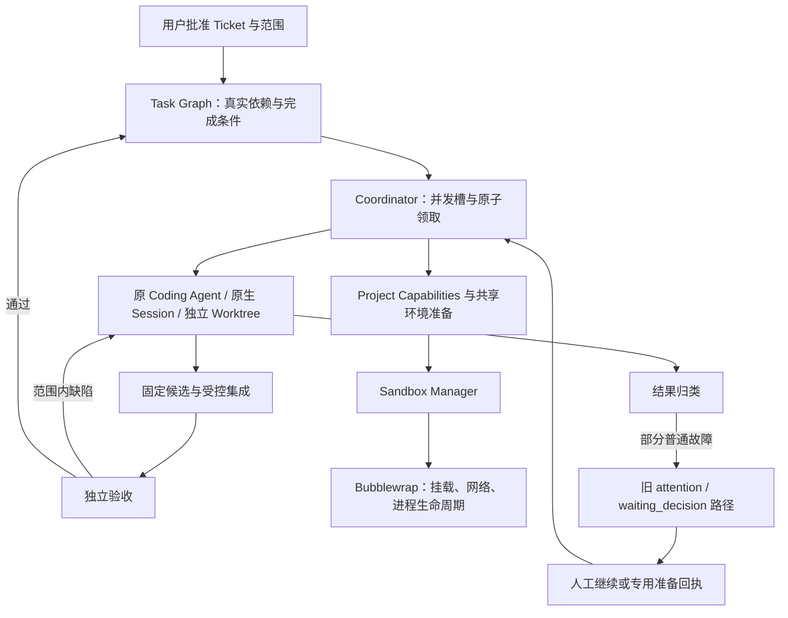

# 持续 Ticket Agent：当前问题与最小收敛方案

状态：只读调查与待审方案；本报告不表示下一轮修复已经实现，也不批准恢复或扩大任何生产任务权限。

固定源码基线：`oss-prep@4c36b4552e329de0293e6894fb8941028adb62bb`。
生产观察：2026-10-22 08:52 CST，路线 `cmvdmf87w043f9xhgf9yvua6p`。
方法：按 pstack `how` 对控制流、输入/能力边界分别只读追踪，再独立综合；采用 `architect` 的职责边界与设计草图写法。本轮没有运行完整重设计或实现流程。


后续核实：见 [529 修复方案](529_ARCH_20261022_TicketAgentNaturalExecutionPlan.md)。其中已实际找到FANUC的Z036原图并核对SHA一致，1254018已证实为品牌查询参数错误；M6_ARBURG当前HEAD与账本候选一致，四个包外叶技能确在沙箱不可读。本文保留原审计时点事实，未证实事项以529的新证据为准。

## 1. 结论与推送核对

近期修复真实生效，但尚未完全满足“获批 Ticket 持续工作”的产品合同。普通实施和历史失败恢复仍存在两条控制流。环境已修复不等于旧暂停会自动重新进入正常调度。

本轮使用 `git ls-remote` 实查，两端与本地相同：

| 远端 | 分支 | 实际 SHA |
| --- | --- | --- |
| Gitee `luyi1678/agent-platform-v2` | `oss-prep` | `4c36b4552e329de0293e6894fb8941028adb62bb` |
| GitHub `luyigy/agent-platform-v2` | `oss-prep` | 同上 |
| 两端 | `fix/historical-ticket-continuation-20261022` | `5106cb229bef6d2cf3937d2755958a64e9ad2abe` |

此前平台源代码、测试及已提交证据均已推送。Reader/Mold的业务候选保存和平台代码推送是不同事实；本轮未逐一核对业务仓远端refs，不能由平台远端一致推断全部业务候选也已推送。本报告会以独立文档提交追加。原有未跟踪文件 `526_agent-platform-v2 极简架构重设计方案md` 保持原样，没有将它当作本轮代码改动加入提交。

宿主配置另有一项非 Git 产物：systemd drop-in 将 `TASK_GRAPH_UPSTREAM_MAX_BYTES` 设为 `536870912`。已实查当前 Coordinator PID `220862` 的该环境变量为512MiB，服务启动时间为2026-10-22 01:06:07 CST。这证明运行配置已更新，不证明每个旧失败已重新预检。

## 2. 宏观架构和故障所在层



当前主要缺口位于 Task Graph 的结果归类、继续调度及事务边界。Sandbox Manager 负责落实已批准资源和进程生命周期，不应决定 Ticket 是否获批、图片能否作为独立验收真值、上游交付是否合格。

持续工作资格、单轮进程、当前 Writer 是不同事实。进程结束可以释放 Writer，但不撤销 Ticket 授权；下一轮仍须核对批准、当前候选和真实 Writer 退出。

## 3. 已发生的真实业务进展

审计摘要见 [`architecture-audit-20261022.json`](../evidence/persistent-ticket-agent/t4-historical/architecture-audit-20261022.json)。当前24节点中16个通过、5个 attention、3个 planned，没有 claimed/verifying 节点。服务正常，业务执行已停在具体阻塞；不能把这个现场说成“仍在自动处理”。

最近六个恢复目标中，BOLE、ARBURG、伊之密和 M6_DEMAG 已通过验收，证据不只是测试数量：

- BOLE，固定提交 `4762630515d354c4bbe1086bbeecb3e3a2f78f6a`：独立验收发现裁剪原图导致HTTP500和CLI崩溃，原Agent自动回修，复验为API422及结构化拒识。完整授权图完成实际OCR、API/CLI及新进程读回。详见已有 `docs/evidence/persistent-ticket-agent/t4-historical/bole-independent-acceptance.txt`。
- ARBURG，固定提交 `32b68bbf2eb5d9713e7911add1fa56eecebd8012`：独立原图发现松退速度50.0误读成500.0；自动回修后HTTP/CLI均为50.0，完整fields一致，固定包和GET重开通过。仅批准Reader声明范围，不能代替Mold闭环。
- 伊之密，固定提交 `e9622681f765cbe0e1319696695f233f4c98c529`：段数地标缺读原先导致HTTP500/CLI traceback；回修后为HTTP422和结构化reject，新进程GET一致。仅批准已声明partial范围，不声称盲样泛化完成。
- M6_DEMAG，固定提交 `f45ff8243ed8c71c9fb0f4bc63341d87a023d802`：独立验收实际执行1440/390px页面、真实OCR、保存退出重开，核对冷却8秒和五温区数值，保存响应与独立GET一致。只批准总览页11个接纳字段，不含未决字段、盲测泛化或正式Run提交。

这证明原Session回修、Sandbox Manager、独立验收和部分后继放行确实工作；不证明整条路线已经自动消费完。

## 4. 当前全部未完成节点

| 节点 | 最新现场 | 责任和处理方向 |
| --- | --- | --- |
| M6_BOLE | prepare/waiting_decision，保留00:34旧256MiB容量失败 | 新运行配置已512MiB；平台应实际重评完整固定输入，条件通过后从原保存点接续。不能仅凭配置变化宣称已恢复 |
| M6_ARBURG | implement/waiting_decision；真实事务超时报错；Agent另报告技能缺失和实际HEAD/调度基线不符 | 平台修事务边界，并在实际沙箱核对技能包和当前阶段输入。模型报告不是资源缺失的最终权威；不能强制切换旧工作区来消除提示 |
| R6_FANUC | CPU调用已修，真实OCR恢复162行；缺Z036旧图；training查询1254018；另记录TACT provenance回归失败 | 先查批准资料接口和历史来源，由原Agent处理范围内缺陷。查询错误不等于用户必须扩权；缺图不能虚构或跳过验收 |
| M6_YIZUMI | 固定Reader输入包含未通过FANUC的历史交付 | 输入保护应保留。优先完成FANUC并重评；不能删除祖先检查或把无真实依赖的实施全局串行 |
| R6_NISSEI | 查至1520条授权记录仍无合格独立保留图；请求读取hmi_finetuning中的Z077/Z078来源及训练/保留分组 | 新目录确在原批准范围外，需要用户同意限定只读，或找到现有范围内的合法来源。原图存在不等于独立验收资格已证明 |
| M6_FANUC | planned | 等R6_FANUC通过；不是单独需人工恢复的故障 |
| M6_NISSEI | planned | 等R6_NISSEI通过 |
| M07 | planned | 等六条M6业务切片通过 |

五个直接阻塞中，两个明确属于平台准备/运行处理，一个属于资料接口与工程调查，一个是真正新增资源授权，一个是必须保留的未验收输入保护。后三个是上述阻塞的依赖后果。不能承诺五个全部无需人类，但也不能要求用户重复批准所有任务。

## 5. 从架构层逐级下钻到源码

源码链接固定在审查基线，行号不会随报告提交漂移。

| 层面 | 入口 | 已核实事实 |
| --- | --- | --- |
| 实施结果归类 | [implementation-result.ts:64](https://github.com/luyigy/agent-platform-v2/blob/4c36b4552e329de0293e6894fb8941028adb62bb/src/lib/task-graph/implementation-result.ts#L64) | 只有implement阶段missing_business_material进入普通等待；70行其他阻塞多数进入decision_required |
| 状态权威 | [execution-progress.ts:293](https://github.com/luyigy/agent-platform-v2/blob/4c36b4552e329de0293e6894fb8941028adb62bb/src/lib/task-graph/execution-progress.ts#L293) | decision_required直接落waiting_decision，requiresUserDecision:false不改变这个事实 |
| 继续调度 | [coordinator.ts:743](https://github.com/luyigy/agent-platform-v2/blob/4c36b4552e329de0293e6894fb8941028adb62bb/src/lib/task-graph/coordinator.ts#L743) | 消费特定恢复回执、冲突和回修；常规派发取ready；store.ts的依赖释放只提升planned。没有统一重评旧平台attention的路径 |
| 请求消费 | [conversation-recovery.ts:59](https://github.com/luyigy/agent-platform-v2/blob/4c36b4552e329de0293e6894fb8941028adb62bb/src/lib/task-graph/conversation-recovery.ts#L59) | 先写started再执行恢复，后续失败只留failed。下轮started存在即跳过，存在失败请求永久消费的结构风险 |
| Writer事务边界 | [execution-progress.ts:310](https://github.com/luyigy/agent-platform-v2/blob/4c36b4552e329de0293e6894fb8941028adb62bb/src/lib/task-graph/execution-progress.ts#L310)、implementation-result.ts:117 | 事务内调用真实进程观察，可能扫描/proc；已有writer-snapshot.ts:11/26可复用事务外观察、事务内身份核对 |
| 资源事务边界 | [runtime-continuity.ts:124](https://github.com/luyigy/agent-platform-v2/blob/4c36b4552e329de0293e6894fb8941028adb62bb/src/lib/task-graph/runtime-continuity.ts#L124) | 持节点锁执行Git/文件/Python检查，approvedProjectTools还使用全局Prisma查询。会放大锁和连接池等待风险 |
| 输入错误归类 | [upstream-inputs.ts:161](https://github.com/luyigy/agent-platform-v2/blob/4c36b4552e329de0293e6894fb8941028adb62bb/src/lib/task-graph/upstream-inputs.ts#L161) | 容量、缓存、资格等准备异常统一包装missing_upstream_input，妨碍按实际条件选择自动处理方式 |
| 输入资格保护 | [upstream-inputs.ts:81](https://github.com/luyigy/agent-platform-v2/blob/4c36b4552e329de0293e6894fb8941028adb62bb/src/lib/task-graph/upstream-inputs.ts#L81) | 检查未通过sibling历史提交；M6_YIZUMI的保护不能直接删 |
| 授权版本耦合 | [policy.ts:49](https://github.com/luyigy/agent-platform-v2/blob/4c36b4552e329de0293e6894fb8941028adb62bb/src/lib/project-capabilities/policy.ts#L49)、60行 | 整项目配置hash必须与scope一致。无关资源配置更新也可能使旧scope不匹配；这是静态结构风险，不是所有当前节点的已证根因 |

事务超时已在线上发生；锁内慢操作是源码事实，但尚不能断言其中某一次/proc或Git操作就是该次超时的唯一原因。

## 6. 两种方案与推荐

方案A：继续增加专用恢复条件。单例改动快，但保留普通工作/异常恢复双轨，无法解释为什么下一个后继又停住。不推荐作为后续路线。

方案B：收敛现有继续入口。获批范围持续有效，普通工作、用户新输入、平台条件恢复都进入现有Coordinator领取边界；当前不能执行的原因仍保留。真实权限、Writer unknown、候选漂移和未验收输入继续拒绝。不新建Manager、数据库状态机或通用Prompt框架。推荐。

这里不是把所有attention无条件改ready，也不是把requiresUserDecision:false当成自动执行授权。必须重新核对当前实际条件，且同一工作事实只安排一次。

### 第一步：缩短事务、保留可继续请求

预计修改 `writer-snapshot.ts`、`implementation-result.ts`、`execution-progress.ts`、`runtime-continuity.ts`、`conversation-recovery.ts` 及对应测试，按实际调用者收敛；不新增通用层。

```text
锁外：读取当前执行与批准事实
锁外：沿用现有Writer观察、资源/固定输入预检
短事务：核对原claim/revision、TaskRun/participant、候选和批准身份仍匹配
短事务：沿用原结果CAS/幂等键安排一次工作
提交成功：确认原请求已消费
暂时失败：保留原待处理事实；不要求用户重新说一次继续
执行边界：资源或批准身份变化则拒绝启动，不能沿用过期证明
```

不能只移动检查后省略CAS或撤权核对。不能简单把全部P2028事务错误当作可无条件重放，也不能仅增加事务timeout掩盖锁内外部工作。

### 第二步：统一平台条件恢复与普通推进

预计修改 `coordinator.ts`、`implementation-result.ts`、`execution-progress.ts`，按需要收缩现有 `preparation-recovery.ts` 及输入错误包装。复用既有状态、账本、检查点和并发槽，不再增加第二套恢复协议。

```text
已有待继续工作/相关条件已变化
  → 原批准仍有效且未由用户暂停？
  → 现有依赖、固定输入和候选仍合格？
  → 资源已实际预检，旧Writer已证明退出？
  → 相同工作事实尚未消费且允许本轮资源使用？
  → 现有claim/CAS入口领取 → 原Session执行

普通工程问题 → 原Agent调查和修复
确实暂无工作 → 保留工作资格等待输入/相关条件
实际扩权或人类决定 → 呈现具体请求
```

只在实际相关条件、新输入或修复事实变化时重评，不每轮盲目调用模型。保留成本/空转保护及原计数，不清空旧预算。历史合法保存点也走这个入口，而非继续增加按Ticket名或旧错误文本匹配的分支。

Project Capabilities整体hash耦合应另以反例确认最小修复：稳定Ticket批准范围与一轮资源绑定分开核对，Runner和资料接口消费一致的有效范围。无关配置变化不得扩权，也不应自动撤销无关Ticket资格。此项不阻塞先完成上述两步，不扩成Scope v3或新授权系统。

### 保留的输入红线

M6_YIZUMI不能忽略FANUC未通过历史。当前最小业务路径是原Agent完成FANUC并独立验收后再核对输入；若必须完全隔离独立交付，应比较从已验收提交组成合格候选的受控集成方案。这涉及交付组装，不能伪装为删一条校验，不在本轮先实现。

## 7. 红绿门禁和业务验收

下一轮先固定反例再修，不把本次只读调查称为测试已通过：

1. 原256MiB失败记录保留，新容量真实预检通过后，只启动原任务一次；相同条件失败不空转。
2. 慢进程/文件观察和数据库竞争不会让恢复请求永久丢失；并发恢复仍只领取一次。
3. 预检后claim/revision、候选、批准或participant变化时，原CAS必须失败；Writer alive/unknown不能执行。
4. 普通提问、测试失败、范围内缺陷保留原Session和工作资格；新用户回复自然续接，不要求额外恢复审批。
5. 新目录未批准、权限撤销、Sandbox越界、未验收历史夹带、旧候选覆盖新提交仍必须失败。
6. 复用现有W001、Sandbox Manager、Writer和真实Codex协议回归，不增加Prompt规则、固定等待或宿主执行回退。
7. 原Reader/Mold中至少两项独立任务实际并行；页面/API与跨仓合同一致；独立验收通过才自动释放对应后继。
8. 总览区分正在执行、自然等待、平台尚未处理、真正需人决定和已通过，展示最新Agent问题及处理回执。历史lastFailure不应覆盖当前通过结果；本轮未核验卡片实际渲染，不能仅凭旧字段断言卡片缓存故障。

## 8. 本轮没有做及需要其他审阅者判断的事项

没有修改业务源码、生产任务、批准快照、预算或宿主配置，没有恢复任何任务；仅查询已有现场并新增本报告和审计摘要。没有读取NISSEI申请的新样本目录，没有联系外部Bot或其他房间成员。

仍需核实M6_ARBURG实际沙箱和完整输入、FANUC查询1254018的具体原因、单次事务超时的唯一慢点。不得用模型说明代替宿主证据。M6_BOLE尚未重新预检，不能说已经可安全启动。

请重点审阅：统一入口能否替换旧分支而非叠加；事务外证明到事务内CAS是否防止竞态；条件变化后是否自动消费原工作；新增授权和未验收污染是否仍严格拒绝；验收是否展示实际页面和数据而非仅passed数量。
