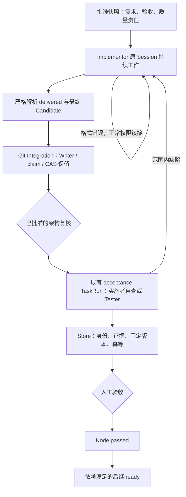

# Delivery contract 与 agent-owned quality 收敛审查与未完成草稿

现在修的是调度楼层的交付与验收房间。保留 Writer、权限和 Git CAS 等承重墙，收敛平台与责任 Agent 重复做业务裁决的隔断。

基线：`agent-platform-v2 / oss-prep @ bdb462b`。未完成草稿：`delivery-contract-agent-quality @ 188f0e63cd52b3ad22271fa9edaf7315e2c1b5e7`，独立工作区 `/tmp/ap-delivery-contract`。用户的 541 原文未修改。生产工作区、服务、运行快照与活动 TaskRun 未部署或改写；本文所有“通过”均指隔离回归，不代表生产票验收通过。

## 决策及职责

实施前清单在 `docs/adr/20261023-agent-owned-quality.md`。以下展示隔离草稿的源码，不能当成已定稿架构。按用户最新指令，本轮已停止扩展，撤出额外 API 门禁和临时退出证明传递设计。S01 已核验；S02 的职责去重、多执行票责任映射、合同切换及最终验收仍未完成。



图中的验收 TaskRun 是已有 acceptance 阶段，由批准的责任 Agent 执行。实施者自查复用其身份，固定源码只读、报告目录可写；不会把这个验收 Session 替换成实施 Session 的所有者。后续回修继续原 Coding Session。

| 房间 | 真实职责 | 拆、留或迁移 |
|---|---|---|
| domain / proposals / proposal-card | 冻结合同、责任与批准 hash | 新提议在展示卡片前加 agent_owned_v1；卡片明确首个实施者负责整体自查或配置 Tester；旧卡不升级 |
| implementation-result / conversation-session | 严格回执、正常工程会话 | 保留；格式错误回原 Session，允许继续编码，实质进展不受历史错误次数阻断 |
| coordinator 的 executeJob | Candidate、集成、失败归属 | 新合同不执行平台业务检查；最终声明后重新固定 Candidate，Git 安全照旧 |
| coordinator 的 verifyNodeOnce | 组织固定版本验收 | 仓内/纵向命令配置交给责任 Agent，复用原 acceptance TaskRun |
| review-contract / review-result | 解析正式质量判断 | 新合同逐稳定 ID 提供结果与证据；唯一结论、缺项/重复/无效结果拒绝 |
| quality-contract / store | 结论能否成为正式记录 | 核验批准责任、真实运行身份、Writer 退出、固定输入、必需证据及与原始 Agent 结果一致 |
| architecture-review / repair | 架构要求和回修 | 保留；架构通过绑定整组 execution 输入，失败走既有回修 |
| worktree / integration-retry / releaseReadyNodes | Git CAS 与依赖释放 | 保留 Git 安全；新合同只认 passed，旧 implement 保留明确未验收语义 |

## 新旧批准边界

- 没有 `deliveryContract` 的旧 run / 旧 pending 卡 / adoptRun 均不自动迁移，继续原检查与完成规则。
- 新提议在生成批准 hash 前标记 `agent_owned_v1`，用户看到实际责任后再批准。角色调整仍通过既有卡片重算 hash。
- 新增的直接 API 门禁已撤出。新旧批准边界还需在 S02 中定稿；当前草稿不得部署。
- `full` 保留配置的架构复核；`lean` 不做架构复核；新 `implement` 也要自查并提供非空验收要求。旧 `implement` 仍可明确标记 `delivered_unverified`。这不是新合同下的自查通过。
- 未获定稿的草稿暂取首个实施者作为整体自查责任人，此项不应未经定稿直接使用。多 Implementor 票的责任映射是 S02 未完成项；Tester 与 Human Review 的既有要求必须保留。

## 实际调用链

1. `src/lib/task-graph/proposals.ts:99`：生成新提议时冻结合同；批准回调只核对原 hash，不临时改变合同。
2. `src/lib/task-graph/coordinator.ts:538`：取得实施原生 Session，启动正常可写实施。
3. `src/lib/task-graph/coordinator.ts:573`：保存当前 Worktree Candidate，随后解析本轮结果。Candidate 是 Git 快照，不是通过凭证。
4. `src/lib/task-graph/implementation-result.ts:19`：严格解析唯一声明；无 marker 的普通进度可继续，明确错误返回具体说明。
5. `src/lib/task-graph/coordinator.ts:596`：通过既有 outcome、工作指纹和预算回原 Session；不新增只读纠错阶段。
6. `src/lib/task-graph/coordinator.ts:618`：集成仍校验所有权、Writer 退出、基线和 Git CAS。候选 SHA 与合并后的 SHA 可以不同。
7. `src/lib/task-graph/store.ts:248`：全部 execution integrated 后才把 Node 从 claimed 写为 verifying。
8. `src/lib/task-graph/coordinator.ts:318`：责任 Agent 在固定集成源码上执行批准命令，逐项回报；平台不再预跑同一业务命令。
9. `src/lib/task-graph/store.ts:297`：事务内锁 Node，检查新合同 publication。正式 passed 的数据库 update 在下文定位。
10. `src/lib/task-graph/store.ts:73`：读取前置状态，仅新合同 passed 可参与 ready frontier，幂等写后继 Node 与 execution。

质量结论绑定 `evidence.inputs=[{executionId, commit}]` 与既有 review binding 的 `candidateCommit/claimKey/taskRunId`。这里的 commit 是该 execution 的集成 Commit。实施回执 evidence 不能替代正式验收证据；新版本或不同组合必须重新验收。架构通过也记录整组输入，不能拿另一组 Commit 的架构结论替代。

## 关键源码逐行导览

以下节选均从真实 Git 基线或本次代码读取，中文解释仅为教学添加。

### 严格解析与普通工程进度，保留现有实现

【教学注释版 · src/lib/task-graph/implementation-result.ts:19–25 @ bdb462b · 中文注释为新增，源码逐行对应】

```ts
export function parseImplementationResult(output: string, options?: { conversation: boolean }): ImplementationResult { // 第 19 行：入口接收 Agent 输出，可选择普通对话模式
  try { return decodeImplementationResult(output); } // 第 20 行：先按严格交付协议解析，明确的错误不能当交付成功
  catch (error) { // 第 21 行：捕获协议解析错误
    if (options?.conversation && output.trim() && !/^[ \t]*TASK_GRAPH_IMPLEMENTATION\b/m.test(output)) return { status: 'working', note: output.trim() }; // 第 22 行：仅在普通对话模式且没有声明 marker 时，把非空输出视为仍在工作
    throw error; // 第 23 行：声明有错则继续抛出具体格式错误，交给原 Session 纠正
  } // 第 24 行：结束错误分支
} // 第 25 行：结束解析入口
```

例子：`blocked` 缺 blockerKind 会返回具体格式错误；没有 marker 的“正在补测”是 working。两者都不是 delivered，也不会释放后继。

### Before / After：质量责任由批准合同决定

【教学注释版 · src/lib/task-graph/coordinator.ts:269–269 @ bdb462b · 中文注释为新增，源码逐行对应】

```ts
  if (policy.mode === 'agent') { // 第 269 行：旧代码只在配置独立验收 Agent 时才启动验收 Agent；automatic 由平台命令结果决定
```
【教学注释版 · src/lib/task-graph/coordinator.ts:274–274 @ 188f0e63cd52b3ad22271fa9edaf7315e2c1b5e7 · 中文注释为新增，源码逐行对应】

```ts
  if (agentOwned || policy.mode === 'agent') { // 第 274 行：新合同都复用已有验收通道：配置 Tester 就由 Tester 验证，否则由批准实施者自查；旧合同维持原判断
```

下面是上述真实单行变更的教学 Diff；每处增删都注释了行为变化。

```diff
-  if (policy.mode === 'agent') { // 原代码：只有 Tester 配置进入 Agent 验收通道
+  if (agentOwned || policy.mode === 'agent') { // 新代码：新合同的自查与 Tester 共用已有通道，旧合同不变
```

【教学注释版 · src/lib/task-graph/quality-contract.ts:48–55 @ 188f0e63cd52b3ad22271fa9edaf7315e2c1b5e7 · 中文注释为新增，源码逐行对应】

```ts
  if (!args.review) throw new Error('Quality review publication ownership required'); // 第 48 行：缺少正式 review publication 则拒绝，不能靠自报 evidence 完成
  if (jobs.some(job => { // 第 49 行：逐执行检查当前持久化验收绑定
    const binding = executionProgress(job.dispatchMetadata)?.review; // 第 50 行：从 execution metadata 读取既有 review binding
    return binding?.kind !== 'running' || binding.taskRunId !== args.review?.taskRunId || binding.claimKey !== args.review.claimKey || binding.phase !== args.review.phase || binding.candidateCommit !== job.commit; // 第 51 行：TaskRun、claim、阶段、固定 Commit 任一不同则不属于当前版本
  })) throw new Error('Quality review ownership changed'); // 第 52 行：发现所有权变化时拒绝，重放也不能先绕过这个检查
  const architecture = effectiveArchitectureReview(args.definition, planned); // 第 53 行：取得本票按模式生效的已批准架构要求
  const allPassed = results.every(item => item.passed); // 第 54 行：汇总 Agent 所报结果，不运行或解释业务测试
  if (args.review.phase !== 'acceptance' && (allPassed || !architecture)) throw new Error('Acceptance quality publication required'); // 第 55 行：架构阶段不能宣称最终通过；最终质量通过必须来自 acceptance
```

输入例子：同一 TaskRun 的旧 commit=A，当前 execution.commit=B，第一层固定 inputs 检查即拒绝；即使调用者复制所有 true 和原证据，也不能写 passed。

【教学注释版 · src/lib/task-graph/store.ts:326–328 @ 188f0e63cd52b3ad22271fa9edaf7315e2c1b5e7 · 中文注释为新增，源码逐行对应】

```ts
    const allPassed = results.every(item => item.passed) && checks.every((check) => results.some((item) => item.name === check && item.passed)); // 第 326 行：结果数组每项必须通过，批准要求的每项也必须存在且通过；新合同此前还核验了逐项真实回执和固定输入
    let status = allPassed ? (node.acceptance === 'human' ? 'awaiting_human' : 'passed') : 'attention'; // 第 327 行：通过且是人工 gate 时仅进入 awaiting_human，其他模式可 passed；失败进入 attention
    if (args.review && (args.review.outcome !== 'classified' || args.review.decision)) { // 第 328 行：如有平台失败、协议耗尽或需要用户决定，则走既有失败分支，不得发布通过
```

真正把 Node.status 写进数据库的是 `src/lib/task-graph/store.ts:333`；这与保存 Candidate、execution integrated 是三件事。人工最终批准的写入在 `src/lib/task-graph/store.ts:373`。

## 状态模型与转换

没有新增状态枚举。TaskGraphNode 的相关状态为 planned、ready、claimed、verifying、awaiting_human、passed、attention，以及历史 implement 已使用的 delivered_unverified。TaskGraphExecution 为 planned、ready、claimed、integrated、attention。

ExecutionProgress.phase 仍是 prepare / implement / collect_result / check / integrate / architecture / acceptance；state 仍是 active / ready / waiting_for_user / waiting_decision / exhausted / ownership_attention。`collect_result` 是已有兼容阶段，继续使用原实施权限，不是另一个只读工程协议。Run 保留 running / attention / paused / completed / completed_unverified 等现有结果。

| 当前对象与状态 | 事件或条件 | 下一状态 | 写入入口与下游影响 |
|---|---|---|---|
| Node planned | 所有真实前置满足合同 | ready | releaseReadyNodes；同时释放本票 execution |
| Node ready / Execution ready | claim 与 Writer 准入成功 | claimed | claimNode / claimExecution；只启动批准范围 |
| Execution claimed / implement | 普通进度、材料可自行查找 | ready，再 implement | continue_work；原 Session 接着工作，不放行依赖 |
| Execution claimed | 明确声明格式错误 | ready / collect_result | result_incomplete；原 Session 可继续编码和测试，最终重新固定候选 |
| Execution claimed | 相同输入与错误持续无进展 | attention / waiting_for_user | 既有预算停空转；保留现场，不合成通过 |
| Execution claimed | waiting_for_user 或范围/权限决定 | attention / waiting_for_user | 等待真实用户输入，沿 conversation inbox / admission 接续；不能扩大授权 |
| attention / waiting_for_user | 获授权用户回复且准入满足 | ready，沿当前实施阶段接续 | 既有 conversation/admission；不直接改 passed |
| Execution claimed / integrate | Git CAS 成功 | integrated | applyExecutionOutcomeTx；保存集成 Commit 与证据，尚不完成 Node |
| Execution claimed / integrate | Git 冲突 | 既有 conflictRepair / 回修 | prepareConflictRepair；使用受控解决产物，不能跳过冲突 |
| Execution claimed / integrate | ref 移动 | 原预算内重试或 attention | integrateJobWithRetry；保留候选，重新校验所有权与 CAS |
| Node claimed | 全部 execution integrated | verifying | markNodeIntegrationsReady；才能启动批准的架构/质量验收 |
| Node verifying | 架构或责任 Agent 判定范围内缺陷 | attention，原执行 ready 回修 | submitNodeVerification / scheduleGraphRepair；新 Commit 重验，后继继续等待 |
| Node verifying | 验收环境失败或无效结果 | 既有 review retry 或 attention | applyReviewFailureTx；不把运行成功当验收通过 |
| Node verifying | 新合同证据完整且责任 Agent 通过 | passed，或 awaiting_human | Store 只认固定版本、合法身份和完整证据；human 不能跳过 |
| Node awaiting_human | 指定用户批准且固定输入仍匹配 | passed | approveHumanNode 再核对质量输入，随后由既有入口释放依赖 |
| 任意发布 | 错身份、旧 Commit、缺项、伪造证据、Writer 未退出 | 拒绝写入 | quality-contract / ownership；不会启动后继 |
| 旧 implement Node verifying | 旧批准合同允许未验收交付 | delivered_unverified | 保留旧完成语义；新合同禁止走 completeUnverifiedNode |

具体行号索引：

- `src/lib/task-graph/execution-progress.ts:182`
- `src/lib/task-graph/review-ownership.ts:79`
- `src/lib/task-graph/repair.ts:16`
- `src/lib/task-graph/conversation-inbox.ts:51`
- `src/lib/task-graph/integration-retry.ts:6`
- `src/lib/task-graph/store.ts:344`

## 一张示例票如何接棒

这是隔离 fixture 的故事，不是生产业务票。

1. 用户批准 A 的 behavior 要求、原命令和质量责任。snapshot hash 包含新合同；B 依赖 A，保持 planned。
2. Implementor 在原 Worktree 编码。第一轮可以回 malformed blocked；平台告诉它缺 blockerKind，原 Session 继续把 bad 改成 good。
3. Writer 退出后保存本轮最终 Candidate，再集成。Git merge Commit 可与 Candidate 不同，因此质量判断安排在固定集成 Commit 上。
4. 仅实施者模式由同一实施者身份自查，Tester 模式由配置 Tester 在隔离报告目录验收，逐项执行批准命令。平台不预跑这些业务命令。
5. Tester 如发现 bad，报告 in_scope_defect 和批准的稳定检查 ID；Store 保留失败证据，原实施 Session 修复，新的集成 Commit 重新验收。
6. 若为 human，质量通过只写 awaiting_human。错误用户批准被拒绝，指定用户批准前还会再次核对固定输入。
7. 正式通过写 Node passed。releaseReadyNodes 发现 A 已满足合同，将 B 从 planned 转 ready；幂等回放不会再启动一次 B。

## 验证结果与限制

- 已核验的 S01：`task-graph-result-recollection` 和 `task-graph-db` 在 fresh PostgreSQL schema 通过，证明正常续接、最终 Candidate、旧 implement 兼容与后继释放。
- S02 探索阶段曾跑通实施者、Tester、人工、回修、格式续接、架构和冲突等隔离场景；但经历范围撤回，不能据此宣称当前草稿最终验收完成。
- `task-graph-review-repair` 的旧归档断言在未修改基线上也失败；已把测试改为核对原生 Session 保留回执及两轮真实产物。改后旧回修、批准卡、Issue 路线和 Git CAS 回归曾通过。
- 发布前 Writer 复查出现过暂时拒绝。这是下一段必须先审查的重复校验问题，不继续用新增证明字段扩展设计。
- 当前收口仅运行 TypeScript、长文件和 diff 静态检查；未跑全仓测试，未作生产验收。

## 修改文件

- `docs/adr/20261023-agent-owned-quality.md`
- `scripts/test-task-graph-postgres.mjs`
- `src/lib/task-graph/architecture-review.ts`
- `src/lib/task-graph/coordinator.ts`
- `src/lib/task-graph/domain.ts`
- `src/lib/task-graph/launch.ts`
- `src/lib/task-graph/prompts.ts`
- `src/lib/task-graph/proposal-card.ts`
- `src/lib/task-graph/proposals.ts`
- `src/lib/task-graph/quality-contract.ts`
- `src/lib/task-graph/review-contract.ts`
- `src/lib/task-graph/review-result.ts`
- `src/lib/task-graph/store.ts`
- `tests/task-graph-agent-owned-quality.test.ts`
- `tests/task-graph-conflict-continuation.test.ts`
- `tests/task-graph-review-repair.test.ts`
- `docs/architecture/542_ARCH_20261023_DeliveryContract_Convergence.md`

本轮交付的是审查与切片边界，以及未验收的隔离代码草稿。后续只按 541 收敛职责，不再增加方案之外的门禁或检测点。
