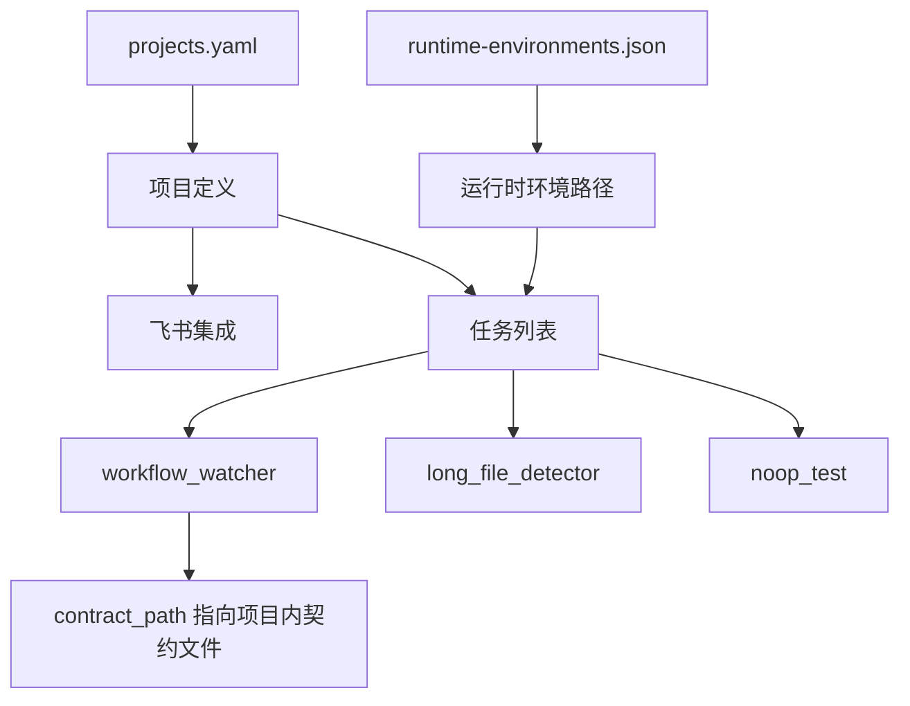

# config


# Config 模块

## 概述

`config` 模块是系统的**声明式配置层**，以 YAML 和 JSON 文件定义所有项目的注册信息、飞书集成参数、定时任务编排以及运行时环境。该模块不包含任何可执行代码，所有配置在系统启动时被加载并驱动任务调度器。

## 文件结构

```
config/
├── projects.yaml          # 项目注册表 + 任务编排
└── runtime-environments.json  # 运行时环境路径映射
```

## projects.yaml

### 顶层结构

```yaml
projects:
  - id: <string>
    name: <string>
    path: <string>
    ref: <string>
    feishu:
      chat_id: <string>
      approver_open_ids:
        - <string>
    jobs:
      - id: <string>
        type: <string>
        schedule: <cron>
        enabled: <bool>
        mode: <string>
        config: <object>
```

### 项目字段

| 字段 | 类型 | 说明 |
|------|------|------|
| `id` | string | 项目唯一标识，用于内部引用 |
| `name` | string | 项目显示名称 |
| `path` | string | 项目代码在服务器上的绝对路径 |
| `ref` | string | Git 分支引用（如 `refs/heads/main`） |
| `feishu.chat_id` | string | 飞书群/会话 ID，用于通知和交互 |
| `feishu.approver_open_ids` | string[] | 审批人的飞书 open_id 列表 |

### 任务（Job）字段

| 字段 | 类型 | 说明 |
|------|------|------|
| `id` | string | 任务唯一标识（项目内唯一） |
| `type` | string | 任务类型，决定执行逻辑 |
| `schedule` | string | Cron 表达式，定义执行频率 |
| `enabled` | bool | 是否启用该任务 |
| `mode` | string | 运行模式：`active` 或 `shadow` |
| `config` | object | 任务特定配置，结构因 `type` 而异 |

### 任务类型

#### `workflow_watcher`

核心任务类型，负责监控项目工作流状态并驱动自动化流程。

**config 字段：**

| 字段 | 类型 | 说明 |
|------|------|------|
| `active_side_effects_enabled` | bool | 是否允许产生实际副作用（如推送代码、发送消息） |
| `coding_bot_chat_id` | string | 编码机器人所在的飞书会话 ID |
| `coding_bot_chat_type` | string | 会话类型：`p2p`（单聊）或 `group`（群聊） |
| `coding_bot_app_id` | string | 编码机器人的飞书应用 ID |
| `contract_path` | string | 工作流契约文件相对于项目根目录的路径 |
| `branch_space` | string | 分支空间标识，`.` 表示当前分支，其他值为具体分支名 |
| `initial_cursor_commit` | string | 初始游标 commit，用于确定监控起点 |
| `workflow_autonomy` | string | 自治级别，当前支持 `semi_auto` |
| `execution_policy.preset` | string | 执行策略预设：`workspace` 或 `full_access` |

**执行策略预设：**

| 预设 | 说明 |
|------|------|
| `workspace` | 受限模式，操作范围限定在工作区内 |
| `full_access` | 完全访问模式，允许更广泛的操作 |

#### `long_file_detector`

定期检测项目中的超长文件，用于代码质量监控。

**config 字段：** 无（空对象 `{}`）

#### `noop_test`

空操作测试任务，用于验证调度器本身是否正常工作。

**config 字段：**

| 字段 | 类型 | 说明 |
|------|------|------|
| `delay_ms` | int | 模拟延迟（毫秒） |
| `timeout_ms` | int | 超时阈值（毫秒） |

### 运行模式

| 模式 | 说明 |
|------|------|
| `active` | 正常执行，产生实际效果 |
| `shadow` | 影子模式，执行但不产生副作用，用于验证逻辑 |

### 当前注册项目

| 项目 ID | 名称 | 路径 | 分支 | 任务数 |
|---------|------|------|------|--------|
| `agent-platform-v2` | Agent Platform V2 | `/data1/code/agent-platform-v2` | `oss-prep` | 3 |
| `mold-data-webpage-tool` | 科学试模助手 | `/data1/code/mold-data-webpage-tool` | `dev` | 2 |
| `workflow-test` | Workflow Test | `/data1/code/workflow-test` | `workflow-test` | 1 |
| `hmi-data-reader` | HMI Reader | `/data1/code/hmi_data_reader` | `master` | 1 |

## runtime-environments.json

定义项目路径到运行时环境（如 conda 环境路径）的映射，供任务执行时设置 `PATH` 或激活环境。

```json
{
  "/data1/code/molding-assist": ["/home/hello/anaconda3"]
}
```

**格式：** `{ "<项目绝对路径>": ["<环境路径1>", "<环境路径2>", ...] }`

## 配置关系



## 使用约定

1. **新增项目**：在 `projects.yaml` 的 `projects` 列表末尾追加条目，确保 `id` 全局唯一。
2. **新增任务**：在对应项目的 `jobs` 列表中追加，`id` 在项目内唯一。
3. **禁用任务**：将 `enabled` 设为 `false`，而非删除条目，便于后续恢复。
4. **影子验证**：新任务上线前可先以 `mode: shadow` 运行，确认逻辑正确后切换为 `active`。
5. **调度频率**：`workflow_watcher` 通常设为 `* * * * *`（每分钟），`long_file_detector` 设为 `*/10 * * * *`（每 10 分钟）。