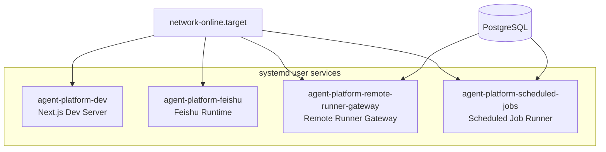

# deploy


# Deploy 模块

## 概述

`deploy` 模块包含 Agent Platform 的 **systemd user-level service 定义**，用于在生产环境中以用户级 systemd 服务的方式运行平台各组件。所有服务共享以下特征：

- 工作目录：`/data1/code/agent-platform-v2`
- 自动重启策略：`Restart=always`，重启间隔 5 秒
- 停止超时：20 秒
- 进程组终止：`KillMode=control-group`（确保子进程一并清理）
- 依赖网络就绪：`After=network-online.target`

## 服务架构



## 服务清单

### agent-platform-dev.service

| 属性 | 值 |
|------|-----|
| 描述 | Agent Platform Next.js Dev Server |
| 启动命令 | `scripts/run-agent-platform-dev.sh` |
| 特殊依赖 | 无额外依赖 |

Next.js 前端开发服务器。通过 shell 脚本启动，脚本内部处理环境变量加载和 `npm run dev` 等逻辑。

### agent-platform-feishu.service

| 属性 | 值 |
|------|-----|
| 描述 | Agent Platform Feishu Runtime |
| 启动命令 | `scripts/run-feishu-runtime.sh` |
| 环境变量 | `TOKIO_WORKER_THREADS=8` |

飞书消息处理运行时。基于 Rust/Tokio 异步运行时，通过 `TOKIO_WORKER_THREADS=8` 显式设置 8 个工作线程以匹配服务器 CPU 核心数。

### agent-platform-remote-runner-gateway.service

| 属性 | 值 |
|------|-----|
| 描述 | Agent Platform Remote Runner Gateway |
| 启动命令 | `/usr/bin/npm run remote-runner:gateway` |
| 环境变量 | `REMOTE_RUNNER_GATEWAY_HOST=0.0.0.0` |
| 特殊依赖 | `postgresql.service` |

远程 Runner 网关服务，负责接收远程执行器的连接和任务分发。

**关键配置说明：**

- 绑定 `0.0.0.0`（所有网络接口），使远程 Runner 可以从外部网络访问该服务。
- 默认监听端口 **3012**。
- 安全性依赖 **node secrets** 进行身份认证，而非网络隔离。
- 依赖 PostgreSQL 服务先于本服务启动（`After=postgresql.service`）。

### agent-platform-scheduled-jobs.service

| 属性 | 值 |
|------|-----|
| 描述 | Agent Platform Scheduled Job Runner |
| 启动命令 | `scripts/run-scheduled-job-runner.sh` |
| 特殊依赖 | `postgresql.service` |

定时任务运行器，负责执行平台内定义的周期性任务（如数据清理、状态同步等）。同样依赖 PostgreSQL 先启动。

## 通用配置说明

### 重启策略

所有服务均配置为：

```ini
Restart=always
RestartSec=5
```

无论退出码如何，服务都会在 5 秒后自动重启。这意味着：

- 进程崩溃 → 自动恢复
- 手动 `systemctl --user stop` → **不会**自动重启（`always` 仅在非手动停止时生效）
- 系统重启 → 服务随 `default.target` 自动启动

### 进程终止

```ini
TimeoutStopSec=20
KillMode=control-group
```

停止服务时，systemd 会向整个 cgroup 发送 `SIGTERM`，等待最多 20 秒后发送 `SIGKILL`。`KillMode=control-group` 确保由主进程派生的所有子进程（如 Node.js 子进程、数据库连接池等）都被清理。

### 安装方式

所有服务均配置为：

```ini
WantedBy=default.target
```

这意味着通过 `systemctl --user enable <service>` 启用后，用户登录时服务会自动启动。

## 部署与运维

### 启用服务

```bash
# 启用所有服务
systemctl --user enable agent-platform-dev.service
systemctl --user enable agent-platform-feishu.service
systemctl --user enable agent-platform-remote-runner-gateway.service
systemctl --user enable agent-platform-scheduled-jobs.service

# 启动所有服务
systemctl --user start agent-platform-dev.service
systemctl --user start agent-platform-feishu.service
systemctl --user start agent-platform-remote-runner-gateway.service
systemctl --user start agent-platform-scheduled-jobs.service
```

### 查看状态

```bash
systemctl --user status agent-platform-feishu.service
journalctl --user -u agent-platform-feishu.service -f
```

### 注意事项

1. **用户级服务**：这些是 `--user` 级别的服务，需要用户会话活跃。如果用户注销，服务会停止。生产环境通常配合 `loginctl enable-linger <user>` 使用，使服务在用户未登录时继续运行。

2. **PostgreSQL 依赖**：`remote-runner-gateway` 和 `scheduled-jobs` 依赖系统级 `postgresql.service`（非用户级），确保 PostgreSQL 以系统服务方式运行。

3. **网络暴露**：`remote-runner-gateway` 绑定 `0.0.0.0:3012`，部署时需确保防火墙规则仅允许受信任的 Runner 节点访问该端口。