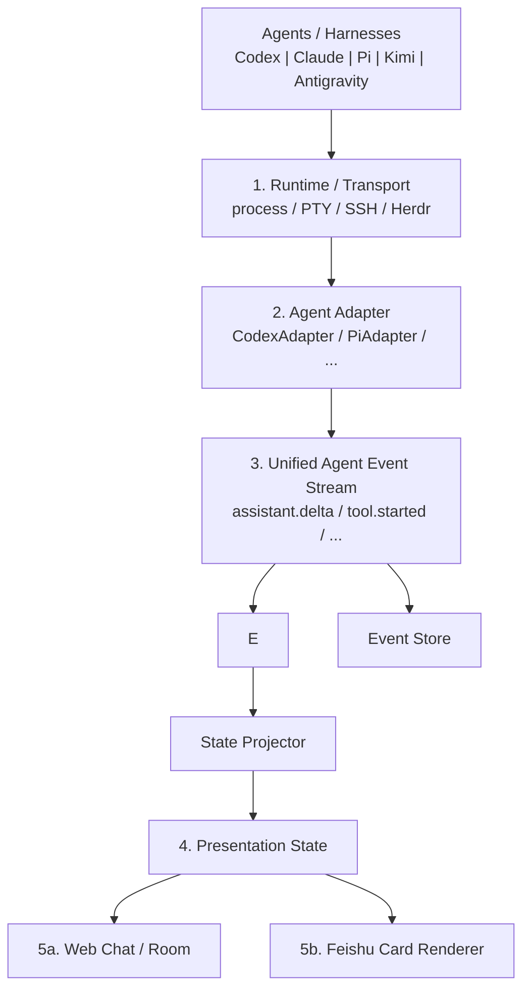

# docs — architecture


# docs — architecture

## 模块概述

`docs/architecture/` 目录存放 Agent Platform V2 的架构设计文档。当前核心文档为 `agent-platform-v2_unified-agent-architecture_handover.md`，它是一份面向后续开发（包括 coding agent）的架构交接文档，定义了统一 Agent Runtime、消息流和配置体系的重构方向。

**文档定位：** 架构方向指引，非一次性重写方案。优先渐进迁移，保留当前可工作的 Codex 路径。

---

## 核心问题

平台支持多个 coding agent（Codex、Claude Code、Pi Agent、Kimi Code、Antigravity 等），当前架构的根本问题是：

> `stdout chunk` 被当成了 `Agent semantic message`。

不同 Agent 的 stdout 含义完全不同：

| Agent | stdout 特征 |
|-------|------------|
| Codex | 相对稳定的 semantic event |
| Antigravity | text_delta 碎片 |
| Pi Agent | 某些事件是累计 snapshot |
| Kimi | 多种 stream-json / Anthropic delta 兼容格式 |
| 普通 CLI | 可能只是 console output |

这导致：
- delta 被截断
- snapshot 被重复
- 不同 Agent 体验完全不一致
- throttle 直接造成信息丢失
- Presentation 层出现大量 `if (harnessType === 'codex')` 特判

---

## 五层架构



### 各层职责

| 层 | 职责 | 关键约束 |
|----|------|----------|
| 1. Runtime / Transport | 进程管理、PTY、SSH、输入输出 | 与 Agent 类型解耦 |
| 2. Agent Adapter | 将 raw runtime event 翻译为 `AgentRunEvent` | 唯一允许 Agent-specific 逻辑的层 |
| 3. Unified Event Stream | 统一事件契约，100% ingest | 不做 throttle，不丢弃 |
| 4. Presentation State | 投影为 UI 可消费的状态 | 不感知 Harness 类型 |
| 5. Renderer | Web / 飞书各自渲染 | 只做展示层 throttle |

**核心原则：限流的是 Renderer，不是 Event Stream。**

---

## 统一事件契约 `AgentRunEvent`

```ts
type AgentRunEvent =
  | AgentStartedEvent
  | AgentStatusEvent
  | AssistantDeltaEvent
  | AssistantSnapshotEvent
  | AssistantCompletedEvent
  | ToolStartedEvent
  | ToolProgressEvent
  | ToolCompletedEvent
  | SubagentStartedEvent
  | SubagentCompletedEvent
  | InteractionRequestEvent
  | ErrorEvent
  | RawRuntimeEvent;
```

### Assistant 事件三态

| 事件 | 语义 | Assembler 行为 |
|------|------|----------------|
| `assistant.delta` | 新增字符/token/phrase | **append** |
| `assistant.snapshot` | 当前完整文本状态 | **replace** |
| `assistant.completed` | 最终完整回复 | **finalize**（权威来源） |

### 关键接口

```ts
interface AssistantDeltaEvent {
  type: 'assistant.delta';
  messageId: string;
  text: string;
}

interface AssistantSnapshotEvent {
  type: 'assistant.snapshot';
  messageId: string;
  text: string;
}

interface AssistantCompletedEvent {
  type: 'assistant.completed';
  messageId: string;
  text?: string;
}
```

---

## MessageAssembler

公共组件，负责将 delta/snapshot/completed 事件组装为最终文本：

```
assistant.delta    → append
assistant.snapshot → replace
assistant.completed → finalize
```

**示例：**

Antigravity（delta 模式）：
```
delta: "I " → delta: "have " → delta: "checked"
Assembler 输出: "I have checked"
```

Pi Agent（snapshot 模式）：
```
snapshot: "I" → snapshot: "I have" → snapshot: "I have checked"
Assembler 输出: "I have checked"
```

文本语义差异在 Adapter + Assembler 层消灭，不下泄到飞书层。

---

## Presentation State

UI 层唯一消费的数据结构，不感知 Harness 类型：

```ts
interface AgentPresentationState {
  status: 'starting' | 'working' | 'waiting' | 'completed' | 'failed';
  currentAssistantText?: string;
  currentTool?: {
    name: string;
    preview?: string;
    startedAt?: number;
  };
  recentTools: Array<...>;
  completedToolCount: number;
  finalAnswer?: string;
}
```

---

## Agent Plugin Contract

每个 Agent integration 收敛为一个 Plugin：

```ts
interface AgentPlugin {
  manifest: AgentManifest;
  capabilities: AgentCapabilities;
  models?: AgentModelProvider;
  resolveConfig(...): ResolvedRuntimeConfig;
  runtime: AgentRuntime;
  eventAdapter: AgentEventAdapter;
}
```

### 目录结构

```
src/lib/agents/
  core/
    types.ts
    registry.ts
    event-stream.ts
    message-assembler.ts
    projector.ts
    model-catalog.ts
  plugins/
    codex/
      manifest.ts
      capabilities.ts
      models.ts
      config.ts
      runtime.ts
      events.ts
    claude/
    pi/
    kimi/
    antigravity/
    generic-terminal/
```

### Capability 声明

```ts
interface AgentCapabilities {
  models: { configurable: boolean; discovery?: 'static' | 'runtime' };
  reasoning: { supported: boolean; presets?: string[] };
  sessionResume: boolean;
  liveControl: boolean;
  interactionRequests: boolean;
  subagents: boolean;
  semanticEvents: boolean;
}
```

前端根据 capability 动态显示配置项，而非硬编码。

---

## 配置体系

### AgentRunConfig

平台保存用户意图，不保存 CLI-specific 参数：

```ts
interface AgentRunConfig {
  model?: string;
  reasoning?: {
    preset?: 'minimal' | 'low' | 'medium' | 'high' | 'xhigh';
    native?: unknown;
  };
  permissions?: {
    sandbox?: 'read-only' | 'workspace-write' | 'full-access';
    network?: boolean;
    approval?: 'never' | 'on-request';
  };
}
```

由 Agent Plugin / Config Adapter 翻译为具体 CLI 参数。

### Agent Profile

避免每次任务重新选择全部参数：

```json
{
  "name": "Codex Deep",
  "harnessType": "codex",
  "model": "<model-id>",
  "reasoning": { "preset": "high" },
  "permissions": {
    "sandbox": "workspace-write",
    "network": true,
    "approval": "on-request"
  }
}
```

---

## Runtime Backend 抽象

Agent 类型与 Runtime Backend 是两个独立维度：

```ts
interface AgentRuntimeBackend {
  start(...): Promise<RuntimeHandle>;
  sendInput(...): Promise<void>;
  interrupt(...): Promise<void>;
  stop(...): Promise<void>;
  resume?(...): Promise<RuntimeHandle>;
  subscribeRawEvents(...): AsyncIterable<RawRuntimeEvent>;
}
```

| Backend | 说明 |
|---------|------|
| LocalProcessRuntime | 本地 child_process |
| RemoteSshRuntime | SSH 远程执行 |
| HerdrRuntime | Herdr PTY 托管 |
| GatewayRuntime | 远程网关 |

例如 `Pi + LocalProcess`、`Pi + SSH`、`Pi + Herdr` 都应产出完全一样的 `AgentRunEvent`。

---

## 渐进迁移路线

| 阶段 | 目标 | 关键动作 |
|------|------|----------|
| Phase 1 | 定义统一 contract | 明确 AgentRunEvent、delta/snapshot/completed、Tool lifecycle、Presentation State |
| Phase 2 | MessageAssembler + Projector | 实现组装和投影，建立测试 |
| Phase 3 | 迁移 Antigravity | text_delta → assistant.delta，验证 Assembler |
| Phase 4 | 迁移 Pi Agent | 处理 delta vs snapshot 判断 |
| Phase 5 | 迁移 Kimi | 统一多种兼容 parser 输出 |
| Phase 6 | 迁移 Codex | 删除 live-room-progress.ts 中 Codex 特判 |
| Phase 7 | 改造 Feishu / Live Room | 消费 AgentRunProjection 而非 Harness callback |
| Phase 8 | Agent Plugin / Registry | 收敛为 Plugin Contract |
| Phase 9 | Herdr Runtime | 作为 Runtime Backend 插入 |

**第一张 PLAN 范围（最小可行）：**

1. 定义 `AgentRunEvent` contract
2. 明确 delta / snapshot / completed
3. 实现 `MessageAssembler`
4. 实现基础 `AgentRunProjector`
5. 建立 replay / fixture tests
6. 选择 Antigravity 作为第一个迁移 Harness
7. 保持现有 Feishu / Live Room 路径兼容

**明确不在范围内：** Herdr 接入、全部 Harness 一次性迁移、Model Catalog 完整 UI、Agent Profile UI、删除旧 callback API、Codex 大规模改写。

---

## 反模式（开发时必须避免）

| 反模式 | 说明 |
|--------|------|
| Presentation 层增加 Harness 判断 | 不要新增 `if (harnessType === 'xxx')` |
| 为解决 UI rate limit 丢 Event | 全量 ingest，throttle 只在 renderer |
| 每个 Agent 单独维护完整转发逻辑 | Agent-specific 逻辑只集中在 Plugin / Adapter |
| 把 stdout 当 assistant message | stdout 是 Transport Signal，必须经 Adapter 转换 |
| 先删除 Codex 旧路径再重写 | 保持兼容，先增加 Event Pipeline，再切流量 |

---

## 测试策略

以 contract test 为核心：

| 测试类型 | 输入 | 输出 | 覆盖点 |
|----------|------|------|--------|
| Adapter fixtures | 真实 CLI output fixture | expected AgentRunEvent[] | 每个 Agent 的 raw → semantic 转换 |
| Message Assembler | delta/snapshot/completed 序列 | 最终文本 | 拼接、替换、重复、空文本、中断 |
| Replay | 已保存 Event Stream | Presentation State | 确定性结果 |
| Renderer | Projection fixture | 渲染输出 | 不感知 Harness |

Fixture 目录：
```
tests/fixtures/agents/
  codex/
  pi/
  kimi/
  antigravity/
```

---

## 成功标准

> 让未来新增一个 Agent 时，只需实现一个 Plugin / Adapter；让任何 Agent 的输出、模型、reasoning、权限和 runtime 差异，都不再污染平台核心、Web Room 和 Feishu。

具体衡量：

- 新增 Agent → 不修改 live-room-progress
- 不修改 Feishu renderer
- 不修改 Web renderer
- 不增加公共层 harnessType 判断
- 不复制 final response extraction 流程
- 只增加 Plugin / Adapter / Capability / Runtime binding

---

## 架构原则总结

1. **平台应该理解"Agent Event"，而不应该理解每一个 Agent 的 stdout。**
2. **平台应该表达"用户想用什么能力"，而不是在业务层拼每一个 Agent 的 CLI 参数。**
3. **Agent-specific 差异应该存在，但只能存在于 Plugin / Adapter 边界。**