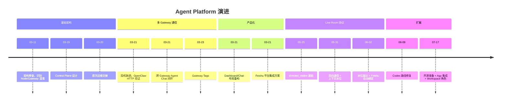

# docs — docs


# Docs 模块

## 概述

`docs/` 目录是 Agent Platform 项目的**机构记忆层**，承载了从架构设计、里程碑记录到运维交接的完整项目演进历史。它不是静态参考文档，而是一套**按时间线组织的交接协议**——每个文件代表一次会话/阶段的结束状态，为下一次会话提供精确的起点。

## 命名规范

文件采用**数字前缀 + 主题**的扁平结构：

| 前缀范围 | 用途 | 示例 |
|---------|------|------|
| `00`–`13` | 早期架构设计与基础能力 | `00_ARCHITECTURE_REVIEW.md` |
| `100`–`110` | 后期功能迭代与运维交接 | `104_AGENT_BIDIRECTIONAL_AND_CONTEXT_WATERMARK_NEXT_HANDOVER.md` |

命名模式：

```
{序号}_{主题关键词}.md
```

- 序号递增，不回收
- 主题关键词使用英文大写 + 下划线
- 后期文件（107+）允许中文主题：`107_HANDOVER_20260609_Codex路径修复.md`

## 文档类型

### 1. 架构审查 / 设计文档

记录架构决策、问题诊断和方案对比。

- `00_ARCHITECTURE_REVIEW.md` — 识别 Node/Gateway 模型混淆，提出正确架构
- `01_CONTROL_PLANE_ARCHITECTURE.md` — Control Plane 三层设计（GatewayClient → GatewayManager → FeishuCommandRouter）
- `05_MULTI_GATEWAY_AGENT_MEETING_PLAN.md` — 多 Gateway Agent 会议的分层推进计划

### 2. 里程碑 / 交接文档

记录一次会话完成的工作、验证结果和下一步建议。这是**最主要的文档类型**。

标准结构：

```markdown
# {序号} {标题}

## 日期 / 任务类型 / 所属主线
## 为什么做
## 修改内容
## 验证结果
## 对主线的影响
## 下一步建议
```

### 3. 运维指南

面向接手者的操作手册。

- `04_HANDOVER.md` — 快速启动、API 概览、故障排查
- `102_FEISHU_SERVICE_RECOVERY_LESSONS_20260531.md` — 服务恢复经验

### 4. 实施清单

将设计文档拆解为可执行任务。

- `06_STAGE1_MULTI_GATEWAY_MVP_CHECKLIST.md` — 阶段 1 的 A–H 工作分解

## 项目演进时间线



## 核心架构决策（从文档中提取）

### 双层 Token 模型

这是项目中最关键的架构约束，在多个文档中反复强调：

| Token 类型 | 来源 | 用途 |
|-----------|------|------|
| **平台 Token** | `POST /api/gateways/token` | Gateway 注册、心跳、平台身份认证 |
| **OpenClaw Token** | OpenClaw 自身配置 | 访问 `/v1/responses`、`/v1/chat/completions` |

**规则：平台 Token 不能直接调用 OpenClaw AI 端点。**

### 分层原则

```
Gateway 通信层 → Agent Adapter 层 → Meeting/Orchestrator 层
```

- 不一次性混合所有层
- A2A 协议定位为中期适配层，不是第一阶段依赖

### 软输入 / 硬内部协议

- 用户输入可以保持自然语言（`@codex 你去问一下 pi`）
- 内部路由必须使用结构化记录（`directed_visible` + `primaryTargetMemberId`）
- 不依赖自由文本正则匹配作为路由真相源

### 运行时管理

- 使用 **user-level systemd** 管理，不用 `nohup`
- 重启命令：`systemctl --user restart agent-platform-dev.service agent-platform-feishu.service`
- `prisma/dev.db` 不纳入 Git 跟踪（103 号文档修复）

## 关键代码位置索引

文档中反复引用的核心文件：

| 文件 | 职责 |
|------|------|
| `src/lib/gateway-router.ts` | Gateway 消息路由 |
| `src/lib/openclaw-client.ts` | OpenClaw HTTP 调用 |
| `src/lib/openclaw-gateway-rpc.ts` | OpenClaw WS 控制面 |
| `src/lib/gateway-auth.ts` | Token 验证中间件 |
| `src/lib/encryption.ts` | AES-256-GCM Token 加密 |
| `src/lib/live-room.ts` | Live Room 核心模型 |
| `src/lib/live-room-delivery.ts` | 消息投递与路由 |
| `src/lib/feishu.ts` | Feishu 命令解析 |
| `src/lib/feishu-long-connection.ts` | Feishu 长连接运行时 |
| `src/lib/task-room.ts` | Task Room 上下文管理 |
| `src/lib/acpx/runner.ts` | ACPX Agent 执行器 |
| `src/components/live-room/LiveRoomWorkspace.tsx` | Live Room Web UI |

## 阅读指南

### 新接手者推荐阅读顺序

根据当前阶段选择入口：

**如果接手 Live Room / Feishu 方向：**
1. `104_AGENT_BIDIRECTIONAL_AND_CONTEXT_WATERMARK_NEXT_HANDOVER.md`
2. `105_LIVE_ROOM_MEMBER_WATERMARK_SLICE_HANDOVER.md`
3. `106_FEISHU_AUTO_BIND_DEFAULT_AGENT_AND_REMOTE_WORKDIR_NEXT_HANDOVER.md`
4. `109_HANDOVER_20260717_Agy本地集成.md`

**如果接手 Gateway 通信方向：**
1. `04_HANDOVER.md`
2. `07_OPENCLAW_HTTP_MILESTONE.md`
3. `08_OPENCLAW_HTTP_HANDOVER.md`
4. `09_CROSS_GATEWAY_AGENT_CHAT_HANDOVER.md`

**如果接手产品/布局方向：**
1. `10_LAYOUT_AND_FEISHU_HANDOVER.md`
2. `11_DASHBOARD_CHAT_LAYOUT_PLAN.md`
3. `12_FEISHU_PLATFORM_INTEGRATION_PLAN.md`

### 每个交接文档的"下一步建议"

每个文档末尾的"下一步建议"或"Recommended Next Session"是**最关键的导航信息**——它告诉下一个会话应该从哪里开始、先读什么、先验证什么。

## 编写新交接文档的规范

基于现有文档的惯例：

1. **序号递增**，不复用已删除的序号
2. **必须包含**：日期、任务类型、所属主线、为什么做、修改内容、验证结果、对主线的影响、下一步建议
3. **验证结果**要具体：列出执行的命令和通过/失败状态
4. **下一步建议**要可执行：明确"先读什么文件"、"先验证什么"、"先改什么代码"
5. **不要假设读者有上下文**：每个文档应自包含足够信息让新会话独立启动
6. **文件变更列表**要完整：列出所有修改的文件路径

## 与代码的关系

`docs/` 不直接参与运行时，但它是**开发流程的核心基础设施**：

- 每次会话结束 → 写交接文档
- 每次会话开始 → 读交接文档确定起点
- 架构决策 → 记录在文档中，代码实现引用文档编号
- 运维操作 → 文档中的命令可直接复制执行

文档中引用的代码路径（如 `src/lib/gateway-router.ts`）是**当前有效的**，但具体实现可能已演进。以最新交接文档中的"文件变更"列表为准。