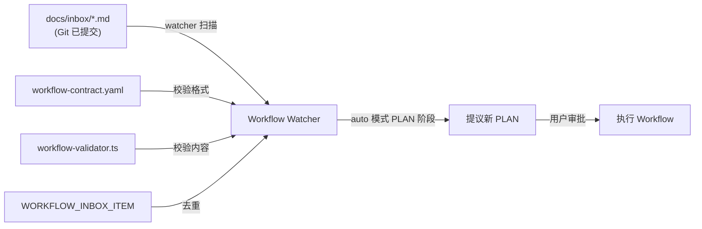

# docs — inbox


# docs/inbox — Workflow 候选需求收件箱

## 概述

`docs/inbox/` 是 Agent Platform workflow `auto` 模式使用的 **Git 收件箱**（Git Inbox）。它不是本地临时草稿目录，而是通过 Git 提交持久化的候选需求存储层。每个候选需求以独立的 Markdown 文件形式存在，由平台 watcher 在 workflow 的 PLAN 阶段自动扫描并提议转化为可执行的 PLAN。

## 文件命名规范

```
NNN_TYPE_YYYYMMDD_标题.md
```

| 字段 | 说明 | 示例 |
|------|------|------|
| `NNN` | 三位数递增编号 | `347`、`380`、`442` |
| `TYPE` | 文档类型（大写） | `ISSUE`、`ROADMAP` |
| `YYYYMMDD` | 提出日期 | `20260804` |
| `标题` | 简短描述（下划线分隔） | `Workflow编排失败恢复收据与断点继续` |

## YAML Frontmatter 结构

每个文件头部包含以下元数据：

```yaml
---
doc_type: ISSUE          # 文档类型：ISSUE | ROADMAP
doc_status: draft        # 状态：draft | active | superseded
next_action: none        # 下一步动作（当前均为 none）
---
```

### 状态语义

| `doc_status` | 含义 |
|---|---|
| `draft` | 已记录，等待排期实施 |
| `active` | 正在执行或已激活（如 ROADMAP） |
| `superseded` | 已被其他文件替代/拆分，不再独立排期 |

## 使用约定

1. **每个候选需求一个文件**：一级标题作为候选名称，正文描述范围和验收目标。
2. **`README.md` 仅说明规则**：watcher 会忽略它，不将其视为候选项。
3. **只读已提交内容**：watcher 只读取目标 Git HEAD 中已提交的内容，不读取工作区草稿。
4. **仅 `auto` 模式消费**：只有 `auto` 在 phase PLAN 完成后可从此处提议新 PLAN；`manual` 和 `semi_auto` 不消费 Inbox。
5. **新 PLAN 仍需用户审批**：Inbox 中的条目不会自动执行，必须经过审批。
6. **去重机制**：已有 PLAN 记录相同 `WORKFLOW_INBOX_ITEM` 时不会重复认领。
7. **安全约束**：不在候选文件中保存凭证、Token、个人数据或未经授权的真实环境信息。

## 文件类型与当前内容

### ISSUE（候选需求）

当前 Inbox 中的 ISSUE 文件覆盖了以下主题域：

| 编号 | 主题 | 优先级 | 状态 |
|------|------|--------|------|
| 347 | Workflow Validator 沙箱绝对路径依赖 | P2 | draft |
| 348 | Feishu Watchdog 误判 Platform Local 长任务 | P1 | draft |
| 349 | 网页平台登录认证与 Inbox 快捷记录命令 | P1 | superseded |
| 350 | 远程 Agent 守护进程与 WebSocket 接入网络 | P1 | draft |
| 351 | 并行工作流调度与 Git Worktree 任务隔离执行 | P1 | draft |
| 357 | 网页平台登录认证与 RBAC | P1 | draft |
| 375 | AP 命令卡片增加角色工作流入口 | P2 | draft |
| 376 | 用户分支变更致 Watcher 阻断与 Handoff 链状态反馈优化 | P1 | draft |
| 377 | Agent 执行过程详细信息折叠显示方案 | P1 | draft |
| 380 | Workflow 编排失败恢复收据与断点继续 | P1 | draft |
| 382 | Agent 职责分工与按意图路由 | P1 | draft |
| 391 | 双工作模式演进（Worktree 并行 + 角色串行） | P1 | draft |
| 442 | Agent 运行时能力增强（模型切换/思考长度/Skill/插话） | P1 | draft |
| 444 | 并行 Slice 执行引擎落地 TODO | P1 | draft |
| 448 | 每个 Slice 重置会话 | P1 | draft |
| 481 | Pi 主机级供应商与模型切换 TODO | P1 | draft |
| 482 | 服务监控、Agent 决策审计与历史保留策略研究 | P1 | draft |

### ROADMAP（排期规划）

| 编号 | 标题 | 状态 |
|------|------|------|
| 378 | Inbox 议题优先级排期与实施规划 | active |

ROADMAP 文件（`378`）维护了所有 Inbox 议题的优先级梯度，分为：
- **第一梯队**：高感知收益，解决现实痛点（380、442、376、377）
- **第二梯队**：提升系统可靠性与快捷交互（348、382、375）
- **第三梯队**：中长期演进与安全基石（357、351、350）
- **暂缓/维护项**：347、349

## 与平台其他组件的关系



### 关键交互点

| 组件 | 与 Inbox 的关系 |
|------|----------------|
| **Workflow Watcher** | 扫描 Git HEAD 中 `docs/inbox/` 下已提交文件，识别候选项 |
| **Workflow Validator** (`src/lib/scheduled-jobs/workflow-validator.ts`) | 校验 Inbox 文件是否符合 `workflow-contract.yaml` 规范 |
| **`workflow-contract.yaml`** | 定义 `allowed_types: ISSUE` 等格式约束 |
| **`WORKFLOW_INBOX_ITEM`** | PLAN 中记录来源 Inbox 条目编号，实现去重 |
| **`npm run workflow:validate`** | 本地校验命令，可验证 Inbox 文件格式 |

## 生命周期

```
提出 → 提交到 Git → Watcher 扫描 → (auto 模式) 提议 PLAN → 用户审批 → 执行
                ↓
         被拆分/替代 → doc_status: superseded
```

1. **提出**：用户或 Agent 在 `docs/inbox/` 下创建新文件并 Git 提交。
2. **扫描**：Watcher 在 workflow `auto` 模式的 PLAN 阶段读取已提交文件。
3. **提议**：Watcher 将候选项转化为 PLAN 提议，记录 `WORKFLOW_INBOX_ITEM` 编号。
4. **审批**：用户审批后 PLAN 进入执行。
5. **归档**：已实施的条目可标记为 `superseded` 或保留为 `draft`（视情况）。

## 贡献指南

### 新增候选需求

1. 确定下一个可用编号（查看现有最大编号 + 1）。
2. 创建文件：`docs/inbox/NNN_ISSUE_YYYYMMDD_标题.md`。
3. 填写 YAML frontmatter（`doc_type: ISSUE`、`doc_status: draft`、`next_action: none`）。
4. 正文包含：状态、问题背景、处理思路/方案、验收标准。
5. Git 提交（必须提交，工作区草稿不会被 watcher 读取）。

### 注意事项

- 不要在工作区未提交状态下期望 watcher 识别新条目。
- 不要在同一文件中混合多个不相关需求。
- 如果需求被拆分为多个子项，将原文件标记为 `superseded` 并在新文件中注明来源。
- 参考 `378_ROADMAP` 了解当前优先级排期，避免重复提出已有议题。