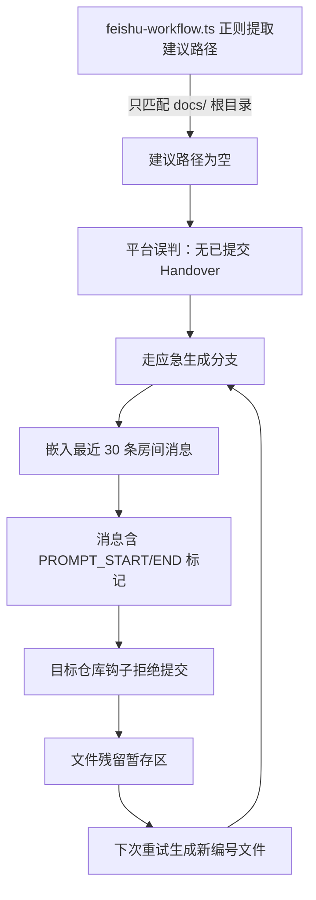
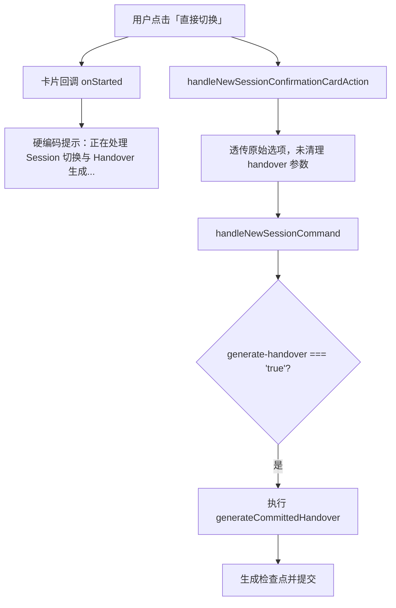

# docs — workflow-bugfix-notes

# docs/workflow-bugfix-notes

## 模块概述

本目录是**工作流 Session 换代（Session Rotation）系统**的修复记录归档。每篇文档对应一次线上问题的完整闭环：现象 → 根因 → 修复 → 验证 → 运维备注。

这些记录不是设计文档，而是**事后分析（post-mortem）**，用于：

- 帮助新成员理解 Session 换代机制中容易出错的边界条件
- 为后续类似问题的排查提供模式参考
- 记录运维决策（如历史残留文件是否回收、游标是否移动）

## 涉及的核心组件

修复记录中反复出现的代码模块：

| 文件 | 职责 |
|------|------|
| `feishu-workflow.ts` | 工作流派发主逻辑，负责从上一轮 Prompt 提取建议 Handover 路径，决定走"复用已提交 Handover"还是"应急生成检查点"分支 |
| `workflow-session-rotation.ts` | Session 换代核心，包含 `suggestHandoverPathFromPrompt` 等路径提取函数 |
| `feishu-new-session.ts` | 飞书侧换代命令入口，处理 `/ap new-session` 命令及确认卡片回调，负责检查点生成与提交 |
| `feishu-long-connection.ts` | 飞书长连接卡片交互层，处理卡片按钮回调并发送进度提示 |

## 问题一：换代派发误生成 Session 换代检查点（2026-08-30）

### 问题摘要

S04 完成后 S05 的 `next_slice` 派发每分钟失败一次，目标仓库 `docs/` 根目录持续生成 `NNN_HANDOVER_20260830_Session换代_*.md` 暂存残留。

### 根因链

三个独立缺陷叠加：

1. **路径正则不匹配子目录** — `docs\/\d+_HANDOVER_\d{8}_...` 无法匹配 `docs/dev/229_HANDOVER_...md`
2. **应急生成器未脱敏** — 原样嵌入 transcript，其中包含 `<!-- WORKFLOW_PROMPT_START/END -->` 标记
3. **重试分支丢失参数** — `rotation_pending` 分支未传 `suggestedPath`，即使首轮已提取成功，重试时仍退回应急生成

### 修复要点（commit `b4f6e83`）

- `suggestHandoverPathFromPrompt` 扩展为接受 `docs/<branch_space>/NNN_HANDOVER_YYYYMMDD_*.md` 多级路径
- `prepared` 与 `rotation_pending` 两个分支统一传入建议路径
- 生成检查点前调用 `redactWorkflowPromptMarkers` 脱敏
- 提交失败时撤销暂存并删除文件，防止残留累积

### 运维决策

- 历史 `docs/NNN_HANDOVER_..._Session换代_*.md`（001–013）保留在 Git 历史中，不回收
- 未提交的重复残留（011/012）由当值 Agent 清理
- 不改变合同、扫描边界或游标

---

## 问题二：直接切换 Session 误生成 Handover（2026-09-03）

### 问题摘要

用户在飞书卡片中点击「直接切换」后，平台仍执行了应急检查点生成逻辑，在目标仓库产生大量 `NNN_HANDOVER_*.md` 文档和 Git 提交。

### 根因链

三个独立缺陷：

1. **卡片提示文案硬编码** — `onStarted` 不区分 `direct` 和 `handover` 决策
2. **确认卡片回调未清理参数** — `decision === 'direct'` 时仍透传 `generate-handover`、`handover`、`from-handover`
3. **核心入口缺少 direct 守卫** — `handleNewSessionCommand` 未对 `direct` 做强制隔离

### 修复要点（commit `a1c002a`）

- `buildCardActionHandler` 的 `onStarted` 接收 `decision` 参数，按决策类型区分提示文案
- `handleNewSessionConfirmationCardAction` 在 `decision === 'direct'` 时显式 `delete` 所有 Handover 相关选项
- `handleNewSessionCommand` 中：
  - `direct` 为 true 时强制 `handoverOption = ''`
  - 生成检查点条件增加 `!direct` 守卫：`if (confirmed && !direct && command.options['generate-handover'] === 'true')`
- 回归测试断言：直接切换后 Git HEAD 不变，不产生任何文档

### 中断恢复记录

修复过程中 `agent-platform-feishu.service` 收到 SIGTERM 重启，正在执行的 antigravity 任务被停止。恢复命令接管后：

1. Git 状态保护确认未提交代码完整
2. 加固审阅：将原地修改传入参数改为构建新的纯净选项对象
3. 跑通回归测试后正式提交

---

## 排查模式参考

两篇记录共同揭示的 Session 换代系统脆弱点：

| 脆弱点 | 表现 | 防御手段 |
|--------|------|----------|
| 路径匹配假设 | 正则只覆盖单一目录布局 | 路径提取函数应接受多级目录，测试覆盖 `docs/` 根和 `docs/<branch_space>/` 子目录 |
| 参数透传污染 | 上游选项泄漏到下游执行层 | 在决策分支入口显式清理不相关参数，构建纯净选项对象 |
| 应急生成副作用 | 生成失败后文件残留 | 提交失败时必须撤销暂存并删除文件 |
| 重试路径不一致 | 首轮和重试走不同分支 | 所有分支统一传入关键参数 |
| 外部内容注入 | transcript 含不可执行标记 | 生成检查点前统一脱敏 |

## 文件清单

| 文件 | 日期 | 主题 |
|------|------|------|
| `20260830_handover-suggestion-and-checkpoint-sanitize.md` | 2026-08-30 | 路径正则 + 标记脱敏 + 重试参数 |
| `20260903_direct-session-rotation-handover-free.md` | 2026-09-03 | direct 模式隔离 + 卡片文案 + 中断恢复 |