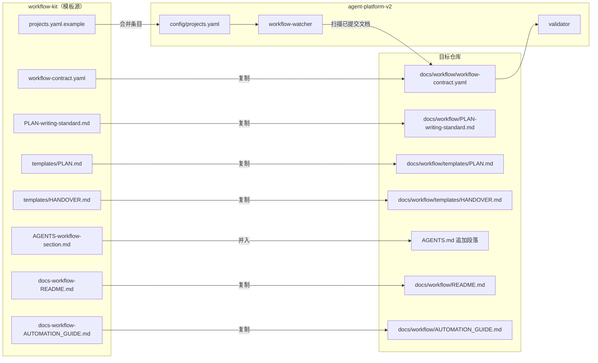
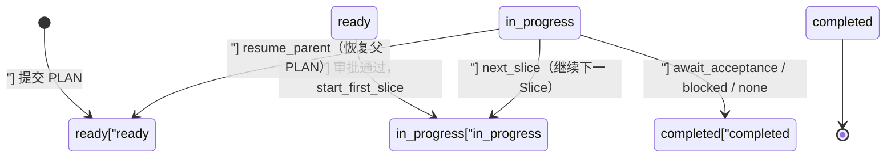

# docs — workflow-kit


# Workflow Kit — 通用工作流套件

## 概述

`docs/workflow-kit/` 是一个**可拷贝的模板目录**，用于将 agent-platform-v2 平台的 PLAN/HANDOVER 文档工作流接入任意新仓库。它不包含可执行代码，而是提供一组带 `[CHANGE-ME]` 占位符的配置文件和文档模板，套用时逐项替换即可。

核心设计原则：

- **规则值永远来自目标 Git ref 中已提交的合同**，平台代码不硬编码仓库规则
- **watcher 只读已提交内容**，不消费工作区文件，不从正文猜测动作
- **同一仓库、ref、branch space 只允许一个 workflow consumer**

## 架构关系



## 文件清单与目标位置

| 套件文件 | 复制到目标仓库 | 说明 |
| --- | --- | --- |
| `workflow-contract.yaml` | `docs/workflow/workflow-contract.yaml` | 机器可读合同，平台 validator/watcher 的唯一规则源 |
| `PLAN-writing-standard.md` | `docs/workflow/PLAN-writing-standard.md` | 跨仓 PLAN 写作与 Slice 划分规范 |
| `templates/PLAN.md` | `docs/workflow/templates/PLAN.md` | PLAN 骨架模板 |
| `templates/HANDOVER.md` | `docs/workflow/templates/HANDOVER.md` | HANDOVER 骨架模板 |
| `docs-workflow-README.md` | `docs/workflow/README.md` | 工作流目录入口说明 |
| `docs-workflow-AUTOMATION_GUIDE.md` | `docs/workflow/AUTOMATION_GUIDE.md` | 平台监测执行操作指南 |
| `AGENTS-workflow-section.md` | 并入根 `AGENTS.md` | 工作流守则段落（追加，非整文件替换） |
| `projects.yaml.example` | **不复制进仓库** | 平台 `config/projects.yaml` 的项目条目示例 |

另需在目标仓库自建：

- 分支文档空间目录（合同 `branch_spaces.root` 指向的目录，如 `docs/codex/<branch-space>/`）
- 需求池 `docs/inbox/`（可选，`auto` 模式使用）

## 核心概念

### 合同（workflow-contract.yaml）

合同是平台运行时读取的**唯一规则源**，定义了：

| 配置段 | 作用 |
| --- | --- |
| `documents` | 文档类型、文件名模式、Slice 编号模式、状态枚举、必填字段 |
| `actions` | 可执行动作（`start_first_slice`、`next_slice`、`resume_parent`）、审批动作（`await_approval`）、终止动作（`await_acceptance`、`blocked`、`none`） |
| `prompt` | Prompt 标记（`WORKFLOW_PROMPT_START` / `WORKFLOW_PROMPT_END`），标记之间的内容是投递给下一 Session 的唯一 Prompt |
| `templates` | 模板文件路径（validator 校验存在性） |
| `standards` | PLAN 写作标准文件路径 |
| `validation` | 校验模式（`balanced`：策略规则产生 warning） |
| `completion_gate` | 完成门禁超时（秒） |
| `numbering` | 文档编号规则（宽度、作用域、唯一性、候选选择策略） |
| `branch_spaces` | 分支文档空间根目录、无编号分支、编号目录模式 |
| `large_files` | 长文件告警/阻断阈值、源文件扩展名、忽略路径 |
| `legacy` | 存量文档豁免截止 commit |

### PLAN 与 HANDOVER

**PLAN** 是工作流的核心驱动文档，描述一个可执行目标及其 Slice 分解。两种尺度：

- **Phase PLAN**：目标跨越多个能力阶段，先说明完整路线，执行部分仍拆成可交付 Slice
- **Slice PLAN**：目标已收敛，直接拆成一个或少量 Session

**HANDOVER** 是 Slice 完成后的交接文档，驱动状态转换：

| `next_action` | 含义 |
| --- | --- |
| `next_slice` | 投递下一 Slice |
| `resume_parent` | 恢复父 PLAN（Interrupt PLAN 完成后） |
| `await_acceptance` | 停下等人工验收 |
| `blocked` / `none` | 通知后停止 |

### Slice 划分规则

每个 Slice 必须满足：

1. 一个 Agent 在一个 Session 内能完成理解、修改、验证、HANDOVER 和提交
2. 只有一个主要结果和一个主要失败原因
3. 默认只跨一个工程边界（算法 / HTTP / UI / 数据库四选一）
4. 通常不超过 2 个生产文件与 2 个测试文件
5. 不依赖下一个 Slice 也能运行本 Slice 的验收
6. 只提交本 Slice，创建 HANDOVER，然后停止

### 状态机



关键约束：

- 新 PLAN 永远需要人工审批
- `auto` 模式只负责从 Roadmap/Inbox 生成提案，不拥有批准权
- 修改、拒绝或审批超时都不得启动 Slice
- 每完成一个 Slice：运行项目门禁，创建 HANDOVER，提交后停止

## 套用步骤

1. **复制文件**到上表位置，创建分支文档空间与 `docs/inbox/`
2. **逐项替换 CHANGE-ME**（见下方核对表）
3. **决定 `legacy.cutoff_commit` 与 `initial_cursor_commit`**（通常都取接入时的 HEAD）
4. **在 agent-platform-v2 `config/projects.yaml` 登记项目**，先 `mode: shadow` 干跑观察
5. **确认 watcher 状态正常**（`/ap workflow status`、`/ap job diagnose workflow-watcher`）后切 `active`
6. **首个 PLAN 用模板手工创建并提交**，走一遍"校验 → 审批卡 → 执行"闭环验证

## CHANGE-ME 核对表

### A. `workflow-contract.yaml`

| 字段 | 说明 |
| --- | --- |
| `contract_version` | 目标仓库自定版本号（建议 `YYYY.MM.DD.N`） |
| `documents.allowed_types` | 按仓库需要增删（如加 `DISCUSSION`、`TODO`） |
| `documents.slice_pattern` | 默认宽松版；要强制标题行内 Slice 号改用严格版 |
| `branch_spaces.root` | 分支文档空间根目录（如 `docs/codex`） |
| `branch_spaces.unnumbered_branches` | 不建编号目录的分支名 |
| `legacy.cutoff_commit` | 接入时当前 HEAD 的完整 SHA |
| `large_files.thresholds` | 按仓库实际调整（默认 800 告警 / 1000 阻断） |
| `large_files.source_extensions` | 按技术栈增删 |
| `large_files.ignored_path_parts` | 按技术栈补充 |

### B. 平台注册（`projects.yaml.example`）

| 字段 | 说明 |
| --- | --- |
| `id` / `name` / `path` | 项目唯一 id、显示名、服务器绝对路径 |
| `ref` | 完整 `refs/heads/...` |
| `feishu.chat_id` / `approver_open_ids` | 审批通知会话与审批人 |
| `branch_space` | 文档空间子目录名（根空间用 `.`） |
| `initial_cursor_commit` | 接入起点 HEAD 的完整 SHA |
| `workflow_autonomy` | `manual` / `semi_auto` / `auto` |
| `execution_policy.preset` | `workspace` / `full_access` |

## Agent 完成约定

Agent 完成一个 Slice 后必须：

1. 提交 HANDOVER 文档
2. 取得该文档最后一次变更的完整 commit SHA
3. 最终回复原样重复合同 Prompt 标记之间的下一 Session Prompt
4. 以 `WORKFLOW_READY <document_commit_full_sha> <document_basename>` 作为最后一行

## 安全规则

- 自动化只读已提交内容，不从自然语言正文猜测下一步；元数据无效即停止并报告
- watcher 已读取提交后，Git 历史只追加：禁止 amend、rebase、reset、强推
- 不重复消费同一事件（commit + path + blob + action 幂等）
- 超时告警不自动 reset；恢复操作须显式命令并在 diagnose 之后执行
- 已达合同 `large_files.blocking_lines` 阈值的文件不得增长；需要新增职责时，先在同一提交中提取明确边界的模块

## 常用操作命令

```text
/ap workflow status              # 查看工作流状态
/ap workflow autonomy show       # 查看自治模式
/ap dashboard                    # 打开 Dashboard
/ap job run workflow-watcher     # 手动触发 watcher
/ap job diagnose workflow-watcher # 诊断 watcher
/ap job cursor workflow-watcher --latest  # 查看最新 cursor
```

> `--latest`、`--clear-pending` 不是常规重试按钮；移动 cursor / 清 pending 必须先诊断确认。

## 边界与原则

- 平台代码不硬编码仓库规则值；规则值永远来自目标 Git ref 中已提交的合同
- 本套件是模板快照，与平台实现可能有版本差；以平台仓库的 `docs/workflow/AUTOMATION_GUIDE.md` 为权威操作说明
- 复制文件不等于接入完成：agent-platform-v2 侧的项目注册是平台侧配置，每个仓库都要单独做