# docs — workflow


# docs/workflow — 文档驱动工作流自动化

## 模块定位

`docs/workflow/` 是 Agent Platform 工作流自动化的**规则源与操作入口**。它定义了一套以 Git 已提交文档为事件源的状态机，驱动 Agent 按 Slice 粒度连续执行、交接和停止。

核心原则：**自动化只消费已提交的文档，不读取工作区半成品，不从正文猜测意图。**

```
已提交 PLAN/HANDOVER → workflow-watcher → 校验 → 审批/执行 → 新 Session
```

## 文件结构

| 文件 | 职责 |
| --- | --- |
| `workflow-contract.yaml` | 唯一机器可读规则源：合法字段、动作、模板路径、编号、阈值 |
| `AUTOMATION_GUIDE.md` | 状态机、自治模式、Roadmap/Inbox、恢复与操作说明 |
| `PLAN-writing-standard.md` | 跨仓 PLAN 写作与 Slice 划分规范 |
| `templates/PLAN.md` | Phase PLAN 和 Interrupt PLAN 最小模板 |
| `templates/HANDOVER.md` | 三种 HANDOVER 状态转换模板 |
| `225_DECISION_20260725_文档自动化状态机.md` | 设计决策记录 |
| `README.md` | 本目录入口索引 |

## 文档类型与自动化语义

| 类型 | 语义 | 是否触发执行 |
| --- | --- | --- |
| `PLAN` | 阶段多 Slice 计划，或阻塞 bug 的嵌套计划 | 仅 `ready` + `start_first_slice` 可启动 |
| `HANDOVER` | 一次 Session 的事实记录和受控转换 | 仅 `next_slice` / `resume_parent` 可启动 |
| `ROADMAP` | 总体路线、阶段顺序和验收后的阶段状态 | 永不直接启动 |
| `DECISION` | 已接受的规则 | 不启动 |
| `ISSUE` | bug 证据、调查或队列项 | 不启动 |
| `REPORT` | 验收、里程碑、进度或验证结果 | 不启动 |
| `FIX` | 缺陷根因与验证 | 不启动 |

## 主状态机

```mermaid
stateDiagram-v2
    [*] --> PLAN_draft["PLAN_draft:"] 创建 PLAN
    PLAN_draft --> PLAN_ready["PLAN_ready:"] 人工修订完成
    PLAN_ready --> PLAN_pending["PLAN_pending:"] start_first_slice 提交
    PLAN_pending --> PLAN_approved["PLAN_approved:"] 人工批准
    PLAN_pending --> PLAN_rejected["PLAN_rejected:"] 拒绝/超时
    PLAN_approved --> S01["S01:"] 投递首个 Slice Prompt
    S01 --> S02["S02:"] HANDOVER next_slice
    S02 --> S03["S03:"] HANDOVER next_slice
    S03 --> Awaiting["Awaiting:"] 最终 Slice await_acceptance
    Awaiting --> [*]: 用户验收
    S01 --> Blocked["Blocked:"] blocked
    S02 --> Blocked["Blocked:"] blocked
    Blocked --> [*]: 通知并停止
    S01 --> Interrupt["Interrupt:"] 大型阻塞 bug
    Interrupt --> S01["S01:"] resume_parent 返回
```



### PLAN 生命周期

1. **创建**：`doc_status: ready`，按用户意图选择 `next_action`：
   - `await_approval`（默认）：留在候选清单，不自动发审批卡
   - `start_first_slice`：提交后由 watcher 直接进入审批
2. **审批**：人工批准 / 修改 / 拒绝 / 超时
3. **执行**：批准后只派发第一个 Slice
4. **推进**：每个 Slice 完成后创建 HANDOVER，由 `next_slice` 驱动下一 Slice
5. **终止**：最终 Slice 使用 `await_acceptance`，通知用户验收并停止

### HANDOVER 动作

| 动作 | 含义 | 后续 |
| --- | --- | --- |
| `next_slice` | 当前 Slice 完成，Phase PLAN 仍在进行 | 投递下一 Slice Prompt |
| `resume_parent` | Interrupt PLAN 完成 | 恢复父 PLAN 的 `return_to` Slice |
| `await_acceptance` | Phase PLAN 完成 | 通知验收；`auto` 可提议下一 PLAN |
| `blocked` / `none` | 无可执行推进 | 通知并停止 |

## 控制字段（YAML Frontmatter）

参与自动化的 PLAN/HANDOVER 在文件首部写 YAML：

```yaml
---
doc_type: HANDOVER
doc_status: completed
plan: 147_PLAN_20260725_阶段计划.md
slice: S01
plan_progress: in_progress
next_action: next_slice
---
```

### 动作分类

**可执行动作**（允许携带 Prompt 标记）：
- `start_first_slice`
- `next_slice`
- `resume_parent`

**终止动作**（禁止携带 Prompt）：
- `await_acceptance`
- `blocked`
- `none`

**审批动作**：
- `await_approval`

### Prompt 标记规则

只有可执行 action 才允许在文末出现**一次** `WORKFLOW_PROMPT_START / WORKFLOW_PROMPT_END` 标记。非可执行 action 禁止携带 Prompt。

```markdown
<!-- WORKFLOW_PROMPT_START -->
读取 `docs/<HANDOVER>.md`、`docs/<PLAN>.md` 和 `docs/workflow/workflow-contract.yaml`，只执行 S02。
完成验证、创建下一 HANDOVER、提交后停止。
<!-- WORKFLOW_PROMPT_END -->
```

## 自治模式

`workflow-watcher` 的启停与自治模式是两个独立控制面。

| 模式 | 已批准 PLAN S01 | `next_slice` | `resume_parent` | Phase 完成后 |
| --- | --- | --- | --- | --- |
| `manual` | 手工运行 watcher | 手工运行 watcher | 手工运行 watcher | 不提议 |
| `semi_auto` | 自动 | 自动 | 停止，等待人工 | 不提议 |
| `auto` | 自动 | 自动 | 自动 | 自动生成待审批 PLAN |

关键约束：
- 任何模式都不会越过 `blocked`，也不会自动批准 PLAN
- 项目配置中的模式只是默认值；数据库 override 优先
- 切换模式必须携带当前 40 位 HEAD

## Roadmap 与 Git Inbox

`auto` 模式在 Phase PLAN 完成后，按以下顺序选取下一 PLAN 候选：

1. Phase PLAN 的 `roadmap` 非空时，读取该 ROADMAP 第一条未勾选项
2. `roadmap: null` 时，扫描 `docs/inbox/` 直属 Markdown（忽略 `README.md`）
3. 跳过已被 `WORKFLOW_INBOX_ITEM` 标记认领的条目
4. 自动创建并提交一份新的 Phase PLAN，进入正常审批流程

Inbox 是已提交需求池，不是可执行 PLAN 目录。推荐每项一个 `ISSUE`：

```bash
/ap inbox add "需求标题" --body="范围与验收目标" --head=<当前40位HEAD>
```

## 校验与幂等

### 校验模式

- `balanced`（默认）：策略规则产生 warning；结构、动作、引用和调度安全问题仍是 error
- `strict`：策略规则也提升为 error

### 幂等机制

- 事件身份由 `(commit, path, blob hash, action)` 共同确定
- cursor 记录已消费位置；pending 记录审批或待执行 PLAN
- 两者都在 PostgreSQL 中，不写入仓库
- 相同事件不会重复执行

### Git 历史保护

watcher 已读取或可能读取提交后，Git 历史必须只追加。禁止 amend、rebase、reset 和强推改写历史。检测到 ref 改写时自动化停止并要求人工判断。

## 编号规则

- 宽度：3 位数字
- 作用域：branch space（`docs/` 下）
- 唯一性：同一 branch space 内唯一
- 候选选择：取本轮变更中编号最高的文档
- 无编号分支：`main`、`master`、`dev`
- 编号目录模式：`^[0-9]{3}_[a-z0-9][a-z0-9._-]*$`

## 大文件保护

| 阈值 | 行为 |
| --- | --- |
| 800 行 | warning |
| 1000 行 | blocking（阻止继续增长） |

适用于 `.py`, `.js`, `.jsx`, `.ts`, `.tsx`, `.vue`, `.java`, `.go`, `.rs`, `.cs`, `.php`, `.rb` 等源码文件。

## Bug 分叉与返回

- **小 bug**（不阻塞当前 Slice）：写入 ISSUE 或 Bugfix Queue，不打断主线
- **大型阻塞 bug**：
  1. 父 Slice 写一次 `paused` HANDOVER
  2. 创建 `plan_kind: interrupt` 的嵌套 PLAN，记录 `parent_plan`、`parent_slice`、`return_to`
  3. 嵌套 PLAN 最终 HANDOVER 使用 `resume_parent` 返回精确父 Slice
  4. 未被预先授权的嵌套 PLAN 默认为 `await_plan_approval`

## 代码入口

| 文件 | 职责 |
| --- | --- |
| `src/lib/scheduled-jobs/workflow-watcher.ts` | 扫描、校验、审批门、执行与终止动作 |
| `src/lib/scheduled-jobs/workflow-autonomy.ts` | 自治模式判定 |
| `src/lib/scheduled-jobs/workflow-roadmap-inbox.ts` | Roadmap/Inbox 选取与 PLAN 提案 |
| `src/lib/scheduled-jobs/workflow-validator.ts` | 合同解析与文档校验 |
| `src/lib/scheduled-jobs/workflow-status.ts` | 状态与唯一下一步 |
| `src/lib/scheduled-jobs/workflow-inspection.ts` | Dashboard 队列与文档检查 |
| `src/lib/scheduled-jobs/git-history-guard.ts` | 只追加历史保护 |
| `src/lib/acpx/workflow-completion-gate.ts` | Session 完成门 |
| `src/lib/feishu-workflow-policy.ts` | 飞书自治模式和权限操作 |
| `src/lib/feishu-scheduled-jobs.ts` | Workflow Dashboard 与 Scheduled Job 命令 |

## 常用操作

```bash
# 仓库内校验
npm run workflow:validate -- HEAD docs/<编号>_PLAN_<日期>_<主题>.md
npm run check:long-files

# watcher 控制
/ap job enable workflow-watcher
/ap job disable workflow-watcher
/ap job run workflow-watcher
/ap job diagnose workflow-watcher

# 自治模式
/ap workflow autonomy show
/ap workflow autonomy set manual --head=<40位HEAD>
/ap workflow autonomy set semi_auto --head=<40位HEAD>
/ap workflow autonomy set auto --head=<40位HEAD>

# 状态与恢复
/ap workflow status
/ap job cursor workflow-watcher --latest
/ap job cursor workflow-watcher --clear-pending
```

## 维护规则

更新规则时按职责修改，不重复维护：

| 内容 | 修改位置 |
| --- | --- |
| 合法字段、动作、模板路径、编号、阈值 | `workflow-contract.yaml` |
| 合格示例 | `templates/PLAN.md`、`templates/HANDOVER.md` |
| 人类流程说明 | `AUTOMATION_GUIDE.md` 与本目录 README |
| 历史决策 | 编号 DECISION 文档 |
| 操作验收证据 | 编号 REPORT |
| 缺陷根因与验证 | 编号 FIX |

修改实现后运行对应的 `test:workflow-*` 聚焦测试；提交前运行 GitNexus `detect_changes()` 核对影响范围。