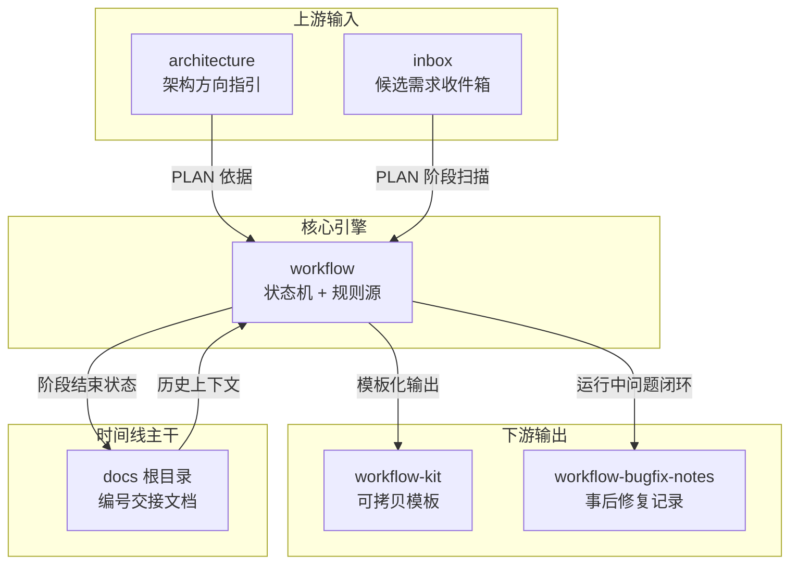

# docs


# docs

## 模块概述

`docs/` 是 Agent Platform 的**机构记忆层**，承载从架构设计、需求收集、工作流自动化到运维修复的完整项目演进记录。它不是静态参考文档，而是一套**以 Git 已提交内容为事件源**的协作协议——每个子目录承担工作流生命周期中不同阶段的角色。

## 子模块关系



## 子模块定位

| 子模块 | 角色 | 详见 |
|--------|------|------|
| [docs 根目录](docs.md) | 按时间线编号的交接协议，记录每次会话/阶段的结束状态 | `00`–`13` 早期架构，`100`+ 后期迭代 |
| [architecture](architecture.md) | V2 统一 Agent Runtime 的架构方向指引，定义消息流与配置体系重构方向 | 核心文档：`agent-platform-v2_unified-agent-architecture_handover.md` |
| [inbox](inbox.md) | Workflow `auto` 模式的 Git 收件箱，存储候选需求（ISSUE / ROADMAP） | 命名：`NNN_TYPE_YYYYMMDD_标题.md` |
| [workflow](workflow.md) | 文档驱动工作流自动化的**规则源与操作入口**，定义状态机、审批与执行语义 | 核心文件：`workflow-contract.yaml`、`AUTOMATION_GUIDE.md` |
| [workflow-kit](workflow-kit.md) | 可拷贝的模板目录，将 workflow 接入任意新仓库 | 包含 `workflow-contract.yaml`、PLAN/HANDOVER 模板、`AGENTS-workflow-section.md` |
| [workflow-bugfix-notes](workflow-bugfix-notes.md) | Session 换代系统的事后修复记录归档 | 涉及 `feishu-workflow.ts`、`workflow-session-rotation.ts` 等组件 |

## 跨子模块的关键工作流

### 需求 → 执行 → 交接

```
inbox 候选需求
    ↓  PLAN 阶段扫描
workflow 状态机（校验 → 审批 → 执行）
    ↓  Slice 完成
HANDOVER 文档提交
    ↓  阶段结束
docs 根目录编号文档（交接状态固化）
```

- **inbox** 提供原始需求，由 `workflow` 的 watcher 在 PLAN 阶段自动扫描并提议转化为可执行 PLAN。
- **architecture** 为 PLAN 提供架构约束——例如统一 Agent Runtime 的消息流设计决定了 Slice 的划分粒度。
- **workflow** 的 `workflow-contract.yaml` 是唯一机器可读规则源，所有自动化行为（编号、阈值、合法动作）均从中读取。
- 阶段结束后，状态固化到 **docs 根目录**的编号文档中，成为下一次会话的精确起点。

### 模板化扩展

当需要将工作流接入新仓库时，**workflow-kit** 提供带 `[CHANGE-ME]` 占位符的完整模板集。其设计原则与 **workflow** 一致：规则值来自目标 Git ref 中已提交的合同，watcher 只读已提交内容。

### 故障闭环

**workflow-bugfix-notes** 记录的是 **workflow** 运行中 Session 换代机制的边界条件问题。每篇记录遵循"现象 → 根因 → 修复 → 验证 → 运维备注"的闭环结构，为后续排查提供模式参考。