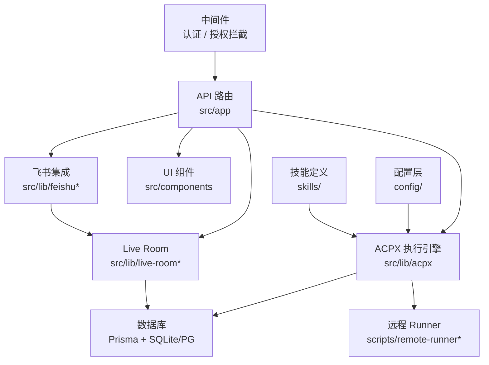

# agent-platform-v2 — Wiki


# Agent Platform v2

Agent Platform v2 是一个基于 **Next.js 14** 的控制面平台，用于编排和协调本地、远程及聊天集成的 AI Agent 执行。它提供 ACPX 任务运行、Live Room 实时协作、飞书/Lark 消息集成、远程 SSH 执行以及面向工作区的任务视图。

## 核心能力

- **ACPX 任务引擎** — 统一调度本地和远程 Agent 执行，支持 Codex、Claude Code、Antigravity、Gemini CLI、DeepSeek、Pi Agent 等多种 harness
- **Live Room** — 多参与者实时协作房间，支持用户、系统和助手消息，带上下文水印和权限展示
- **飞书/Lark 集成** — 长连接 + Webhook 双通道，支持卡片交互、命令解析、权限审批
- **远程 Runner** — 通过 SSH 在远程机器上注册和运行 Agent 节点
- **工作流自动化** — 基于 `docs/` 目录的状态机驱动开发流程

## 架构总览



## 请求处理链路

一次典型的请求从浏览器或飞书进入后，经过以下路径：

1. **中间件**（`src/src/middleware.ts`）拦截请求，完成认证和授权校验
2. **API 路由**（`src/app/api/`）解析请求参数，分发到对应业务逻辑
3. **业务逻辑层**（`src/lib/`）执行核心操作——无论是 ACPX 任务调度、飞书命令处理还是 Live Room 状态变更
4. **数据层**（`prisma/`）通过 Prisma ORM 持久化状态

飞书侧的入口则通过长连接或 Webhook 直接调用 `src/lib/feishu.ts` 中的命令处理器，再路由到 Live Room 或任务绑定逻辑。

## 关键端到端流程

### 飞书卡片交互 → 任务绑定

用户在飞书中点击卡片按钮时，`buildCardActionHandler`（`src/lib/feishu-long-connection.ts`）接收事件，通过 `getBoundLiveRoom` 解析目标房间，再经 `resolveFeishuTaskConversation` 和 `scopeKey` 确定任务上下文，最终触发对应的 Agent 执行。

### 飞书命令 → Agent 选择

当用户在 Live Room 中发送命令时，`handleRoomCommand`（`src/lib/feishu-live-room-commands.ts`）解析指令，调用 `resolveFeishuSelectedAgentIds` 确定目标 Agent，再通过 `deriveGatewayHarnessOptions` 和 `ensurePlatformLocalAgents` 构建执行选项，最终由 ACPX 引擎调度执行。

### 远程节点注册与执行

远程机器通过 `scripts/register-remote-node.ts` 向 Gateway 注册自身，Gateway 维护节点状态。当 ACPX 引擎需要远程执行时，通过 SSH 通道将任务下发到对应节点。

## 模块导航

- **[src](src.md)** — 应用源码，包含中间件、API 路由、业务逻辑、UI 组件和类型定义
- **[config](config.md)** — 声明式配置，定义项目注册表、飞书参数和定时任务编排
- **[prisma](prisma.md)** — 数据库 Schema 和迁移历史
- **[scripts](scripts.md)** — 辅助脚本，涵盖飞书集成、远程节点管理、工作流验证等
- **[skills](skills.md)** — 为各类 Agent 提供的标准化操作指南
- **[tests](tests.md)** — 分层测试基础设施，从单元测试到 Playwright E2E
- **[deploy](deploy.md)** — systemd 服务定义，用于生产环境部署
- **[docs](docs.md)** — 项目演进记录和工作流状态机
- **[plans](plans.md)** — 开发阶段计划与进展跟踪

## 快速开始

### 环境要求

- Node.js 20+
- npm
- 本地 SQLite（开发）或 PostgreSQL（生产）

### 安装与启动

```bash
# 安装依赖
npm install

# 运行数据库迁移（开发环境使用 SQLite）
npm run db:migrate:sqlite

# 启动开发服务器
npm run dev
```

### 常用脚本

| 命令 | 用途 |
|------|------|
| `npm run dev` | 启动 Next.js 开发服务器 |
| `npm run feishu:runtime` | 启动飞书长连接运行时 |
| `npm run scheduled-jobs:runtime` | 启动定时任务调度器 |
| `npm run remote-runner:gateway` | 启动远程 Runner Gateway |
| `npm run build` | 生产构建 |
| `npm run lint` | 代码检查 |

### 测试

```bash
# 运行特定模块测试
npm run test:auth-users
npm run test:workflow-validator
npm run test:remote-node-ws

# 运行 E2E 测试（需要应用已启动）
npx playwright test
```

## 技术栈

| 层级 | 技术 |
|------|------|
| 框架 | Next.js 14 + React 18 |
| 语言 | TypeScript 5.x |
| ORM | Prisma 5 |
| 数据库 | SQLite（开发）/ PostgreSQL（生产） |
| 实时通信 | Socket.IO 4.x |
| 飞书 SDK | @larksuiteoapi/node-sdk |
| 样式 | Tailwind CSS 3.x |
| 测试 | Playwright + Node.js 原生 assert |