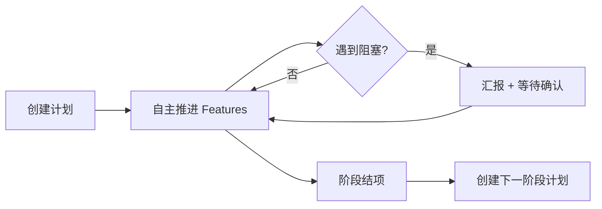

# plans


# Plans 模块

`plans/` 目录是 Agent Platform v2 项目的**计划管理目录**，用于记录每个开发阶段的完整计划、进展日志和状态跟踪。每个计划文件对应一个开发阶段，采用 Markdown 格式，包含 Features 列表、时间线、进展日志和阻塞问题等结构化信息。

---

## 文件命名规范

```
plans/{序号}_{创建日期}_{阶段名}_{主题}.md
```

| 字段 | 示例 | 说明 |
|------|------|------|
| 序号 | `001`, `002` | 三位数字，按创建顺序递增 |
| 创建日期 | `2026-03-15` | 计划创建日期 |
| 阶段名 | `阶段 2` | 所属开发阶段 |
| 主题 | `Agent 集成` | 阶段核心主题 |

当前文件：

| 文件 | 阶段 | 状态 |
|------|------|------|
| `001_2026-03-15_阶段 2_Agent 集成.md` | 阶段 2 | ✅ 已完成 (12/12) |
| `002_2026-03-20_阶段 3_控制平面增强.md` | 阶段 3 | 🟡 进行中 (1.5/10) |

---

## 计划文档结构

每个计划文件遵循统一的结构模板：

```
# 阶段标题
├── 元信息（创建时间、项目、状态、进度）
├── Features 列表（表格：编号、名称、优先级、状态、预计/实际时间）
├── 阶段目标（核心目标 + 成功标准 checklist）
├── 进展日志（按时间倒序，记录每次关键事件）
├── 阻塞问题（表格：问题、发现时间、状态、需要决策）
├── 下一步行动（立即执行 + 等待确认）
├── 自主推进规则（行为矩阵 + 汇报格式）
└── 相关文档（链接到 STATUS.md、docs/ 等）
```

### 关键设计决策

- **进展日志按时间倒序排列**：最新事件在最上方，方便快速定位当前状态
- **Features 使用表格**：支持快速扫描整体进度
- **阻塞问题独立成表**：明确区分"可自主推进"和"需要用户决策"的事项
- **自主推进规则显式声明**：定义 Agent 在无人干预时的行为边界

---

## 阶段生命周期



每个阶段遵循以下流程：

1. **创建**：定义 Features 列表、优先级、时间线
2. **推进**：按优先级顺序完成 Features，每次完成后更新进展日志
3. **阻塞处理**：遇到需要用户决策的问题时暂停并汇报
4. **结项**：所有 Features 完成后标记为已完成，记录最终进度

---

## 阶段 2：Agent 集成与跨网关通信（已完成）

**时间范围**: 2026-03-10 ~ 2026-03-20  
**最终进度**: 12/12 (100%)

### 核心交付物

| 类别 | 交付内容 |
|------|----------|
| Agent 集成 | Codex + Claude Code 真实 Agent 接入 |
| 群聊协作 | @提及功能、Agent 自动响应 |
| 任务编排 | 任务 CRUD、多 Agent 分配、状态跟踪 |
| Gateway 架构 | Node → Gateway 模型重构、Token 认证、消息路由 |
| 安全 | AES-256-GCM Token 加密存储 |
| 测试 | Playwright E2E 框架（18 个测试用例） |

### 关键技术实现

- **Gateway 模型重构**：`Node` 表重命名为 `Gateway`，新增 `url`、`token` 字段；`Agent.nodeId` → `Agent.gatewayId`
- **Token 认证**：`/api/gateways/token` (POST/GET/DELETE) + `src/lib/gateway-auth.ts` 中间件
- **消息路由**：`src/lib/gateway-router.ts`，发送端点 `/api/gateways/messages/send`，接收端点 `/api/gateways/messages/incoming`
- **加密存储**：`src/lib/encryption.ts`，AES-256-GCM 算法

### 遗留问题

| 问题 | 影响 |
|------|------|
| Linux Gateway 消息 API 端点不匹配 | 跨网关消息路由无法端到端验证 |
| UI 测试选择器需优化 | 12/18 E2E 测试未通过 |

---

## 阶段 3：控制平面增强（进行中）

**创建日期**: 2026-03-20  
**当前进度**: 1.5/10 (15%)

### Features 概览

| 优先级 | Features | 状态 |
|--------|----------|------|
| P0 | Control Plane 集成测试、Linux Gateway 通信修复、Gateway 状态监控面板、消息路由日志 | 1 完成, 1 部分完成, 2 待开始 |
| P1 | Dashboard 性能优化、通知系统、搜索功能 | 待开始 |
| P2 | 任务模板系统、Agent 能力标签、批量操作 | 待开始 |

### 当前阻塞

**Linux Gateway 通信修复**（Feature 2）部分完成：
- ✅ 连接测试通过（Ping 19ms，端口 18789 开放）
- ✅ Health Check 通过（`/health` 返回 live）
- ❌ 消息 API 端点不匹配（预期 `/api/messages/incoming` 返回 404）

**解决方向**：等待 Linux-Agent 确认 API 配置，或改用 Feishu 群聊通信作为替代方案。

### 团队分工

| 角色 | Agent | 职责 |
|------|-------|------|
| Orchestrator | HK-vision (Main) | 项目编排、进度跟踪、文档维护 |
| Coder | Claude Code (ACPX) | 主要编码工作 |
| QA | Gemini 2.5 Flash | 测试审阅、边界条件检查 |
| Researcher | Kimi K2.5 | 技术调研、方案对比 |

---

## 自主推进机制

计划文档中显式定义了 Agent 的自主推进规则：

| 场景 | 行为 |
|------|------|
| Feature 完成 | 自动开始下一个 Feature + 群聊汇报 |
| 遇到阻塞问题 | 汇报 + 等待用户确认 |
| 用户长时间无回复 | 继续自主推进（默认继续） |
| 用户明确打断 | 暂停当前任务，响应用户 |

**标准汇报格式**：

```
✅ Feature X 完成
📊 进度：X/12 (XX%)
⏭️ 自动开始 Feature X+1
🔜 预计完成时间：XX 分钟
```

---

## 与项目其他部分的关系

| 关联文件/目录 | 关系 |
|---------------|------|
| `STATUS.md` | 项目总体状态，plans 中的进度数据汇总于此 |
| `HEARTBEAT.md` | 心跳检查流程，引用 plans 确认当前任务 |
| `docs/ARCHITECTURE_REVIEW.md` | 架构审查文档，阶段 2 中产出 |
| `docs/CROSS_GATEWAY_REGISTRATION.md` | 跨网关注册指南 |
| `CONTROL_PLANE_STATUS.md` | Control Plane 实施状态，阶段 3 核心参考 |
| `tests/e2e/` | E2E 测试，各 Feature 的验证产物 |
| `memory/YYYY-MM-DD.md` | 当天详细记录，plans 进展日志的补充 |

**唤醒规则**：每次会话启动时，Agent 读取当前计划文件 → 检查进展日志确认最后完成的任务 → 继续执行下一个待办 → 更新进展日志。这确保了跨会话的连续性。