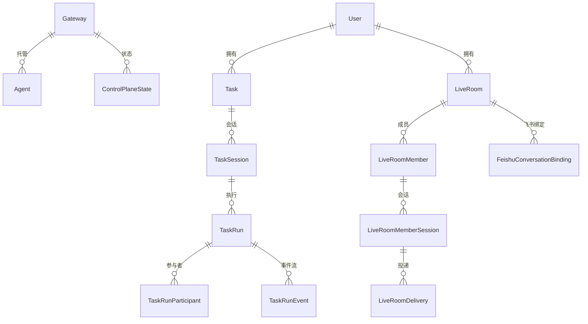
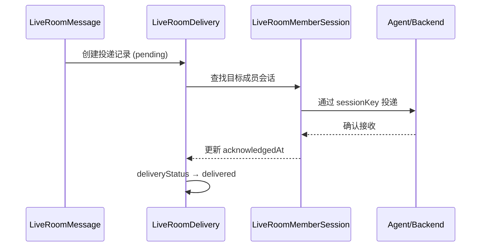

# prisma


# Prisma 数据库 Schema

## 概述

本模块定义了系统的完整数据层，基于 **Prisma ORM** + **PostgreSQL**。包含：

- `schema.prisma` — 所有数据模型的 Prisma 定义
- `migrations/` — 数据库迁移历史（从 SQLite 到 PostgreSQL 的完整演进）
- `seed.ts` — 开发环境种子数据

数据库通过环境变量 `DATABASE_URL` 连接，使用 `cuid()` 作为主键生成策略。

## 数据域总览



系统数据按以下领域划分：

| 领域 | 核心模型 | 职责 |
|------|---------|------|
| 基础设施 | `Gateway`, `RemoteHarnessHost`, `RemoteNode`, `ControlPlaneState` | 节点注册、资源发现、健康监控 |
| 任务执行 | `Task`, `TaskSession`, `TaskRun`, `TaskRunParticipant`, `TaskRunEvent` | 任务生命周期、多参与者编排、事件流 |
| 实时房间 | `LiveRoom`, `LiveRoomMember`, `LiveRoomMessage`, `LiveRoomMemberSession`, `LiveRoomDelivery` | 多 Agent 协作讨论、消息投递 |
| 飞书集成 | `FeishuConversationBinding`, `FeishuUserAccess`, `FeishuGroupBroadcast` 等 | 飞书群/DM 与 LiveRoom 的映射、权限审批、群广播 |
| 跨网关通信 | `GatewayMessage`, `IncomingGatewayMessage`, `CrossGatewayChatSession` | 网关间消息传递、跨网关对话 |
| 调度 | `ScheduledJobState`, `ScheduledJobRun`, `ScheduledJobRequest`, `WorkflowDispatch` | 定时任务状态、执行记录、工作流分发 |
| 用户与认证 | `User`, `PairingTicket` | Web 认证、设备配对 |
| 聊天 | `ChatRoom`, `Message` | 基础聊天室（早期设计） |

## 基础设施层

### Gateway

网关是 Agent 的宿主节点，提供 API 端点和资源信息。

```prisma
model Gateway {
  id              String   @id @default(cuid())
  name            String
  url             String?  // Gateway API URL
  token           String?  // 认证 token（加密存储）
  openclawToken   String?  // OpenClaw HTTP API token
  ip              String?  // 兼容旧字段
  status          String   @default("offline") // online, offline, maintenance
  resources       String?  // JSON: { cpu, memory, disk }
}
```

### Agent

Agent 是执行任务的基本单元，可归属于某个 Gateway。

```prisma
model Agent {
  id             String   @id @default(cuid())
  name           String
  runtimeAgentId String?  // 运行时标识
  type           String
  status         String   @default("offline") // online, offline, busy, error
  lastHeartbeat  DateTime @default(now())
  gatewayId      String?
  // 身份管理字段
  userNickname   String?  // 用户自定义昵称
  roleDescription String? // 角色描述
  colorTag       String?  // UI 颜色标签
  emojiIcon      String?  // 表情图标
  hostname       String?  // 服务器主机名
}
```

Agent 与 Task 之间是**多对多**关系（通过 Prisma 隐式中间表 `_AgentToTask`）。

### RemoteHarnessHost

远程 SSH 执行主机，用于在远程机器上运行 harness。

```prisma
model RemoteHarnessHost {
  id                 String   @id @default(cuid())
  label              String
  host               String
  port               Int      @default(22)
  sshUser            String
  authType           String   @default("ssh_key")
  encryptedPrivateKey String?
  viaNetwork         String   @default("wireguard") // wireguard, lan, public
  supportedHarnesses String?  // JSON 数组
}
```

### RemoteNode

通过 WebSocket 注册的远程节点（较新设计，替代部分 Gateway 功能）。

```prisma
model RemoteNode {
  id        String   @id @default(cuid())
  name      String   @unique
  host      String
  secretHash String
  status    String   @default("offline")
  lastSeen  DateTime?
  ownerUserId String?
}
```

### ControlPlaneState

每个 Gateway 的控制平面状态，用于负载均衡和健康检查。`gatewayId` 是唯一约束，保证每个网关只有一条状态记录。

```prisma
model ControlPlaneState {
  id               String   @id @default(cuid())
  gatewayId        String   @unique
  status           String   @default("offline")
  loadScore        Float    @default(0)  // 0-100，越低越好
  latency          Int      @default(0)  // ms
  consecutiveFails Int      @default(0)
}
```

## 任务执行层

任务执行是系统的核心流程，采用 **Task → TaskSession → TaskRun → TaskRunParticipant** 的层级结构。

### 层级关系

```
Task (任务定义)
 └── TaskSession (会话，可多次执行)
      └── TaskRun (单次执行)
           └── TaskRunParticipant (参与者)
                └── TaskRunEvent (事件流)
```

### Task

```prisma
model Task {
  id                   String   @id @default(cuid())
  name                 String
  status               String   @default("pending") // pending, running, completed, failed
  executionMode        String   @default("standard") // standard, acpx
  workingDirectory     String?
  currentTaskSessionId String?  // 指向当前活跃会话
  ownerUserId          String?
  result               String?  // JSON
  error                String?
}
```

### TaskSession

会话是 Task 的一次"对话上下文"，一个 Task 可以有多个 Session（例如用户重新发起）。

```prisma
model TaskSession {
  id             String   @id @default(cuid())
  taskId         String
  status         String   @default("active") // active, waiting_user, paused, completed, failed
  attentionState String   @default("normal") // normal, needs_review, needs_user_input, stuck, error
  activeRunId    String?  // 当前活跃 Run
}
```

### TaskRun

单次执行实例，包含编排模式和状态机。

```prisma
model TaskRun {
  id                String   @id @default(cuid())
  taskId            String
  taskSessionId     String?
  mode              String   @default("acpx")
  orchestrationMode String   @default("single") // single, staged
  status            String   @default("pending")
  controlState      String   @default("normal") // normal, interrupt_requested, stop_requested
  activityState     String   @default("quiet")  // streaming, quiet, stalled, waiting_user, terminating
  watchdogConfig    String?  // JSON
}
```

### TaskRunParticipant

执行中的参与者，可以是本地 Agent 或远程 Gateway Agent。

```prisma
model TaskRunParticipant {
  id                   String   @id @default(cuid())
  taskRunId            String
  executionBackend     String   @default("gateway_openclaw") // platform_local, gateway_openclaw
  harnessType          String
  role                 String
  status               String   @default("pending")
  activityState        String   @default("quiet")
  interruptSupported   Boolean  @default(false)
  resumeSupported      Boolean  @default(false)
  sessionControlSupported Boolean @default(false)
  softStopSupported    Boolean  @default(false)
}
```

### TaskRunEvent

事件流记录，按 `sequence` 排序，支持 `tier` 字段区分摘要和详细级别。

```prisma
model TaskRunEvent {
  id           String   @id @default(cuid())
  taskRunId    String
  participantId String?
  sequence     Int
  eventType    String
  stream       String   @default("system") // system, stdout, stderr
  tier         String   @default("summary") // summary, detail
  content      String
}
```

### TaskRunControlMessage

用户向运行中任务发送的控制消息（如中断、停止、追加指令）。

```prisma
model TaskRunControlMessage {
  id             String   @id @default(cuid())
  taskId         String
  taskRunId      String
  participantId  String?
  senderUserId   String
  deliveryMode   String   @default("queued") // queued, immediate
  deliveryStatus String   @default("pending") // pending, delivered, superseded, rejected
  controlAction  String   @default("queue_message") // queue_message, interrupt_now, stop_run
  content        String
}
```

### TaskRunInteractionRequest

Harness 向用户发起的交互请求（如确认操作、选择选项）。

```prisma
model TaskRunInteractionRequest {
  id           String   @id @default(cuid())
  taskRunId    String
  participantId String?
  source       String   @default("harness") // harness, system
  requestKind  String
  status       String   @default("pending") // pending, approved, denied, answered, expired, cancelled
  message      String
  optionsJson  String?
  expiresAt    DateTime?
}
```

## 实时房间层

LiveRoom 是多 Agent 协作讨论的核心，支持消息投递、会话管理和 handoff 机制。

### LiveRoom

```prisma
model LiveRoom {
  id                     String   @id @default(cuid())
  title                  String
  mode                   String   @default("discussion") // discussion, execution, hybrid
  status                 String   @default("active") // active, archived
  sourceTaskId           String?  // 可选关联到 Task
  currentSpeakerMemberId String?
  workingDirectory       String?
  handoffLimit           Int      @default(4)
  executionTimeoutMs     Int?     // 房间级执行超时（毫秒），null 使用后端默认值
  ownerUserId            String?
}
```

### LiveRoomMember

房间成员，可以是用户、本地 Agent、网关 Agent 或系统。

```prisma
model LiveRoomMember {
  id           String   @id @default(cuid())
  roomId       String
  memberType   String   @default("user") // user, local_agent, gateway_agent, system
  displayName  String
  role         String   @default("custom")
  specialty    String?  // documentation, diagnostics, implementation, general
  backend      String?  // platform_local, gateway_openclaw
  joinStatus   String   @default("joined") // joined, invited, removed
  presenceStatus String @default("idle")   // idle, online, busy, offline
  canReply     Boolean  @default(false)
  sortOrder    Int      @default(0)
  // 身份管理
  userNickname String?
  shortAlias   String?  // 用于 @提及
  // 执行配置
  acpxPermissionConfig String?
  codexModel           String?
  codexReasoningEffort String?
}
```

### LiveRoomMessage

房间消息，支持回复链和 handoff 追踪。

```prisma
model LiveRoomMessage {
  id               String   @id @default(cuid())
  roomId           String
  senderMemberId   String?
  replyToMessageId String?  // 自引用，形成回复链
  messageType      String   @default("user") // user, assistant, system, tool, topic, control
  visibility       String   @default("room") // room, system
  content          String
  // Handoff 字段
  handoffRootMessageId  String?
  handoffLimitSnapshot  Int?
  handoffCount          Int    @default(0)
  handoffClaimStatus    String?
  handoffTargetMemberId String?
}
```

### LiveRoomMemberSession

成员的后端会话，记录连接状态和能力。

```prisma
model LiveRoomMemberSession {
  id                    String   @id @default(cuid())
  roomId                String
  memberId              String
  backend               String   // platform_local, gateway_openclaw
  sessionKey            String
  status                String   @default("online") // online, offline, busy, expired
  supportsStreaming     Boolean  @default(false)
  supportsAppendMessage Boolean  @default(true)
  supportsInterrupt     Boolean  @default(false)
  lastHeartbeatAt       DateTime?
  lastDeliveredAt       DateTime?
}
```

### LiveRoomDelivery

消息投递记录，追踪每条消息到每个成员的投递状态。

```prisma
model LiveRoomDelivery {
  id             String   @id @default(cuid())
  roomMessageId  String
  targetMemberId String
  sessionId      String?
  deliveryStatus String   @default("pending") // pending, delivered, failed, fallback
  fallbackReason String?
  attemptedAt    DateTime @default(now())
  acknowledgedAt DateTime?
}
```

### 消息投递流程



## 飞书集成层

飞书集成将 LiveRoom 映射到飞书群/DM，支持权限审批、任务绑定和群广播。

### FeishuConversationBinding

飞书会话与 LiveRoom 的绑定关系。`scopeKey` 唯一标识一个绑定。

```prisma
model FeishuConversationBinding {
  id                 String   @id @default(cuid())
  scopeKey           String   @unique
  chatId             String
  chatType           String
  appId              String?  // 任务绑定模式
  threadId           String?
  rootMessageId      String?
  liveRoomId         String
  typingReactionId   String?  // 正在输入的表情
  typingForMessageId String?
}
```

**约束**：`threadId` 和 `rootMessageId` 要么都为 NULL（传统群/DM 绑定），要么都非 NULL 且 `chatType = 'group'`（任务绑定模式）。

### FeishuUserAccess

飞书用户访问权限。

```prisma
model FeishuUserAccess {
  openId        String   @id
  status        String   @default("pending") // pending, approved, denied, revoked, blocked
  displayName   String?
  workspaceRoot String?
  decidedBy     String?
  decidedAt     DateTime?
}
```

### FeishuAdminApproval

管理员审批流程（用户配对、完全访问）。

```prisma
model FeishuAdminApproval {
  id              String   @id @default(cuid())
  kind            String   // user_pairing, full_access
  status          String   @default("pending") // pending, processing, approved, denied, expired
  requesterOpenId String
  requesterChatId String
  cardMessageId   String?  // 飞书卡片消息 ID
  expiresAt       DateTime?
}
```

### FeishuGroupBroadcast

群广播：一条源消息发布到多个目标房间。

```
FeishuGroupBroadcast (源消息)
 └── FeishuGroupBroadcastTarget (发布时固定的目标快照)
      └── FeishuGroupBroadcastMemberDelivery (每个成员的投递进度)
```

**设计要点**：`FeishuGroupBroadcastTarget` 中的 `bindingId`、`liveRoomId`、`threadId`、`rootMessageId` 是**快照字段**，不建立外键。这确保历史广播记录在绑定变更或房间删除后仍然完整。

### FeishuTaskBindingRequest

任务绑定的持久化创建意图。在飞书卡片线程确认之前，房间尚不存在。

```prisma
model FeishuTaskBindingRequest {
  id               String   @id @default(cuid())
  appId            String
  chatId           String
  sourceMessageId  String
  title            String
  workingDirectory String
  rootMessageId    String?
  bindingId        String?  @unique
}
```

### FeishuProcessedMessage

已处理的飞书消息去重表，以 `messageId` 为主键。

## 跨网关通信

### GatewayMessage / IncomingGatewayMessage

网关间消息传递。`GatewayMessage` 是出站消息，`IncomingGatewayMessage` 是入站消息。

```prisma
model GatewayMessage {
  fromGatewayId String
  toGatewayId   String
  type          String   @default("direct") // direct, broadcast, request
  payload       String   // JSON
  status        String   @default("pending") // pending, sent, delivered, failed
}
```

### CrossGatewayChatSession

跨网关对话会话，记录两个网关 Agent 之间的多轮对话。

```prisma
model CrossGatewayChatSession {
  id            String   @id @default(cuid())
  fromGatewayId String
  toGatewayId   String
  fromAgentId   String   @default("main")
  toAgentId     String   @default("main")
  prompt        String
  turns         Int      @default(2)
  status        String   @default("completed")
}
```

## 调度层

### ScheduledJobState

每个项目-任务组合的调度状态（唯一约束 `projectId + jobId`）。

```prisma
model ScheduledJobState {
  id               String   @id @default(cuid())
  projectId        String
  jobId            String
  enabledOverride  Boolean?
  modeOverride     String?
  scheduleOverride String?
  lastScheduledAt  DateTime?
  lastStartedAt    DateTime?
  lastFinishedAt   DateTime?
  lastSuccessAt    DateTime?
  lastError        String?
  cursorJson       Json?
  workflowAutonomy Json?
}
```

### ScheduledJobRun

每次执行的记录，`idempotencyKey` 唯一约束防止重复执行。

```prisma
model ScheduledJobRun {
  id             String   @id @default(cuid())
  projectId      String
  jobId          String
  trigger        String
  mode           String
  status         String
  scheduledFor   DateTime
  startedAt      DateTime
  finishedAt     DateTime?
  idempotencyKey String   @unique
}
```

### ScheduledJobRequest

调度请求队列，用于解耦触发和执行。

```prisma
model ScheduledJobRequest {
  id          String   @id @default(cuid())
  projectId   String
  jobId       String
  status      String   @default("pending") // pending, processing, completed, failed
  requestedAt DateTime @default(now())
  claimedAt   DateTime?
  finishedAt  DateTime?
}
```

### WorkflowDispatch

工作流分发状态机，追踪每个事件的分发进度。

```prisma
model WorkflowDispatch {
  id        String   @id @default(cuid())
  projectId String
  jobId     String
  eventKey  String
  state     String   @default("prepared")
  roomId    String?
  feishuMessageId String?
  messageId String?
}
```

状态流转：`prepared` → `rotation_not_required` / `rotation_checkpoint_prepared` → `rotation_confirmation_posting` → `rotation_confirmation_required` → `rotation_pending` → `rotation_completed` → `session_reset` → `feishu_posted` → `prompt_posted` → `reply_queued`

## 用户与认证

### User

Web 认证用户。

```prisma
model User {
  id           String   @id @default(cuid())
  username     String   @unique
  passwordHash String
  role         String   @default("user") // admin, user
  displayName  String?
}
```

User 是 `Task`、`LiveRoom`、`RemoteNode` 的可选所有者（`ownerUserId` 外键，`ON DELETE SET NULL`）。

### PairingTicket

设备配对票据，用于安全地关联远程节点到用户。

```prisma
model PairingTicket {
  id          String   @id @default(cuid())
  tokenHash   String   @unique
  ownerUserId String?
  expiresAt   DateTime
  consumedAt  DateTime?
}
```

## 迁移历史

数据库经历了从 **SQLite** 到 **PostgreSQL** 的迁移。关键迁移节点：

| 迁移 | 说明 |
|------|------|
| `20260308075929_init` | 初始 schema（SQLite）：Agent, Node, Task |
| `20260309142041_add_chat` | 添加 ChatRoom, Message |
| `20260321090000_add_openclaw_token` | Gateway 添加 openclawToken |
| `20260321180556_add_cross_gateway_chat_history` | 跨网关对话 |
| `20260325093000_add_live_rooms` | LiveRoom 完整体系 |
| `20260325110000_add_remote_harness_hosts` | 远程 SSH 主机 |
| `20260328120000_add_feishu_conversation_bindings` | 飞书绑定 |
| `20260405124000_add_task_run_interaction_requests` | 交互请求 |
| `20260722160000_postgresql_baseline` | **PostgreSQL 基线**（完整重建） |
| `20260725113000_add_scheduled_jobs` | 调度系统 |
| `20260726173000_add_workflow_dispatch` | 工作流分发 |
| `20260729043000_add_live_room_handoff` | Handoff 机制 |
| `20260805163000_add_user_model` | 用户模型 |
| `20260805163500_add_remote_node` | 远程节点 |
| `20260815150000_add_resource_owners` | 资源所有权 |
| `20260815153000_add_pairing_tickets` | 配对票据 |
| `20260922180000_add_feishu_task_bindings` | 飞书任务绑定 |
| `20260923113000_add_feishu_group_broadcasts` | 群广播 |

`migration_lock.toml` 确认当前 provider 为 `postgresql`。

## 种子脚本

`seed.ts` 用于开发环境初始化，创建三个示例 Gateway：

```typescript
// 删除旧数据
await prisma.task.deleteMany();
await prisma.agent.deleteMany();
await prisma.gateway.deleteMany();

// 创建示例网关
await prisma.gateway.createMany({
  data: [
    { name: 'Local Gateway', ip: '127.0.0.1', status: 'online', resources: JSON.stringify({ cpu: 32, memory: 64, disk: 512 }) },
    { name: 'Remote Gateway A', ip: '10.0.8.12', status: 'online', resources: JSON.stringify({ cpu: 16, memory: 32, disk: 256 }) },
    { name: 'Remote Gateway B', ip: '10.0.8.21', status: 'offline', resources: JSON.stringify({ cpu: 8, memory: 16, disk: 128 }) },
  ],
});
```

## 关键设计决策

1. **JSON 字段以 TEXT 存储**：`capabilities`、`resources`、`acpxParticipants`、`watchdogConfig` 等字段以 JSON 字符串形式存储在 TEXT 列中，而非使用 PostgreSQL 的 `JSONB` 类型（仅 `ScheduledJobState.cursorJson` 和 `workflowAutonomy` 使用了 `Json` 类型）。

2. **快照模式**：`TaskRunParticipant` 中的 `gatewayNameSnapshot`、`harnessNameSnapshot`、`agentNameSnapshot` 以及 `FeishuGroupBroadcastTarget` 中的身份字段都是快照，不依赖实时外键，确保历史记录在源数据变更或删除后仍然完整。

3. **Handoff 机制**：`LiveRoomMessage` 上的 `handoffRootMessageId`、`handoffCount`、`handoffClaimStatus` 字段实现消息的接力传递，`LiveRoom.handoffLimit` 控制最大接力次数。

4. **投递追踪**：`LiveRoomDelivery` 和 `FeishuGroupBroadcastMemberDelivery` 都采用"每消息×每成员"的投递记录模式，支持重试和降级（`fallbackReason`）。

5. **幂等性**：`ScheduledJobRun.idempotencyKey` 唯一约束确保同一调度事件不会重复执行。

6. **所有权模型**：`User` 通过 `ownerUserId` 可选关联到 `Task`、`LiveRoom`、`RemoteNode`，使用 `ON DELETE SET NULL` 保证用户删除后资源不丢失。