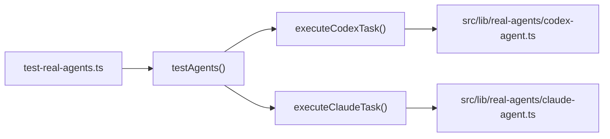

# Root


# Root 模块

## 概述

Root 模块是 **Agent Platform v2** 项目的根目录，包含项目级配置、开发指南、状态跟踪文档和辅助脚本。它定义了项目的技术栈、构建流程、开发规范和工作流自动化规则。

Agent Platform v2 是一个基于 Next.js 14 的控制面，用于编排本地、远程和聊天集成的 AI Agent 执行，支持 ACPX 任务运行、Live Room 协作、飞书/Lark 消息集成和远程 SSH 执行。

## 技术栈

| 层级 | 技术 | 版本 |
|------|------|------|
| 框架 | Next.js | 14.2.35 |
| 前端 | React | 18 |
| ORM | Prisma | 5.22.0 |
| 数据库 | SQLite（开发）/ PostgreSQL（生产） | — |
| 实时通信 | Socket.IO | 4.8.3 |
| 飞书 SDK | @larksuiteoapi/node-sdk | 1.60.0 |
| A2A | @a2a-js/sdk | 0.3.10 |
| 测试 | Playwright | 1.58.2 |
| 样式 | Tailwind CSS | 3.4.1 |
| 语言 | TypeScript | 5.x |

## 项目结构

```
agent-platform-v2/
├── src/
│   ├── app/                  # Next.js App Router 页面和 API 路由
│   ├── components/           # React 组件
│   ├── lib/                  # 核心业务逻辑
│   │   ├── acpx/            # ACPX 运行时（runner, session, interactions）
│   │   ├── real-agents/     # 真实 Agent 执行（claude-agent, codex-agent）
│   │   ├── control-plane/   # 控制平面（GatewayClient, GatewayManager）
│   │   ├── feishu*.ts       # 飞书集成
│   │   ├── live-room*.ts    # Live Room 协作
│   │   └── websocket.ts     # Socket.IO 服务
│   └── types/               # TypeScript 类型定义
├── prisma/
│   ├── schema.prisma        # 数据库模型
│   └── migrations/          # 数据库迁移
├── scripts/                 # 辅助脚本
├── tests/                   # 测试文件
├── docs/                    # 文档
├── plans/                   # 实施计划
├── deploy/                  # 部署配置（systemd）
├── package.json
├── tsconfig.json
├── next.config.mjs
├── tailwind.config.ts
├── postcss.config.mjs
├── playwright.config.ts
└── CLAUDE.md / AGENTS.md    # Agent 开发指南
```

## 核心配置

### `package.json` — 脚本与依赖

项目通过 `package.json` 中的 `scripts` 字段定义所有可执行命令：

**开发命令：**

```bash
npm run dev              # 开发服务器（端口 3010，先执行 prisma generate）
npm run build            # 生产构建
npm start                # 生产服务器
npm run lint             # ESLint 检查
```

**运行时服务：**

```bash
npm run feishu:runtime           # 飞书 WebSocket 独立监听器
npm run scheduled-jobs:runtime   # 定时任务运行器
npm run remote-runner:gateway    # 远程 Runner Gateway
npm run remote-runner:register   # 远程节点注册
```

**数据库：**

```bash
npm run db:migrate:sqlite -- /path/to/dev.db   # SQLite → PostgreSQL 一次性迁移
npm run db:verify:migration -- /path/to/dev.db # 迁移验证
npx prisma migrate dev                        # 应用迁移 + 重新生成客户端
npx prisma generate                           # 重新生成 Prisma Client
```

**测试命令（按模块）：**

```bash
npm run test:acpx-session-tracking
npm run test:live-room-steering
npm run test:feishu-room-timeout
npm run test:workflow-watcher
npm run test:codex-steering
# ... 更多见 package.json
```

**工作流自动化：**

```bash
npm run workflow:new       # 生成 PLAN/HANDOVER 骨架
npm run workflow:validate  # 校验工作流文档
npm run check:long-files   # 长文件守卫检查
```

### `tsconfig.json` — TypeScript 配置

关键配置项：

- `strict: true` — 严格模式
- `moduleResolution: "bundler"` — 使用 bundler 解析策略
- `paths: { "@/*": ["./src/*"] }` — 路径别名，`@/` 映射到 `src/`
- `jsx: "preserve"` — 保留 JSX 由 Next.js 处理

### `next.config.mjs` — Next.js 配置

当前配置极简，仅忽略构建时的 ESLint 检查：

```javascript
const nextConfig = {
  eslint: {
    ignoreDuringBuilds: true,
  },
};
```

### `playwright.config.ts` — E2E 测试配置

- 测试目录：`./tests/e2e`
- 基础 URL：`http://localhost:3000`
- 并行执行，CI 环境重试 2 次
- 报告器：HTML + List
- 失败时自动截图和录制视频
- 支持 Chromium、Firefox、WebKit 三浏览器

### `tailwind.config.ts` — 样式配置

扫描 `src/pages`、`src/components`、`src/app` 下的所有模板文件，扩展了 `background` 和 `foreground` 颜色变量。

## 开发工作流

### 运行时管理

项目使用 **用户级 systemd 服务** 管理运行时，而非 `nohup` 或手动后台进程：

```bash
systemctl --user restart agent-platform-dev.service
systemctl --user restart agent-platform-feishu.service
```

修改 `deploy/systemd-user/*.service` 后需执行：

```bash
systemctl --user daemon-reload
systemctl --user restart agent-platform-dev.service
systemctl --user restart agent-platform-feishu.service
```

### 工作流自动化

项目支持基于 Git 提交文档的 PLAN/HANDOVER 自动化：

- 唯一规则源：`docs/workflow/workflow-contract.yaml`
- 新建文档必须使用 `npm run workflow:new` 生成骨架
- 提交后必须运行 `npm run workflow:validate -- --preflight <文档路径>`
- 自动化只读取目标 Git ref 中已提交的文档
- `automation_enabled: false` 时只维护文档，不启动 watcher

### 长文件守卫

```bash
npm run check:long-files
```

开工前运行此命令确认已达阻断阈值的文件。这些文件不得增长，需要新增职责时先提取明确边界的模块。

### Git 历史规则

当 workflow watcher 已启用后，Git 历史必须只追加：

- 禁止 `git commit --amend`、rebase、reset 或强推
- 对同一文件的后续修正必须创建新 commit
- 发现历史改写时停止自动化，由人工确认

## 测试策略

项目没有统一的自动化测试框架，测试分为三类：

| 类型 | 工具 | 位置 | 说明 |
|------|------|------|------|
| 单元测试 | ts-node | `tests/*.test.ts` | 按模块独立运行，通过 `npm run test:<name>` |
| E2E 测试 | Playwright | `tests/e2e/` | 需要开发服务器运行 |
| 手动测试 | 飞书机器人 / API 调用 | — | 通过飞书 bot 或 curl 验证 |

### 测试脚本示例

`test-real-agents.ts` 是一个独立的集成测试脚本，直接调用 Agent 执行函数：

```typescript
import { executeCodexTask } from './src/lib/real-agents/codex-agent';
import { executeClaudeTask } from './src/lib/real-agents/claude-agent';

async function testAgents() {
  const testTask = {
    id: 'test-1',
    name: 'Test Task',
    description: 'This is a test task to verify agent execution',
  };

  const codexResult = await executeCodexTask(testTask);
  const claudeResult = await executeClaudeTask(testTask);
}
```

调用关系：



## 环境变量

关键环境变量（参考 `.env.example`）：

| 变量 | 用途 |
|------|------|
| `DATABASE_URL` | 数据库连接（SQLite 或 PostgreSQL） |
| `SOCKET_PORT` / `NEXT_PUBLIC_SOCKET_PORT` | Socket.IO 端口（默认 3101） |
| `FEISHU_CONNECTION_MODE` | 飞书连接模式：`long_connection` 或 `webhook` |
| `FEISHU_APP_ID` / `FEISHU_APP_SECRET` | 飞书应用凭证 |
| `FEISHU_VERIFICATION_TOKEN` / `FEISHU_ENCRYPT_KEY` | 飞书安全配置 |
| `ACPX_CODEX_SANDBOX_MODE` | Codex 沙箱模式：`workspace-write` / `read-only` / `danger-full-access` |
| `ANTIGRAVITY_CLI_PATH` | Antigravity CLI 可执行文件路径 |
| `OPENCLAW_ENCRYPTION_KEY` | Gateway Token 加密密钥（32 字符） |
| `LINUX_GATEWAY_*` | 远程 Gateway 冒烟测试目标 |

## 关键文档

| 文件 | 用途 |
|------|------|
| `CLAUDE.md` | Claude Code 开发指南，包含架构概述、命令、行为准则 |
| `AGENTS.md` | Agent 使用规范，GitNexus 使用规则、工作流约定、长文件守卫 |
| `README.md` | 项目入口文档，功能列表、技术栈、设置步骤 |
| `STATUS.md` | 项目状态跟踪，各阶段完成情况和 Bug 修复记录 |
| `PROGRESS.md` | 实施计划，三阶段任务清单和验收标准 |
| `HEARTBEAT.md` | 心跳驱动自主推进机制，记忆结构定义 |
| `REAL_AGENTS_SETUP.md` | 真实 Agent（Codex/Claude）安装和注册指南 |
| `CONTROL_PLANE_STATUS.md` | 控制平面增量集成的实施状态 |
| `FEATURE_3_SUMMARY.md` | Gateway 状态监控面板的完成总结 |

## 与子模块的连接

Root 模块通过以下方式与子模块交互：

1. **`package.json` 脚本** → 调用 `scripts/` 下的工具脚本和 `tests/` 下的测试文件
2. **`tsconfig.json` 路径别名** → 使 `src/` 下所有模块可通过 `@/` 导入
3. **`CLAUDE.md` / `AGENTS.md`** → 为所有 Agent 定义行为边界和开发规范
4. **`playwright.config.ts`** → 配置 `tests/e2e/` 的 E2E 测试运行环境
5. **环境变量** → 被 `src/lib/` 下所有运行时模块消费（飞书、ACPX、控制平面等）

## 部署

生产部署通过 systemd 用户服务管理：

- `agent-platform-dev.service` — 主应用（Next.js + Socket.IO）
- `agent-platform-feishu.service` — 飞书 WebSocket 监听器

两个服务共享同一仓库的本地飞书环境变量回退（`scripts/load-local-env.sh`），启动脚本会将 `DATABASE_URL` 规范化为 `/data1/code/agent-platform-v2/prisma/dev.db`。