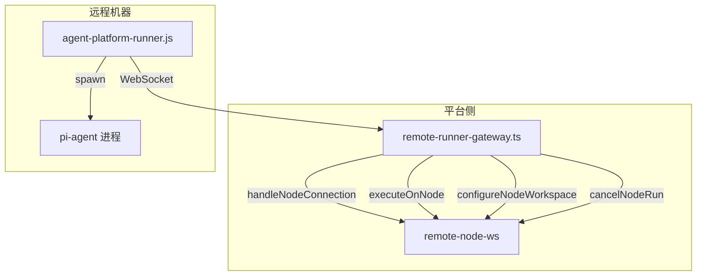
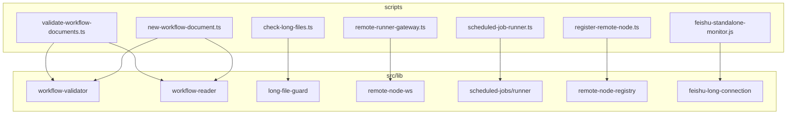

# scripts


# Scripts 模块

`scripts/` 目录包含 Agent Platform v2 项目的所有辅助脚本，涵盖飞书集成、远程节点管理、工作流文档管理、数据库迁移、部署运维、质量检查和项目管理等场景。

---

## 目录结构

| 脚本 | 用途分类 |
|------|----------|
| `feishu-bot-mvp.ts` | 飞书集成 |
| `feishu-standalone-monitor.js` | 飞书集成 |
| `feishu-ws-smoke.js` | 飞书集成 |
| `agent-platform-runner.js` | 远程节点 |
| `remote-runner-gateway.ts` / `.js` | 远程节点 |
| `register-remote-gateway.js` | 远程节点 |
| `register-remote-node.ts` / `.js` | 远程节点 |
| `new-workflow-document.ts` | 工作流管理 |
| `validate-workflow-documents.ts` | 工作流管理 |
| `build-workflow-validator.mjs` | 工作流管理 |
| `migrate-sqlite-to-postgresql.mjs` | 数据库迁移 |
| `verify-postgresql-migration.mjs` | 数据库迁移 |
| `bootstrap-postgresql.sh` | 数据库迁移 |
| `install-systemd-user-services.sh` | 部署运维 |
| `run-agent-platform-dev.sh` | 部署运维 |
| `run-feishu-runtime.sh` | 部署运维 |
| `run-scheduled-job-runner.sh` | 部署运维 |
| `load-local-env.sh` | 部署运维 |
| `check-long-files.ts` | 质量检查 |
| `capture-full.mjs` | 截图 |
| `take-screenshots.mjs` | 截图 |
| `submit-to-miaoda-pm.mjs` | 项目管理 |
| `submit-updates-to-miaoda-pm.mjs` | 项目管理 |
| `set-agent-nickname.ts` | 工具 |
| `list-available-agents.ts` | 工具 |
| `scheduled-job-runner.ts` | 定时任务 |

---

## 飞书集成

### `feishu-bot-mvp.ts`

最简 Agent 通信工具，通过 Feishu 群聊实现 Windows ↔ Linux Agent 之间的实时通信。

**架构：**

```mermaid
graph LR
    A[Feishu 群聊] -->|Event Subscription 回调| B[FeishuBotServer]
    B --> C[MessageHandler]
    C -->|isMentionedToMe| D{是否@自己?}
    D -->|是| E[generateResponse]
    E --> F[FeishuClient.replyMessage]
    F --> A
```

**核心类：**

- **`FeishuClient`** — 封装 Feishu Open API 调用
  - `getTenantAccessToken()` — 获取并缓存 tenant access token（提前 100 秒刷新）
  - `sendTextMessage(chatId, text)` — 发送文本消息到群聊
  - `replyMessage(chatId, messageId, text)` — 带引用回复消息

- **`MessageHandler`** — 消息解析与响应逻辑
  - `parseMessageEvent(body)` — 解析 Feishu 事件，提取消息类型、内容、@提及
  - `isMentionedToMe(mentions)` — 检查是否被@
  - `generateResponse(message)` — 基于关键词匹配生成响应（测试/你好/状态/ping）
  - `handleMessage(event)` — 完整处理流程

- **`FeishuBotServer`** — HTTP 服务器，接收 Feishu 回调
  - 处理 `url_verification` 挑战验证
  - 转发消息事件到 `MessageHandler`

**环境变量：**

| 变量 | 说明 |
|------|------|
| `FEISHU_APP_ID` | 应用 ID |
| `FEISHU_APP_SECRET` | 应用密钥 |
| `FEISHU_VERIFICATION_TOKEN` | 验证 Token |
| `FEISHU_CHAT_ID` | 群聊 ID |
| `AGENT_NAME` | 当前 Agent 名称 |
| `AGENT_ID` | 当前 Agent 的 Feishu user_id |
| `PORT` | 回调监听端口（默认 3001） |

**运行方式：**
```bash
npx ts-node scripts/feishu-bot-mvp.ts
```

---

### `feishu-standalone-monitor.js`

独立运行的飞书长连接运行时，作为 systemd 用户服务部署。

**关键行为：**
- 通过 `ts-node` 注册加载 TypeScript 模块
- 修补 `Module._resolveFilename` 以支持 `@/` 路径别名
- 调用 `startFeishuLongConnectionRuntime()` 启动长连接
- 注册 `SIGTERM`/`SIGINT` 处理器，调用 `shutdownFeishuRuntime()` 优雅关闭
- 处理 `unhandledRejection` 和 `uncaughtException` 防止进程崩溃

**运行方式：**
```bash
node scripts/feishu-standalone-monitor.js
```

---

### `feishu-ws-smoke.js`

飞书 WebSocket 长连接冒烟测试脚本，用于验证 `@larksuiteoapi/node-sdk` 的 `WSClient` 连接是否正常。

**行为：**
1. 从环境变量读取 `FEISHU_APP_ID` 和 `FEISHU_APP_SECRET`
2. 创建 `Lark.EventDispatcher` 并注册多个事件处理器（消息接收、已读、机器人加入/退出、表情反应、卡片交互）
3. 创建 `Lark.WSClient` 并启动
4. 运行指定时长（默认 30 秒，通过 `FEISHU_SMOKE_DURATION_MS` 配置）后自动退出

**运行方式：**
```bash
FEISHU_APP_ID=xxx FEISHU_APP_SECRET=xxx node scripts/feishu-ws-smoke.js
```

---

## 远程节点系统

远程节点系统由三部分组成：**Runner**（运行在远程机器上）、**Gateway**（平台侧 WebSocket 网关）、**注册脚本**（将远程机器注册到平台）。



### `agent-platform-runner.js`

运行在远程机器上的 Agent 执行器，通过 WebSocket 连接到平台 Gateway，接收任务并调用 `pi-agent` 执行。

**核心功能：**

- **WebSocket 连接管理** — 内置完整的 WebSocket 客户端实现（当 `ws` 包不可用时），支持帧编解码、掩码、分片、心跳
- **自动重连** — 指数退避（1s → 2s → 4s → ... → 30s 上限）
- **任务执行** — 接收 `run` 消息，调用 `spawnPi()` 启动 `pi-agent` 子进程
- **输出流式回传** — 实时将 stdout/stderr 通过 WebSocket 发回平台
- **工作区安全** — `safeCwd()` 确保工作目录在配置的 workspace 内
- **配置持久化** — 保存到 `~/.agent-platform/runner.json`

**关键函数：**

| 函数 | 说明 |
|------|------|
| `connect()` | 建立 WebSocket 连接，注册消息处理器 |
| `run(ws, message)` | 执行单个任务，管理子进程生命周期 |
| `spawnPi(piArgs, cwd)` | 跨平台启动 pi-agent（Windows 使用 PowerShell 编码命令） |
| `safeCwd(value)` | 验证工作目录在 workspace 范围内 |
| `assistantText(line)` | 从 JSON 行中提取 assistant 文本内容 |
| `sessionDirFor(taskId)` | 生成会话目录路径 |

**命令行参数：**

| 参数 | 说明 |
|------|------|
| `--server` | 平台 WebSocket 地址 |
| `--node` | 节点名称 |
| `--token` | 节点认证 Token |
| `--workspace` | 工作目录 |
| `--pi` | pi-agent 可执行文件路径 |
| `--pairing-token` | 配对 Token（首次注册用） |

**环境变量：**
- `REMOTE_PI_AGENT_BIN` — pi-agent 二进制路径
- `REMOTE_PI_AGENT_TOOLS` — 可用工具列表（默认 `read,bash,edit,write,grep,find,ls`）

**运行方式：**
```bash
node scripts/agent-platform-runner.js --server ws://host:3012/runner --node my-node --token <secret>
```

---

### `remote-runner-gateway.ts`

平台侧的 HTTP + WebSocket 网关服务，作为远程 Runner 的接入点。

**HTTP 端点：**

| 方法 | 路径 | 说明 |
|------|------|------|
| GET | `/health` | 健康检查 |
| POST | `/workspace` | 配置节点工作区（仅限本地访问） |
| POST | `/run` | 在远程节点上执行任务，返回 NDJSON 流 |

**WebSocket 端点：**
- 路径：`/runner`
- 调用 `handleNodeConnection(ws, req)` 处理节点连接

**`/run` 端点行为：**
1. 验证请求参数（`nodeName`, `runId`, `taskId`, `cwd`, `prompt`）
2. 调用 `executeOnNode()` 执行任务
3. 以 NDJSON 格式流式返回 `stdout`/`stderr`/`complete` 事件
4. 客户端断开时调用 `cancelNodeRun()` 取消任务

**环境变量：**
- `REMOTE_RUNNER_GATEWAY_HOST` — 监听地址（默认 `127.0.0.1`）
- `REMOTE_RUNNER_GATEWAY_PORT` — 监听端口（默认 `3012`）

---

### `register-remote-gateway.js`

在远程 OpenClaw 实例上运行的网关注册脚本，向 Agent Platform 注册网关信息并维持心跳。

**命令：**

| 命令 | 说明 |
|------|------|
| `register` | 注册网关 |
| `heartbeat` | 发送一次心跳 |
| `unregister` | 注销网关 |
| `daemon`（默认） | 注册后持续发送心跳 |

**关键函数：**
- `getGatewayInfo()` — 收集网关信息（IP、端口、Agent 列表、系统资源）
- `normalizeAgent(agent, index)` — 标准化 Agent 信息，支持多种 ID 字段回退
- `parseRuntimeAgentsOverride(fs)` — 从 `RUNTIME_AGENTS_JSON` 或 `RUNTIME_AGENTS_FILE` 读取 Agent 覆盖配置
- `getLocalIP()` — 获取本机非回环 IPv4 地址

**环境变量：**

| 变量 | 说明 |
|------|------|
| `PLATFORM_URL` | 平台地址（默认 `http://localhost:3000`） |
| `GATEWAY_ID` | 网关 ID |
| `GATEWAY_NAME` | 网关名称 |
| `GATEWAY_PORT` | 网关端口 |
| `GATEWAY_TOKEN` | 认证 Token |
| `HEARTBEAT_INTERVAL` | 心跳间隔（默认 30000ms） |
| `GATEWAY_IP` | 优先使用的 IP |
| `RUNTIME_AGENTS_JSON` | Agent 列表 JSON |
| `RUNTIME_AGENTS_FILE` | Agent 列表文件路径 |

---

### `register-remote-node.ts`

将远程节点注册到平台的轻量脚本。

**用法：**
```bash
npm run remote-runner:register -- --node <name> --token <secret>
```

调用 `provisionNode(nodeName, token)` 完成注册。

---

## 工作流文档管理

工作流系统基于 `workflow-contract.yaml` 定义的规则，管理 PLAN 和 HANDOVER 文档的创建与校验。

### `new-workflow-document.ts`

创建新的 PLAN 或 HANDOVER 工作流文档。

**用法：**
```bash
# 创建 Phase PLAN
npm run workflow:new -- --kind plan --title "主题" [--plan-kind phase|interrupt]

# 创建 Interrupt PLAN
npm run workflow:new -- --kind plan --title "修复主题" --plan-kind interrupt \
  --parent-plan docs/xxx_PLAN.md --parent-slice S01 --return-to S02

# 创建 HANDOVER
npm run workflow:new -- --kind handover --plan docs/xxx_PLAN.md --slice S01
```

**核心流程：**
1. 解析命令行参数
2. 读取 `workflow-contract.yaml` 获取规则
3. 计算下一个文档编号（`nextNumber()`）
4. 从模板中提取对应区块（`templateBlock()`）
5. 填充占位符生成文档内容
6. 调用 `validateWorkflowDocuments()` 校验
7. 写入文件（校验失败时保留 `.tmp` 文件）

**关键函数：**

| 函数 | 说明 |
|------|------|
| `createWorkflowDocument(cwd, args)` | 主入口，导出供测试使用 |
| `nextNumber(cwd, directory, pattern, width)` | 扫描工作目录和 Git 跟踪文件，计算下一个编号 |
| `templateBlock(source, heading)` | 从模板 Markdown 中提取指定标题下的代码块 |
| `workflowSlices(content, pattern)` | 从 PLAN 内容中提取所有 Slice 编号 |
| `cleanTitle(value)` | 清理标题，确保文件名安全 |

**依赖：**
- `src/lib/scheduled-jobs/workflow-validator` — 提供 `GitRefReader`、`WorkingTreeReader`、`readWorkflowContract`、`validateWorkflowDocuments`

---

### `validate-workflow-documents.ts`

工作流文档校验器，支持多种运行模式。

**模式：**

| 模式 | 触发方式 | 说明 |
|------|----------|------|
| 标准模式 | `npm run workflow:validate -- <ref> <file>...` | 校验指定 Git ref 下的文档 |
| 预检模式 | `--preflight <file> [--json]` | 校验工作区中的单个文件 |
| Hook 批量模式 | `--hook-batch <batch-file>` | Git 提交钩子批量校验 |

**Hook 批量模式行为：**
- 读取制表符分隔的批次文件（`contractRef\tref\tcontractPath\tfilePath`）
- 按 `(contractRef, ref, contractPath)` 分组
- 文档校验失败 → 输出 `WORKFLOW_DOCUMENT_VALIDATION_FAILED` 标记，退出码 1（阻止提交）
- 运行时错误 → 输出警告，退出码 2（不阻止提交）

**导出：**
- `DOCUMENT_VALIDATION_FAILED_MARKER` — 常量 `'WORKFLOW_DOCUMENT_VALIDATION_FAILED'`，Git 钩子通过此标记判断是否拒绝提交

---

### `build-workflow-validator.mjs`

将工作流校验器打包为单文件 CommonJS bundle，输出到 `src/lib/scheduled-jobs/generated/workflow-validator.cjs`。

**流程：**
1. 使用 TypeScript `transpileModule` 将源文件编译为 JS
2. 静态分析 `require()` 调用，递归收集依赖模块
3. 生成自包含的 bundle（内置 `__bundleRequire` 模块加载器）
4. 写入目标路径

**源文件：**
- `src/lib/scheduled-jobs/workflow-reader.ts`
- `src/lib/scheduled-jobs/workflow-validator.ts`
- `scripts/validate-workflow-documents.ts`

---

## 数据库迁移

### `migrate-sqlite-to-postgresql.mjs`

将 SQLite 数据库迁移到 PostgreSQL。

**流程：**
1. 验证源文件存在且目标为 PostgreSQL
2. 检查目标 schema 包含所有源表
3. 检查目标表为空
4. 按外键依赖顺序导入（`importOrder()`）
5. 分批插入（每批 250 行）
6. 恢复延迟列（自引用外键）

**延迟列处理：**

以下列因自引用外键需要延迟填充：
- `Task.currentTaskSessionId`
- `LiveRoom.currentSpeakerMemberId`
- `LiveRoomMessage.replyToMessageId`

**运行方式：**
```bash
DATABASE_URL=postgresql://... node scripts/migrate-sqlite-to-postgresql.mjs [path/to/dev.db]
```

---

### `verify-postgresql-migration.mjs`

验证迁移结果的正确性。

**检查项：**
- 每张表的行数匹配
- 每张表的 SHA-256 行哈希匹配
- 所有外键无孤儿行

**运行方式：**
```bash
DATABASE_URL=postgresql://... node scripts/verify-postgresql-migration.mjs [path/to/dev.db]
```

---

### `bootstrap-postgresql.sh`

PostgreSQL 初始化脚本，标记已有迁移为已应用并执行 `prisma migrate deploy`。

```bash
DATABASE_URL=postgresql://... bash scripts/bootstrap-postgresql.sh
```

---

## 部署运维

### `load-local-env.sh`

环境变量加载工具库，提供以下函数：

| 函数 | 说明 |
|------|------|
| `load_dotenv_file <file>` | 解析并导出 `.env` 文件中的变量 |
| `load_local_env_fallbacks` | 依次尝试加载 `.env.feishu.local` 和 `.env.runtime.local` |
| `normalize_database_url` | 验证 `DATABASE_URL` 使用 PostgreSQL 协议 |

---

### `install-systemd-user-services.sh`

安装并启动所有 systemd 用户服务：

- `agent-platform-dev.service` — 开发服务器
- `agent-platform-feishu.service` — 飞书运行时
- `agent-platform-remote-runner-gateway.service` — 远程 Runner 网关
- `agent-platform-scheduled-jobs.service` — 定时任务运行器

---

### 服务启动脚本

| 脚本 | 启动的服务 |
|------|-----------|
| `run-agent-platform-dev.sh` | `npm run dev` |
| `run-feishu-runtime.sh` | `npm run feishu:runtime` |
| `run-scheduled-job-runner.sh` | `npm run scheduled-jobs:runtime` |

所有脚本共享相同的模式：
1. `cd` 到项目根目录
2. 加载本地环境变量
3. 验证 `DATABASE_URL`
4. 设置 `PATH`
5. `exec` 启动对应命令

---

## 质量检查

### `check-long-files.ts`

检查项目中是否存在超过阈值行数的文件。

**调用链：**
```
main() → captureLongFileBaseline(cwd) → longFileNotice(baseline)
```

**运行方式：**
```bash
npx ts-node scripts/check-long-files.ts
```

---

## 截图工具

### `capture-full.mjs` 和 `take-screenshots.mjs`

使用 Playwright 对平台各页面进行截图，输出到 `docs/screenshots/`。

**覆盖页面：**
- Dashboard（`/`）
- Workspaces（`/workspaces`）
- Chat（`/chat`）
- Gateway Tools（`/gateway-tools`）
- Rooms（`/rooms`）
- Workflow（`/workflow`）
- Tasks（`/tasks`）

**认证方式：** 从 `.env` 读取 `AUTH_ADMIN_USERNAME` 和 `AUTH_ADMIN_PASSWORD`，通过 UI 登录。

**`take-screenshots.mjs` 额外功能：** 生成 16:9 比例的封面图（`platform_cover_*.png`）。

---

## 项目管理

### `submit-to-miaoda-pm.mjs`

向飞书秒搭 PM 平台提交项目展示记录。

**行为：**
1. 检查 `FEISHU_DOC_URL` 是否有效
2. 若无效，自动通过 `importMarkdownAsFeishuDocument()` 从 `docs/AGENT_PLATFORM_V2_SHOWCASE.md` 创建飞书云文档
3. 构建项目展示 payload
4. 检查是否已存在同名记录（存在则 PATCH，否则 POST）

### `submit-updates-to-miaoda-pm.mjs`

向飞书秒搭 PM 平台同步项目进展记录（5 个阶段：25% → 55% → 75% → 90% → 100%）。

---

## 工具脚本

### `set-agent-nickname.ts`

列出所有 Agent 并展示设置昵称的方法（API 和 Prisma Studio）。

### `list-available-agents.ts`

调用 `listLiveRoomCatalogAgents()` 列出可用的 Agent ID 和标签。

### `scheduled-job-runner.ts`

定时任务运行器入口，调用 `startScheduledJobRunner(prisma, signal)`，支持 `SIGINT`/`SIGTERM` 优雅关闭。

---

## 与核心代码的依赖关系



---

## 注意事项

1. **Windows 兼容性** — `agent-platform-runner.js` 中的 `spawnPi()` 在 Windows 上使用 PowerShell 编码命令（Base64 UTF-16LE）来避免参数转义问题，prompt 通过临时文件传递
2. **WebSocket 回退** — `agent-platform-runner.js` 内置了完整的 WebSocket 客户端实现，当 `ws` 包不可用时自动启用
3. **工作区安全** — 远程 Runner 严格限制工作目录在配置的 workspace 内，防止路径穿越
4. **Git 钩子集成** — `validate-workflow-documents.ts` 的 `--hook-batch` 模式专为 Git 提交钩子设计，区分文档校验失败（阻止提交）和运行时错误（允许提交）
5. **systemd 部署** — 生产环境通过 systemd 用户服务管理各进程，`install-systemd-user-services.sh` 一键安装