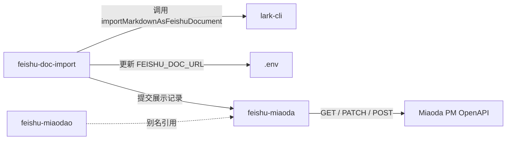

# skills


# Skills 模块

`skills/` 目录是 Agent Platform v2 的**技能定义层**，为各类 AI Agent（Codex、Claude Code、Antigravity、Pi Agent、Deepseek 等）提供标准化的操作指南。每个子目录包含一个 `SKILL.md` 文件，定义特定场景下的行为规范、工作流和 API 调用约定。

## 技能清单

| 技能名称 | 目录 | 用途 |
|---|---|---|
| `feishu-doc-import` | `skills/feishu-doc-import/` | 本地 Markdown → 飞书云文档导入 + 展示记录同步 |
| `feishu-miaoda` | `skills/feishu-miaoda/` | 飞书秒搭 PM 集成的标准操作指南（主文档） |
| `feishu-miaodao` | `skills/feishu-miaodao/` | `feishu-miaoda` 的别名入口 |
| `karpathy-codex` | `skills/karpathy-codex/` | Karpathy 风格编码规范（高严谨度、最小 diff） |

## 技能间关系



`feishu-doc-import` 是**执行层**技能，负责具体的文档导入和 URL 生成；`feishu-miaoda` 是**规范层**技能，定义所有 Agent 与 Miaoda PM 交互的标准流程。`feishu-miaodao` 仅作为别名存在，内容指向 `feishu-miaoda`。

---

## feishu-doc-import

### 适用场景

当本地 Markdown 文档需要自动转换为飞书云文档（Feishu Cloud Doc）时使用。典型触发条件：

- 飞书文档链接返回 404 或空白
- 链接中包含占位符 token（如 `doxcnAgentPlatformV2Showcase2026`）
- 需要将 `docs/AGENT_PLATFORM_V2_SHOWCASE.md` 发布为在线文档

### 核心 API

```typescript
import { importMarkdownAsFeishuDocument } from '../src/lib/feishu-document-import';

const docUrl = await importMarkdownAsFeishuDocument({
  content: markdownString,
  name: '文档标题',
});
// 返回: "https://*.feishu.cn/docx/..."
```

### 内部机制

`importMarkdownAsFeishuDocument` 的执行流程：

1. 创建临时目录，写入 `plan.md`（去除 frontmatter 和顶层 `#` 标题，确保渲染干净）
2. 调用 `lark-cli`：

```bash
lark-cli docs +create --as bot --api-version v2 \
  --title "<Title>" \
  --doc-format markdown \
  --content @plan.md \
  --format json
```

3. 从 JSON 响应中提取文档 URL 并返回

### 自动化脚本

`scripts/submit-to-miaoda-pm.mjs` 封装了完整的导入 + 同步流程：

```bash
node scripts/submit-to-miaoda-pm.mjs
# 或指定已有文档 URL：
node scripts/submit-to-miaoda-pm.mjs --doc-url=https://feishu.cn/docx/<token>
```

脚本行为：

| 步骤 | 行为 |
|---|---|
| 占位符检测 | 检查 `FEISHU_DOC_URL` 是否为空或包含 `doxcnAgentPlatformV2Showcase2026` |
| 自动导入 | 若无效，调用 `importMarkdownAsFeishuDocument` 创建新文档 |
| 环境持久化 | 将新 URL 写回 `.env` 的 `FEISHU_DOC_URL` 字段 |
| 展示记录 Upsert | 查询 Miaoda PM 中名为 `'Agent Platform v2'` 的记录，存在则 `PATCH`，不存在则 `POST` |

---

## feishu-miaoda

### 定位

所有 AI Agent 与飞书秒搭（Miaoda PM）低代码平台交互的**标准操作规范**。定义了环境变量要求、工作流步骤、数据库 Schema 和故障排查方法。

### 必需环境变量

| 变量名 | 说明 |
|---|---|
| `FEISHU_MIAODA_PM_API_KEY` | Miaoda PM OpenAPI 的 Bearer Token |
| `FEISHU_MIAODA_PM_NEW_API_URL` | Miaoda PM 数据库 API 端点 URL |
| `FEISHU_DOC_URL` | 飞书云文档在线 URL，同步到记录的 `docUrls` 字段 |

### 标准工作流（4 步）

1. **更新本地展示文档** — 确保 `docs/AGENT_PLATFORM_V2_SHOWCASE.md` 内容准确
2. **执行同步脚本** — `node scripts/submit-to-miaoda-pm.mjs`
3. **脚本自动处理** — 文档验证 → 自动创建 → `.env` 持久化 → Miaoda PM Upsert
4. **验证响应** — 确认输出包含 `HTTP Status: 200/201` 和 `Record ID`

### Miaoda PM 数据库 Schema

```json
{
  "name": "Agent Platform v2",
  "description": "面向企业级复杂研发场景的高能 AI Agent 协作平台...",
  "resultDescription": "1. 👥 多 Agent Live Room\n2. ⚡️ 飞书卡片 50ms Fast-Ack\n...",
  "categoryId": "3d2ce773-9f06-49b7-b9b9-04217e09cd3e",
  "categoryName": "内部工具",
  "tags": ["工程", "测试"],
  "gitUrl": "file:///data1/code/agent-platform-v2",
  "projectUrl": "",
  "docUrls": [
    { "name": "说明文档", "url": "https://feishu.cn/docx/..." }
  ],
  "isShowcase": true,
  "status": "completed",
  "priority": "P2"
}
```

### 故障排查

| 症状 | 原因 | 解决方案 |
|---|---|---|
| `❌ 缺少环境变量 FEISHU_MIAODA_PM_NEW_API_URL 或 FEISHU_MIAODA_PM_API_KEY` | `.env` 未配置 | 检查并填充对应变量 |
| `lark-cli` 执行失败 | CLI 未安装或认证过期 | 检查 `lark-cli` 状态，或手动传入 `--doc-url=<valid_url>` |
| HTTP 401 / 403 | Token 过期 | 更新 `FEISHU_MIAODA_PM_API_KEY` |

---

## feishu-miaodao

`feishu-miaodao` 是 `feishu-miaoda` 的**别名技能**，其 `SKILL.md` 仅包含对主文档的引用：

> 请参阅主技能文档 `skills/feishu-miaoda/SKILL.md`。

存在目的：兼容不同 Agent 框架对技能名称的拼写差异（"miaoda" vs "miaodao"）。

---

## karpathy-codex

### 适用场景

当用户要求更高的工程严谨度和更低的 diff 噪音时启用。适用于非平凡的工程任务。

### 核心规则

| 规则 | 要点 |
|---|---|
| **先思考再编码** | 明确假设；多义请求时主动澄清而非静默选择 |
| **简洁优先** | 用最少的组件解决问题；不添加未被要求的抽象或扩展性 |
| **外科手术式修改** | 只触碰与任务直接相关的文件和行；不重构相邻代码 |
| **目标驱动执行** | 将模糊需求转化为具体检查项；完成前用最低成本验证 |

### 反模式

- 静默假设跳跃
- 以修复为名的重构
- 用户未要求的"未来兼容性"设计
- 冗长解释（短答案 + 验证步骤即可）

---

## 技能注册位置

所有技能在以下位置注册，确保各 Agent 框架均可发现：

- `AGENTS.md`
- `CLAUDE.md`
- `skills/<name>/SKILL.md`
- `.claude/skills/<name>/SKILL.md`

## 与代码库的集成点

| 集成点 | 路径 | 说明 |
|---|---|---|
| 文档导入模块 | `src/lib/feishu-document-import.ts` | 提供 `importMarkdownAsFeishuDocument` 函数 |
| 同步脚本 | `scripts/submit-to-miaoda-pm.mjs` | 自动化导入 + Miaoda PM 同步 |
| 展示文档 | `docs/AGENT_PLATFORM_V2_SHOWCASE.md` | 被导入为飞书云文档的源文件 |
| 环境配置 | `.env` | 存储 `FEISHU_DOC_URL`、`FEISHU_MIAODA_PM_API_KEY` 等 |