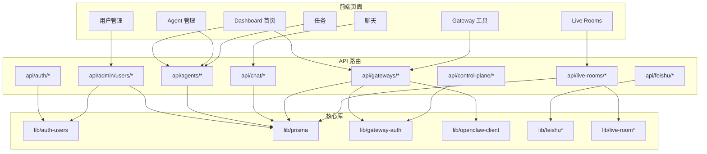

# src — app


# src/app — 应用层

## 概述

`src/app` 是 Next.js App Router 的根目录，承载了平台的所有前端页面和 API 路由。它分为两大块：

- **页面组件**（`page.tsx`）：客户端组件，负责 UI 渲染和状态管理
- **API 路由**（`api/*/route.ts`）：服务端处理函数，负责业务逻辑、数据持久化和外部服务调用

---

## 架构总览



---

## 页面组件

### Dashboard（`src/app/page.tsx`）

平台首页，展示 Gateway 状态、Agent 列表和远程 Runner 面板。

- 调用 `fetchDashboardData` 获取聚合数据
- 集成 `RegisterGatewayModal`、`CreateAgentModal`、`RemoteRunnersPanel` 等组件

### Agent 管理（`src/app/agents/page.tsx`）

Agent 身份配置页面，支持为每个 Agent 设置：

| 字段 | 说明 |
|------|------|
| `userNickname` | 用户自定义昵称，用于 @mention |
| `roleDescription` | 角色描述 |
| `emojiIcon` | 图标（从预设列表选择） |
| `colorTag` | 颜色标签（从预设色板选择） |

**关键行为：**

- Agent 按 Gateway 分组展示（Platform Local 按 hostname 分组）
- 编辑时调用 `PATCH /api/agents/[id]`
- 保存后自动更新 `displayName` 和 `shortAlias`
- 状态徽章支持 `online` / `offline` / `busy` / `error` 四种状态

**组件结构：**

```
AgentsPage
├── AgentCard（每个 Agent 的卡片容器）
│   ├── ViewMode（只读展示）
│   └── EditMode（编辑表单）
└── StatusBadge（状态标签）
```

### 用户管理（`src/app/admin/users/page.tsx`）

管理员专属页面，功能包括：

- **创建用户**：用户名（3-64 位字母/数字/`._-`）、显示名（可选）、初始密码（≥8 位）
- **重置密码**：通过 `window.prompt` 输入新密码
- **删除用户**：确认后删除，资源保留为无主资源

所有操作需要管理员权限，通过 `requireAdmin` 中间件保护。

### 其他页面

| 路径 | 说明 |
|------|------|
| `chat/page.tsx` | 聊天界面，支持房间列表和消息收发 |
| `tasks/page.tsx` | 任务管理，集成 ACPX harness 选项 |
| `rooms/page.tsx` | Live Room 列表 |
| `workspaces/page.tsx` | 工作区管理 |
| `gateway-tools/page.tsx` | Gateway 工具（注册、测试、配置） |
| `remote-ssh-tools/page.tsx` | 远程 SSH 主机管理 |
| `login/page.tsx` | 登录页面 |

---

## API 路由

### 认证（`api/auth/*`）

| 路由 | 方法 | 说明 |
|------|------|------|
| `/api/auth/login` | POST | 用户名+密码登录，设置 `httpOnly` Cookie |
| `/api/auth/logout` | POST | 清除会话 Cookie |
| `/api/auth/me` | GET | 获取当前登录用户信息 |

**登录流程：**

```
POST /api/auth/login
  → authenticateUser(username, password)
  → createSessionForUser(user)
  → 设置 AUTH_COOKIE（httpOnly, sameSite=lax, maxAge=86400）
```

生产环境下 Cookie 带 `secure` 标志。

### 管理员用户管理（`api/admin/users/*`）

| 路由 | 方法 | 说明 |
|------|------|------|
| `/api/admin/users` | GET | 列出所有用户 |
| `/api/admin/users` | POST | 创建新用户 |
| `/api/admin/users/[id]` | DELETE | 删除用户（不能删除自己） |
| `/api/admin/users/[id]/reset-password` | POST | 重置密码 |

**认证链：** 所有路由经过 `requireAdmin` → `requireCurrentUser` → `verifySessionToken` → `verifyOperatorSession` → `keyedDigest`（恒定时间比较）。

**创建用户验证规则：**
- 用户名：`/^[a-zA-Z0-9._-]{3,64}$/`
- 密码：至少 8 位
- 显示名：最多 100 字符
- 用户名重复返回 `409`

### Agent 管理（`api/agents/*`）

#### `GET /api/agents`

获取所有 Agent 列表，是平台最核心的数据聚合端点。

**执行流程：**

1. 调用 `ensurePlatformLocalAgents()` 确保平台内置 Agent 存在于数据库
2. 从数据库查询所有 Agent（含 Gateway 关联）
3. 按 `backend:type` 统计数量（用于生成去重显示名）
4. 为每个 Agent 计算：
   - `displayName`：用户昵称 > 自动生成名
   - `rawName`：格式如 `"Platform Local - Claude"` 或 `"Linux Gateway - Claude"`
   - `shortAlias`：基于昵称生成的简短别名
   - `colorTag` / `emojiIcon`：用户设置 > 默认值
   - `status`：通过 `computeEffectiveAgentStatus` 计算有效状态（远程 Agent 考虑心跳新鲜度，90 秒阈值）
   - `capabilities`：解析 JSON 字符串，解析失败返回空数组

**响应契约（Dashboard AgentCard 等消费方依赖）：**

```typescript
{
  id: string;
  agentKey: string;           // "gatewayId:type" 或 "platform_local:type"
  originalName: string;       // 数据库中的原始名称
  rawName: string;            // 完整来源名称
  displayName: string;        // 显示名
  name: string;               // 与 displayName 同值（向后兼容）
  userNickname: string | null;
  shortAlias: string | null;
  roleDescription: string | null;
  colorTag: string;
  emojiIcon: string;
  hostname: string | null;
  status: string;             // 有效状态
  storedStatus: string;       // 数据库原始状态
  type: string;
  runtimeAgentId: string | null;
  gateway: { id, name } | null;
  location: string | null;
  backend: string;            // "platform_local" | "gateway_openclaw" | "unknown"
  isPlatformLocal: boolean;
  capabilities: string[];
  lastHeartbeat: string;      // ISO 时间
  createdAt: string;
  updatedAt: string;
}
```

#### `PATCH /api/agents/[id]`

更新 Agent 身份信息。如果设置了 `userNickname`，会自动调用 `generateShortAlias` 生成简短别名。

#### `GET/POST /api/agents/register-real`

管理真实 Agent（antigravity、codex、claude、deepseek、gemini-cli、pi-agent、kimi-code 等）的注册和状态检查。

### 聊天（`api/chat/*`）

| 路由 | 方法 | 说明 |
|------|------|------|
| `/api/chat/rooms` | GET | 获取房间列表（自动确保默认房间存在） |
| `/api/chat/messages` | GET | 获取消息（支持分页：`limit`、`before`） |
| `/api/chat/messages` | POST | 发送消息 |
| `/api/chat/agent-response` | POST | 生成 Agent 响应并通过 WebSocket 广播 |

**消息访问控制（`canAccessRoom`）：**
- 管理员可访问所有房间
- 普通用户只能访问自己任务关联的房间（通过 `room.description` 中的 `TASK_ROOM:<id>` 标记匹配）

**消息目标类型（`targetType`）：**
- `task`：面向整个任务
- `participant`：面向特定参与者（需 `targetParticipantKey` + `targetParticipantLabel`）
- `all`：面向所有人

### Gateway 管理（`api/gateways/*`）

这是最复杂的 API 组，涵盖 Gateway 的完整生命周期。

#### 基础 CRUD

| 路由 | 方法 | 说明 |
|------|------|------|
| `/api/gateways` | GET | 列出所有 Gateway（含 Agent 列表） |
| `/api/gateways` | POST | 创建 Gateway（token 加密存储） |

#### 注册与心跳

`POST /api/gateways/register` 支持三种 action：

| action | 说明 |
|--------|------|
| `register` | 首次注册，upsert Gateway + Agent |
| `heartbeat` | 心跳续期，更新状态和 Agent 信息 |
| `unregister` | 下线，标记 Gateway 和 Agent 为 offline |

**认证要求：** 请求必须携带有效 Token，且 Token 对应的 `gatewayId` 必须与请求体中的 `gatewayId` 一致。

**Agent 注册时的 `runtimeAgentId` 解析优先级：**
`runtimeAgentId` → `openclawAgentId` → `acpAgentId` → `agentId` → `id`

#### 健康检查

`GET /api/gateways/[id]/health`：

1. 从数据库获取 Gateway 信息
2. 向 Gateway 的 `/health` 端点发送请求（5 秒超时）
3. 根据结果更新 `controlPlaneState`：
   - 成功 → `status: 'online'`，计算 `loadScore`
   - HTTP 错误 → `status: 'unhealthy'`，`consecutiveFails +1`
   - 网络错误 → `status: 'offline'`，`consecutiveFails +1`

**负载分数计算：** `cpu * 0.4 + memory * 0.4 + disk * 0.2`，上限 100。

#### 连接测试

`POST /api/gateways/[id]/test`：

- 需要 Token 认证
- 依次尝试 `/health`、`/healthz`、`/api/health` 三个路径
- 如果数据库中有加密 token，解密后作为 Bearer 发送
- 成功时更新 Gateway 状态为 `online`

#### Token 管理

| 路由 | 方法 | 说明 |
|------|------|------|
| `/api/gateways/token` | POST | 生成/刷新 Token（32 字节随机 hex） |
| `/api/gateways/token` | GET | 验证 Token 有效性 |
| `/api/gateways/token` | DELETE | 撤销 Token |

#### OpenClaw 配置

| 路由 | 方法 | 说明 |
|------|------|------|
| `/api/gateways/[id]/openclaw/config` | GET | 获取配置（不返回 token 明文） |
| `/api/gateways/[id]/openclaw/config` | POST | 设置 OpenClaw Token（加密存储） |
| `/api/gateways/[id]/openclaw/config` | DELETE | 清除 OpenClaw Token |
| `/api/gateways/[id]/openclaw/respond` | POST | 调用 OpenClaw 响应 API |

#### 跨 Gateway 聊天

`POST /api/gateways/chat` 实现两个 Gateway 之间的 Agent 对话：

```
用户 prompt
  → Gateway A Agent 回复
  → 构建 relay prompt（包含原始问题 + A 的回复）
  → Gateway B Agent 回复
  → （可选，turns=2）构建 return prompt
  → Gateway A Agent 再次回复
```

支持会话持久化（`crossGatewayChatSession` + `crossGatewayChatMessage`），可通过 `sessionId` 继续历史会话。

#### Gateway 间消息

| 路由 | 方法 | 说明 |
|------|------|------|
| `/api/gateways/messages/send` | POST | 发送消息（支持 `direct` 和 `broadcast`） |
| `/api/gateways/messages/send` | GET | 获取消息历史 |
| `/api/gateways/messages/incoming` | POST | 接收来自其他 Gateway 的消息 |
| `/api/gateways/messages/incoming` | GET | 获取接收消息历史 |

所有消息路由都需要 Gateway Token 认证。

#### Agent 刷新

`POST /api/gateways/[id]/agents/refresh`：调用 `syncGatewayAgents` 从远端 Gateway 同步 Agent 列表。

### 飞书集成（`api/feishu/*`）

#### Webhook（`POST /api/feishu/webhook`）

飞书消息入口，处理流程：

```
接收请求
  → 验证签名（validateFeishuRequestSignature）
  → 验证 token（validateFeishuVerificationToken）
  → 处理 challenge（URL 验证）
  → 解析消息（parseFeishuMessage）
  → 过滤：非 @bot 消息 / 自身消息 / 未授权用户
  → 解析命令（parseFeishuCommand）
  → 分支：
    ├─ 是命令 → handleFeishuCommand → 回复
    └─ 非命令 → tryRelayNonCommandToLiveRoom
         ├─ 成功 → 可能发送 session watermark 警告
         └─ 失败 → 发送未绑定提示
```

**关键设计：**
- 使用 `noStore()` 禁用缓存
- 处理过程中添加/移除 typing reaction
- 错误时尝试向飞书发送错误回复

#### 授权（`GET /api/feishu/grant`）

处理飞书授权卡片的回调：

1. 验证 `token` 参数（`verifyGrantActionToken`）
2. 调用 `grantRightsForRoom` 授予权限
3. 返回 HTML 页面展示授权结果

#### 连接状态（`GET /api/feishu/connection`）

检查飞书长连接运行时状态，返回 `200`（运行中）或 `503`（未运行）。

### Live Room（`api/live-rooms/*`）

| 路由 | 方法 | 说明 |
|------|------|------|
| `/api/live-rooms/[id]/members` | POST | 添加成员（Agent） |
| `/api/live-rooms/[id]/members` | GET | 获取成员列表 |
| `/api/live-rooms/[id]/members/[memberId]` | PATCH | 更新成员（昵称、角色、权限、Codex 设置） |
| `/api/live-rooms/[id]/members/[memberId]` | DELETE | 移除成员 |
| `/api/live-rooms/[id]/interrupt` | POST | 中断成员回复 |
| `/api/live-rooms/[id]/clear-task-room` | POST | 清空关联 Task Room 的历史消息 |

**添加成员时的去重逻辑：** 基于 `runtimeAgentId` + `backend` + `gatewayId`（remote_ssh 用 `roleLabel` 中的 hostId）判断是否重复。

**成员权限配置（`permissionProfile`）：**
- `safe_local`：安全本地
- `dev_local`：开发本地（默认）
- `full_access`：完全权限

### 控制平面（`api/control-plane/execute`）

通过 `GatewayManager` 单例执行控制命令：

| command | 说明 |
|---------|------|
| `assign` | 分配任务到 Gateway |
| `broadcast` | 广播任务到所有 Gateway |
| `select` | 根据条件选择最佳 Gateway |
| `status` | 获取所有 Gateway 状态 |

### 其他

| 路由 | 说明 |
|------|------|
| `GET /api/health` | 平台健康检查 |
| `GET /api/acpx/harness-options` | 获取 ACPX harness 选项（需登录） |

---

## 关键设计模式

### 认证分层

```
requireAdmin(request)
  └─ requireCurrentUser(request)
       └─ verifySessionToken(request)
            └─ verifyOperatorSession(token)
                 └─ keyedDigest / safeEqual（恒定时间比较）
```

- **用户认证**：基于 Cookie 中的 session token
- **Gateway 认证**：基于 `Authorization: Bearer <token>` 或 `X-Gateway-Token` 头
- 两种认证体系独立，互不干扰

### 数据加密

Gateway Token 和 OpenClaw Token 在数据库中加密存储（`encryptToken`），仅在需要时解密使用。API 响应中只返回 `hasToken: boolean`，不暴露明文。

### 状态计算

Agent 的 `status` 字段区分了：
- `storedStatus`：数据库中的原始值
- `status`：通过 `computeEffectiveAgentStatus` 计算的有效值

对于远程 Gateway Agent，如果心跳超过 90 秒，即使 `storedStatus` 为 `online`，有效状态也会降级。

### 响应格式约定

- 成功：`{ success: true, ...data }` 或直接返回数据
- 错误：`{ error: '描述' }` + 对应 HTTP 状态码
- 认证错误：通过 `authenticationErrorResponse` 统一处理

---

## 与核心库的依赖关系

| 库 | 被哪些 API 使用 |
|----|----------------|
| `lib/auth-users` | auth/*, admin/users/*, chat/*, live-rooms/*, acpx/* |
| `lib/prisma` | 几乎所有 API 路由 |
| `lib/gateway-auth` | gateways/*（register, test, messages） |
| `lib/encryption` | gateways/*（token, openclaw/config） |
| `lib/openclaw-client` | gateways/chat, gateways/[id]/openclaw/respond |
| `lib/openclaw-gateway-rpc` | gateways/[id]/agents/refresh |
| `lib/feishu*` | feishu/webhook, feishu/grant |
| `lib/live-room*` | live-rooms/* |
| `lib/agent-identity` | agents/*, live-rooms/* |
| `lib/agent-effective-status` | agents/* |
| `lib/platform-local-init` | agents/* |
| `lib/websocket` | chat/agent-response |
| `lib/control-plane/GatewayManager` | control-plane/execute |
| `lib/gateway-router` | gateways/messages/send |