# src — components


# src/components 模块文档

## 模块概览

`src/components` 是 Agent Platform 前端的所有 UI 组件层，按功能域划分为四个子模块：

| 子模块 | 职责 | 主要消费者 |
|--------|------|-----------|
| `common/` | 全局基础设施：认证、导航、设备配对 | `RootLayout`、`LoginPage` |
| `dashboard/` | 仪表盘：Agent 管理、Gateway 监控、跨网关对话 | `DashboardPage`、`ChatPage`、`GatewayToolsPage` |
| `chat/` | 聊天室：消息输入、消息展示、房间侧栏 | `ChatPage` |
| `live-room/` | 实时协作房间：多 Agent 讨论、角色管理、权限控制 | `WorkspacesPage`、`LiveRoomsPage`、`LiveRoomDetailPage` |
| `tasks/` | 任务管理：任务表单、任务卡片、权限快照 | `TaskChatPage` |

## 架构关系

```mermaid
graph TD
    RootLayout["RootLayout (app/layout.tsx)"]
    RootLayout --> AuthProvider["AuthProvider"]
    RootLayout --> Sidebar["Sidebar"]
    Sidebar --> PairComputerButton["PairComputerButton"]
    Sidebar --> useAuth["useAuth()"]

    DashboardPage["DashboardPage (app/page.tsx)"]
    DashboardPage --> DashboardStatsView["DashboardStatsView"]
    DashboardPage --> AgentGrid["AgentGrid"]
    DashboardPage --> CreateAgentModal["CreateAgentModal"]
    DashboardPage --> RegisterGatewayModal["RegisterGatewayModal"]
    DashboardPage --> RemoteRunnersPanel["RemoteRunnersPanel"]
    DashboardPage --> FeishuRuntimeMonitor["FeishuRuntimeMonitor"]

    ChatPage["ChatPage (app/chat/page.tsx)"]
    ChatPage --> CrossGatewayChatPanel["CrossGatewayChatPanel"]
    ChatPage --> ChatInput["ChatInput"]
    ChatPage --> ChatMessage["ChatMessage"]
    ChatPage --> ChatSidebar["ChatSidebar"]

    LiveRoomWorkspace["LiveRoomWorkspace"]
    LiveRoomWorkspace --> LiveRoomDetailsPanel["LiveRoomDetailsPanel"]
    LiveRoomWorkspace --> LiveRoomThread["LiveRoomThread"]
    LiveRoomWorkspace --> LiveRoomRoomsPanel["LiveRoomRoomsPanel"]
    LiveRoomWorkspace --> useLiveRoomController["useLiveRoomController"]
    useLiveRoomController --> useLiveRoomEffects["useLiveRoomEffects"]
    useLiveRoomEffects --> websocketClient["websocket-client.ts"]
```



---

## common/ — 全局基础设施

### AuthProvider

**文件**: `src/components/common/AuthProvider.tsx`

基于 React Context 的认证状态管理，是整个应用的安全边界。

**核心接口**:

```typescript
interface AuthUser {
  id: string;
  username: string;
  role: 'admin' | 'user';
  displayName: string | null;
}

interface AuthContextValue {
  user: AuthUser | null;
  loading: boolean;
  login: (username: string, password: string) => Promise<{ success: boolean; error?: string }>;
  logout: () => Promise<void>;
}
```

**生命周期**:

1. 挂载时调用 `GET /api/auth/me` 恢复会话
2. `login()` 调用 `POST /api/auth/login`，成功后更新 `user` 状态
3. `logout()` 调用 `POST /api/auth/logout`，清空 `user`

**使用方式**:

```tsx
// 在任意组件中获取认证状态
const { user, loading, login, logout } = useAuth();
```

**关键设计**:
- `loading` 初始为 `true`，防止未认证时闪烁
- `Sidebar` 组件依赖 `loading` 和 `user` 做路由守卫（未登录重定向到 `/login`）

---

### Sidebar

**文件**: `src/components/common/Sidebar.tsx`

应用主导航栏，包含路由守卫逻辑。

**菜单结构**:

| 路由 | 标签 | 图标 | 可见性 |
|------|------|------|--------|
| `/` | Dashboard | 📊 | 所有用户 |
| `/workspaces` | Workspaces | 🧠 | 所有用户 |
| `/chat` | Chat Room | 💬 | 所有用户 |
| `/gateway-tools` | Gateway Tools | 🛠️ | 所有用户 |
| `/remote-ssh-tools` | Remote SSH | 🧷 | 所有用户 |
| `/tasks` | 任务 | 📋 | 所有用户 |
| `/workflow` | Workflow | 🧭 | 所有用户 |
| `/admin/users` | 用户管理 | 👥 | 仅 admin |

**行为**:
- 折叠状态持久化到 `localStorage`（key: `app-sidebar-collapsed`）
- 在 `/login` 页面完全隐藏
- 底部集成 `PairComputerButton` 和退出登录按钮

---

### PairComputerButton

**文件**: `src/components/common/PairComputerButton.tsx`

将本地电脑接入平台的配对入口。

**执行流程**:

```
用户点击 → POST /api/pairing-tickets → 获得 token
→ 生成命令: {origin}/runner.js | node - --pairing-token={token}
→ 用户复制到目标机器终端执行
```

**剪贴板兼容策略** (`copyText` 函数):

1. 优先使用 `navigator.clipboard.writeText`（需要 HTTPS 或 localhost）
2. 失败时回退到 `document.execCommand('copy')`（创建临时 textarea）
3. 两者都失败时提示用户手动复制

> **注意**: 平台通常通过 HTTP 在局域网提供服务，因此 `navigator.clipboard` 通常不可用，回退路径是主要执行路径。

---

## dashboard/ — 仪表盘组件

### 导出索引

**文件**: `src/components/dashboard/index.ts`

```typescript
export { AgentCard } from './AgentCard';
export { AgentGrid } from './AgentGrid';
export { CreateAgentForm } from './CreateAgentForm';
export { CreateAgentModal } from './CreateAgentModal';
export { CrossGatewayChatPanel } from './CrossGatewayChatPanel';
export { DashboardStatsView } from './DashboardStats';
export { OpenClawGatewayConsole } from './OpenClawGatewayConsole';
export { RemoteGatewayForm } from './RemoteGatewayForm';
export { RegisterGatewayModal } from './RegisterGatewayModal';
export { RemoteRunnersPanel } from './RemoteRunnersPanel';
```

---

### AgentCard / AgentGrid

**文件**: `src/components/dashboard/AgentCard.tsx`, `src/components/dashboard/AgentGrid.tsx`

Agent 状态展示与管理的核心组件。

**AgentCard** 展示单个 Agent 的：
- 名称、状态（online/offline/busy/error）
- 位置、能力标签
- 状态切换按钮（上线/下线/忙碌）
- 最后心跳时间（通过 `formatAgentHeartbeat` 格式化）

**AgentGrid** 实现乐观更新模式：

```
用户点击状态按钮
  → 立即更新本地 state（乐观 UI）
  → 调用 PUT /api/agents/{id}
  → 成功：通知父组件刷新
  → 失败：回滚到原始 agents 数组
```

**状态颜色映射**:

| 状态 | 颜色 | 标签 |
|------|------|------|
| online | `bg-green-500` | 在线 |
| offline | `bg-gray-400` | 离线 |
| busy | `bg-yellow-500` | 忙碌 |
| error | `bg-red-500` | 错误 |

---

### CreateAgentForm / CreateAgentModal

**文件**: `src/components/dashboard/CreateAgentForm.tsx`, `src/components/dashboard/CreateAgentModal.tsx`

创建 Agent 的表单和模态框。

**表单字段**:

| 字段 | 类型 | 必填 | 说明 |
|------|------|------|------|
| name | text | ✅ | Agent 名称 |
| type | select | ✅ | generic / specialized / claude / codex / gemini / pi-agent |
| location | text | ❌ | 位置描述 |
| capabilities | text | ❌ | 逗号分隔的能力列表 |
| gatewayId | text | ❌ | 关联的网关 ID |

**API 调用**: `POST /api/agents`

---

### CrossGatewayChatPanel

**文件**: `src/components/dashboard/CrossGatewayChatPanel.tsx`

跨 Gateway 对话面板，让两个不同 Gateway 上的 Agent 进行多轮对话。

**核心概念**:

- **Transcript**: 对话记录，每条消息包含 `speaker`、`gatewayId`、`agentId`、`text`
- **Session**: 可持久化的对话会话，支持续聊
- **Turns**: 对话轮次（1 轮 = User→A→B，2 轮 = User→A→B→A）

**Agent 解析逻辑** (`resolveAgentValue`):

```typescript
// 优先级：runtimeAgentId > 非前缀 id > name
function resolveAgentValue(gatewayId: string, agent: GatewayAgentSummary): string {
  if (agent.runtimeAgentId?.trim()) return agent.runtimeAgentId.trim();
  if (agent.id && !agent.id.startsWith(`${gatewayId}:`)) return agent.id;
  return agent.name;
}
```

**自动刷新机制**:
- 选择 Gateway 后自动调用 `POST /api/gateways/{id}/agents/refresh`
- 使用 `autoRefreshedGatewayIds` ref 确保每个 Gateway 只自动刷新一次
- 支持手动刷新按钮

**API 端点**:
- `GET /api/gateways/chat?limit=6` — 获取历史会话
- `POST /api/gateways/chat` — 执行跨网关对话
- `POST /api/gateways/{id}/agents/refresh` — 刷新 Agent 列表

**前置条件**: 至少 2 个已配置 `hasOpenClawToken` 的 Gateway。

---

### DashboardStatsView

**文件**: `src/components/dashboard/DashboardStats.tsx`

仪表盘顶部统计卡片，展示 Agent 总数、在线数、忙碌数、离线数。

接收 `DashboardStats` 类型数据（来自 `@/types`），渲染 4 个 `StatsCard`。

---

### FeishuRuntimeMonitor

**文件**: `src/components/dashboard/FeishuRuntimeMonitor.tsx`

飞书 Standalone Runtime 的进程监控面板。

**监控指标**:

| 指标 | 预警阈值 | 说明 |
|------|----------|------|
| 线程数 | ≥100 | 线程泄漏检测 |
| 文件句柄 | — | 总体资源使用 |
| SQLite 句柄 | ≥25 | 连接泄漏检测 |
| RSS 内存 | — | 内存使用 |

**轮询机制**: 每 10 秒调用 `GET /api/feishu/connection`，记录 baseline 用于计算增量。

**健康等级**:
- `healthy` — 所有指标正常
- `warning` — 接近阈值
- `critical` — 超过阈值

---

### GatewayMonitor

**文件**: `src/components/dashboard/GatewayMonitor.tsx`

Gateway 健康状态实时监控面板。

**数据获取流程**:

```
GET /api/gateways → 获取所有 Gateway 列表
  → 对每个 Gateway 并行调用 GET /api/gateways/{id}/health
  → 合并为 GatewayHealthStatus[]
```

**刷新策略**: 默认 30 秒自动刷新，支持手动刷新。

**GatewayCard 展开内容**:
- 资源使用（CPU / 内存 / 磁盘）— 进度条形式
- Agent 列表及状态

**延迟颜色规则**:
- ≤200ms: 绿色
- 200-500ms: 黄色
- >500ms: 红色

---

### OpenClawGatewayConsole

**文件**: `src/components/dashboard/OpenClawGatewayConsole.tsx`

OpenClaw Gateway 的调试控制台，用于：
1. 配置/更新每个 Gateway 的 OpenClaw token
2. 直接发送 prompt 测试 Agent 响应

**API 端点**:
- `POST /api/gateways/{id}/openclaw/config` — 保存 token
- `POST /api/gateways/{id}/openclaw/respond` — 发送 prompt（固定 `agentId: 'main'`）

**状态管理**: 使用 `Record<string, ...>` 模式为每个 Gateway 独立维护 token 草稿、prompt 草稿、响应、错误、忙碌状态。

---

### RemoteGatewayForm / RegisterGatewayModal

**文件**: `src/components/dashboard/RemoteGatewayForm.tsx`, `src/components/dashboard/RegisterGatewayModal.tsx`

远程网关注册向导，分三步：

1. **选择方式**: 手动配置 或 自动生成脚本
2. **手动配置**: 填写名称、IP、端口、Token、Agent 列表 → `POST /api/gateways/register`
3. **自动生成脚本**: 生成 PowerShell 脚本，在远程机器上运行 `register-remote-gateway.js daemon`

**Agent 类型选项**: coding / analysis / communication / monitoring / operations / generic

---

### RemoteRunnersPanel

**文件**: `src/components/dashboard/RemoteRunnersPanel.tsx`

Remote Runner 节点状态面板，独立于 Gateway Agents 展示。

**数据模型** (`RemoteRunnerNode`):

```typescript
interface RemoteRunnerNode {
  id: string;
  name: string;
  host: string;
  status: 'online' | 'offline';
  lastSeen: string | null;
  harnesses?: string[] | null;
  workspace?: string | null;
}
```

**功能**:
- 查看节点连接状态和最近连接时间
- 编辑 workspace 路径（Pi 的文件和工具访问边界）
- 删除离线 runner（需确认）

**API 端点**:
- `GET /api/remote-nodes` — 获取节点列表
- `POST /api/remote-nodes` — 更新 workspace
- `DELETE /api/remote-nodes` — 删除节点

**设计原则**: RemoteNode 是独立数据模型，不与 `/api/agents` 合并。API 只返回非敏感元数据，不暴露 node secret hash。

---

## chat/ — 聊天室组件

### ChatInput

**文件**: `src/components/chat/ChatInput.tsx`

聊天输入框，支持 @提及 功能。

**提及检测逻辑**:

```typescript
// 正则匹配文本末尾的 @mention
const match = value.match(/@([\w\u4e00-\u9fa5-]*)$/);
```

支持英文、数字、下划线、连字符和中文（`\u4e00-\u9fa5`）。

**交互流程**:

```
用户输入 @ → 显示候选列表（最多 6 个，按名称模糊匹配）
  → 点击候选项 → 替换 @query 为 @name + 空格
  → 按 Enter（非 Shift+Enter）→ 发送消息
  → 按 Shift+Enter → 换行
```

**防 blur 技巧**:
- 候选按钮使用 `onMouseDown={(e) => e.preventDefault()}` 防止触发 textarea 的 blur
- `handleBlur` 使用 200ms 延迟隐藏，避免点击按钮时先触发 blur

**Props**:

```typescript
{
  onSend: (content: string) => void;
  placeholder?: string;
  agents: AgentRef[];  // 来自 @/lib/mentions
}
```

---

### ChatMessage

**文件**: `src/components/chat/ChatMessage.tsx`

单条消息的展示组件。

**提及高亮**: 使用正则 `/(@[a-zA-Z0-9_-]+)/g` 分割文本，将 `@xxx` 部分渲染为 `text-indigo-600 font-medium`。

**布局**:
- `isOwn=true`: 右对齐，蓝色背景白字
- `isOwn=false`: 左对齐，白色背景灰字

---

### ChatSidebar

**文件**: `src/components/chat/ChatSidebar.tsx`

聊天室侧栏，展示房间列表和在线用户。

**Props**:

```typescript
{
  rooms: ChatRoom[];
  currentRoomId: string;
  onSelectRoom: (roomId: string) => void;
  users: ChatUser[];
}
```

---

## live-room/ — 实时协作房间

### 架构概览

Live Room 是最复杂的组件模块，实现了多 Agent 实时协作讨论。

**核心文件**（部分在截断中，但通过调用图可推断）:

| 文件 | 职责 |
|------|------|
| `LiveRoomWorkspace.tsx` | 顶层容器，组合所有子组件 |
| `LiveRoomThread.tsx` | 消息线程展示 |
| `LiveRoomRoomsPanel.tsx` | 房间列表侧栏 |
| `LiveRoomDetailsPanel.tsx` | 房间详情面板（设置、成员、权限） |
| `use-live-room-controller.ts` | 核心状态管理和业务逻辑 |
| `use-live-room-effects.ts` | WebSocket 连接和副作用 |
| `use-live-room-derived.ts` | 派生状态计算 |
| `live-room-workspace-models.tsx` | 数据模型和工具函数 |
| `live-room-context.tsx` | React Context 提供 |

**WebSocket 连接流程**:

```
useLiveRoomController
  → useLiveRoomEffects
    → connectSocket
      → ensureSocketServerReady (src/lib/websocket-client.ts)
```

### LiveRoomDetailsPanel

**文件**: `src/components/live-room/LiveRoomDetailsPanel.tsx`

房间详情面板，包含以下区域：

**1. 房间设置**
- Title / Description / Mode
- Mode 选项:
  - `discussion`: 仅定向成员或当前 speaker 回复
  - `execution`: 按 planner → researcher → implementer → reviewer → tester 顺序
  - `hybrid`: 平时 discussion，发送 `/run ...` 时启动角色队列
- 操作: 保存 / 归档 / 永久删除（仅已归档房间）

**2. 当前 Topic**
- 可编辑的讨论主题

**3. 当前 Speaker**
- 点击成员切换发言者

**4. 房间成员**
- 显示每个成员的：
  - 权限标签（`permissionProfile`）
  - 上下文水印状态（`contextWatermark`）
  - 角色（`role`，仅非 user 类型）
  - Codex 配置（`codexModel`、`codexReasoningEffort`，仅 `harnessType === 'codex'`）

**工具函数**（来自 `live-room-workspace-models.tsx`）:

| 函数 | 用途 |
|------|------|
| `getAgentLabel` | 获取 Agent 显示标签 |
| `getMemberSubtitle` | 获取成员副标题 |
| `getPermissionBadgeTone` | 权限徽章颜色 |
| `getPermissionProfileLabel` | 权限配置标签 |
| `getWatermarkPolicyLabel` | 水印策略标签 |
| `getWatermarkPolicyTone` | 水印策略颜色 |
| `getWatermarkTooltip` | 水印提示文本 |
| `getWatermarkUsageBarTone` | 水印使用量条颜色 |
| `getWatermarkUsageLabel` | 水印使用量标签 |

**常量**:
- `MEMBER_ROLES` — 成员角色列表
- `PERMISSION_PROFILES` — 权限配置列表
- `CODEX_REASONING_EFFORTS` — Codex 推理力度选项

---

## tasks/ — 任务组件

### TaskForm

**文件**: `src/components/tasks/TaskForm.tsx`

任务创建表单。

**关键依赖**:
- `getHarnessKey` — 内部工具函数
- `getPermissionProfileLabel` — 来自 `lib/acpx/permissions.ts`
- `buildAcpxPermissionConfigForProfile` — 来自 `lib/acpx/permissions.ts`
- `toggleAgent` — 内部 Agent 选择切换

### TaskCard

**文件**: `src/components/tasks/TaskCard.tsx`

任务卡片，展示任务状态并提供执行操作。

**内部函数**:
- `handleExecuteTask` — 执行任务
- `formatTime` — 时间格式化

### WorkflowPermissionSnapshotCard

**文件**: `src/components/tasks/WorkflowPermissionSnapshotCard.tsx`

工作流权限快照卡片，在任务聊天页面中展示。

**导出函数**: `workflowPermissionSnapshotFrom` — 从数据源构建权限快照。

---

## 关键设计模式

### 1. 乐观更新

`AgentGrid` 和 `RemoteRunnersPanel` 都采用乐观更新模式：先更新 UI，再调用 API，失败时回滚。

```typescript
// AgentGrid 中的模式
setAgentList(prev => prev.map(a => a.id === agentId ? { ...a, status: newStatus } : a));
try {
  await fetch(`/api/agents/${agentId}`, { method: 'PUT', ... });
  onAgentRefresh?.();
} catch {
  setAgentList(agents); // 回滚
}
```

### 2. 轮询监控

`FeishuRuntimeMonitor`（10s）和 `GatewayMonitor`（30s）使用 `setInterval` 轮询，组件卸载时清理。

```typescript
useEffect(() => {
  let active = true;
  const refresh = async () => { /* ... */ };
  void refresh();
  const interval = setInterval(() => void refresh(), 10_000);
  return () => { active = false; clearInterval(interval); };
}, []);
```

### 3. 模态框模式

`CreateAgentModal` 和 `RegisterGatewayModal` 使用相同的模态框结构：
- `isOpen` 控制渲染
- 背景遮罩点击关闭
- 内部表单成功后调用 `onSuccess` + `onClose`

### 4. 多 Gateway 状态隔离

`OpenClawGatewayConsole` 和 `CrossGatewayChatPanel` 使用 `Record<string, T>` 模式为每个 Gateway 独立维护状态，避免状态交叉污染。

### 5. 剪贴板降级

`PairComputerButton` 的 `copyText` 函数实现了三级降级：
1. `navigator.clipboard.writeText`
2. `document.execCommand('copy')`
3. 提示用户手动复制

---

## 与外部模块的集成

| 外部模块 | 集成点 |
|----------|--------|
| `@/types` | `Agent`、`Gateway`、`GatewayAgentSummary`、`DashboardStats` 类型定义 |
| `@/lib/chat-types` | `ChatMessage`、`ChatRoom`、`ChatUser` 类型 |
| `@/lib/mentions` | `AgentRef` 类型（ChatInput 使用） |
| `@/lib/dashboard-display` | `formatAgentHeartbeat`、`formatRemoteNodeLastSeen`、`UNREPORTED_CAPABILITIES_LABEL` |
| `@/lib/websocket-client` | `getSocketClient`、`ensureSocketServerReady`（Live Room 使用） |
| `lib/acpx/permissions` | `getPermissionProfileLabel`、`buildAcpxPermissionConfigForProfile`（TaskForm 使用） |
| `app/layout.tsx` | 挂载 `AuthProvider` 和 `Sidebar` |
| `app/page.tsx` | 组合 Dashboard 组件 |
| `app/chat/page.tsx` | 组合 Chat 和 CrossGatewayChatPanel |
| `app/workspaces/page.tsx` | 使用 `LiveRoomWorkspace` |
| `app/rooms/page.tsx` | 使用 `LiveRoomWorkspace` |
| `app/login/page.tsx` | 使用 `useAuth` |
| `app/gateway-tools/page.tsx` | 使用 `OpenClawGatewayConsole` |
| `gateways/register/page.tsx` | 使用 `RemoteGatewayForm` |

---

## 测试覆盖

`live-room-workspace-models.tsx` 中的工具函数有专门的测试文件：

- `tests/context-watermark-display.test.ts` — 测试 `getWatermarkPolicyLabel`、`getWatermarkTooltip`、`getWatermarkUsageLabel`

这些函数是纯函数，不依赖 React 状态，便于单元测试。