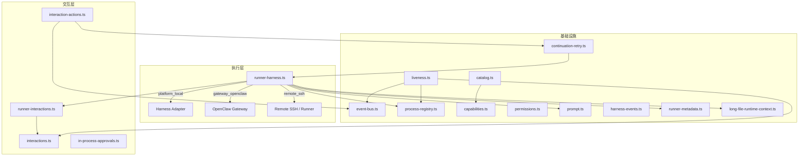
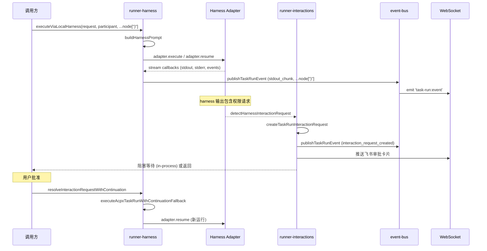

# src — lib


# ACPX 执行引擎模块

## 概述

`src/lib/acpx` 是平台的 **Agent 控制平面执行引擎**（Agent Control Plane eXecution），负责将任务（Task）分发到不同的 AI Harness（如 Codex、Claude、DeepSeek、Gemini CLI 等）并管理其完整生命周期。

核心职责：

- **多后端执行**：支持 `platform_local`（本地进程）、`gateway_openclaw`（OpenClaw 网关）、`remote_ssh`（远程 SSH / Runner）三种执行后端
- **会话续接**：通过 session/thread ID 实现跨运行的上下文延续
- **交互请求**：检测 harness 输出中的权限请求、选择请求、输入请求，并驱动用户审批流程
- **存活检测**：监控本地 harness 进程是否意外消失，自动收口任务状态
- **权限控制**：基于 profile 的沙箱、网络、审批策略管理
- **事件总线**：通过 WebSocket 实时推送任务运行事件

## 架构总览



## 核心组件

### 1. 执行后端（runner-harness.ts）

`runner-harness.ts` 是执行入口，根据 `executionBackend` 分发到不同实现：

| 函数 | 后端 | 说明 |
|------|------|------|
| `executeViaLocalHarness` | `platform_local` | 通过 Harness Adapter 在本地 spawn 子进程 |
| `executeViaGateway` | `gateway_openclaw` | 通过 OpenClaw 网关 API 远程执行 |
| `executeViaRemoteSshHarness` | `remote_ssh` | 通过 SSH 或 Remote Runner 在远程节点执行 |

**本地执行流程**：

1. 调用 `getHarnessAdapter(harnessType)` 获取对应适配器
2. 解析权限配置（`permissionConfig`），确定 `workspaceRoot`、`extraWritableRoots`、`extraReadOnlyPaths`
3. 判断是否为续接运行（`continuationMessage` + `resumeSessionId`）：
   - 是 → 调用 `adapter.resume()`
   - 否 → 调用 `adapter.execute()`
4. 通过 `registerRunningProcess` 将子进程注册到全局注册表
5. 执行完成后，对特定 harness（kimi-code、antigravity）收集上下文使用量遥测

**超时配置**：
- 本地默认：24 小时（`DEFAULT_LOCAL_HARNESS_MAX_RUNTIME_MS`）
- 远程默认：由 `DEFAULT_REMOTE_EXECUTION_TIMEOUT_MS` 决定
- 可通过 `request.watchdogConfig.maxRuntimeMs` 覆盖

### 2. 能力检测（capabilities.ts）

`getHarnessCapabilities(harnessType, executionBackend)` 返回 `HarnessCapability` 对象，描述特定 harness 在特定后端下支持的能力：

```typescript
interface HarnessCapability {
  supportsQueuedUserMessages: boolean;    // 支持排队用户消息
  supportsImmediateInterrupt: boolean;    // 支持立即中断
  supportsResumeAfterInterrupt: boolean;  // 中断后可恢复
  supportsLiveSessionControl: boolean;    // 支持实时会话控制
  supportsSoftStop: boolean;              // 支持软停止
}
```

**能力矩阵**（`platform_local` 后端）：

| Harness | 排队消息 | 立即中断 | 中断恢复 | 实时控制 | 软停止 |
|---------|---------|---------|---------|---------|--------|
| codex | ✓ | ✓ | ✓ | ✓ | ✓ |
| claude | ✓ | ✓ | ✓ | ✗ | ✓ |
| gemini-cli | ✓ | ✓ | ✓ | ✗ | ✓ |
| deepseek | ✗ | ✗ | ✗ | ✗ | ✓ |

优先通过 `getHarnessAdapter` 获取适配器自定义能力，无适配器时回退到硬编码矩阵。

### 3. 目录发现（catalog.ts）

`deriveGatewayHarnessOptions(user)` 是 harness 选项的发现入口，根据用户角色返回可用的执行选项列表：

- **非 admin 用户**：仅返回其拥有的 `remoteNode` 对应的选项
- **admin 用户**：聚合以下来源：
  1. **Platform Local**：从数据库 `Agent` 表（`hostname` 匹配当前服务器）获取，回退到 `getRealAgentsStatus()` 检测本地可用性
  2. **Gateway**：从 `Gateway` + `Agent` 表获取在线的 OpenClaw 网关代理
  3. **Remote SSH Host**：从 `RemoteHarnessHost` 表获取声明了 `supportedHarnesses` 的主机
  4. **Remote Node**：从 `RemoteNode` 表的 `metadata.harnesses` 字段解析

返回的 `HarnessOption` 包含 `gatewayId`、`executionBackend`、`harnessType`、`agentId` 等字段，供前端选择器使用。

### 4. 交互请求系统

交互请求是 harness 与用户之间的双向通信机制，覆盖权限审批、选项选择、补充输入等场景。

#### 4.1 检测（runner-interactions.ts）

`detectHarnessInteractionRequest(chunk)` 通过关键词匹配从 harness 输出流中检测交互请求：

| 类型 | 触发关键词（示例） | 响应格式 |
|------|-------------------|---------|
| `permission_request` | "permission" + "?"、"approve this action"、"需要你的确认" | `approve_deny` |
| `choice_request` | "select an option"、"请选择" | `single_choice` |
| `input_request` | "waiting for input"、"请输入" | `text` |
| `workspace_issue` | "只读环境"、"read-only environment" | — |

`handleHarnessInteractionRequest` 的完整流程：

1. 检查权限边界（`isPermissionRequestWithinBoundary`）—— 非 full_access 模式下，路径超出 `writableRoots` 则直接拒绝
2. 去重：查找同 taskRun + participant + kind + message 的 pending 请求
3. 持久化到 `TaskRunInteractionRequest` 表
4. 更新 TaskRun / Participant / TaskSession 状态为 `waiting_for_input`
5. 发布 `interaction_request_created` 事件
6. 推送飞书审批卡片（`sendFeishuApprovalCard`）
7. 若为 `in_process` 策略（仅 Codex 本地），调用 `waitForInProcessApproval` 阻塞等待

#### 4.2 解决（interaction-actions.ts）

`resolveInteractionRequestWithContinuation` 处理用户响应：

```
用户响应
  │
  ├─ 过期/已取消 → 标记 expired/cancelled，取消 in-process approval
  │
  ├─ deny → 标记 denied，participant 标记 failed，run 标记 failed
  │
  ├─ approve + in_process（Codex 本地）
  │    → resolveInProcessApproval 唤醒阻塞的 Promise
  │    → 原进程继续执行，无需重启
  │
  └─ approve/answer + 其他
       → 构建 continuationMessage
       → 调用 executeAcpxTaskRunWithContinuationFallback
       → 以 resumeSessionId 启动新运行
```

**in-process 审批**（`in-process-approvals.ts`）：

使用模块级 `Map<string, (result) => void>` 实现进程内 Promise 等待：

- `waitForInProcessApproval(requestId, timeoutMs)` — 创建 Promise，10 分钟超时自动 deny
- `resolveInProcessApproval(requestId, decision)` — 由用户操作触发 resolve
- `cancelInProcessApproval(requestId)` — 取消等待，resolve 为 `{ decision: 'deny', cancelled: true }`

#### 4.3 持久化（interactions.ts）

提供 `TaskRunInteractionRequest` 的 CRUD 操作：

- `createTaskRunInteractionRequest` — 创建
- `findRecentPendingInteractionRequest` — 去重查询
- `listPendingTaskRunInteractionRequests` — 列表
- `resolveTaskRunInteractionRequest` — 标记已解决
- `expireStaleTaskRunInteractionRequests` — 批量过期
- `finishPendingTaskRunInteractionRequests` — 按 scope 批量取消/过期

### 5. 存活检测（liveness.ts）

`reconcileTaskRunLiveness(taskId)` 检测本地 harness 进程是否意外消失：

**检测逻辑**：

1. 查找所有 `running` / `waiting_for_input` 状态的 TaskRun
2. 对每个 run，筛选 `platform_local` 且状态为 `running`/`waiting_for_input` 的 participant
3. 对每个 participant：
   - 检查 `process-registry` 中是否仍有注册 → 有则跳过
   - 从 `controlMetadata.childPid` 读取 PID，通过 `/proc/{pid}/cmdline` 验证进程是否存活且匹配 harness 类型
   - 若 PID 不存在且超过 30 秒宽限期（`LOCAL_STALE_GRACE_MS`）→ 标记为 stale
4. 若存在 stale participant：
   - 根据 `controlState` 映射最终状态（`stop_requested` → `stopped`，`interrupt_requested` → `interrupted`，其他 → `failed`）
   - 事务性更新 TaskRun、Task、TaskSession、所有 Participant
   - 清理 pending 交互请求
   - 发布 `participant_failed` / `run_failed` 等事件

### 6. 事件总线（event-bus.ts）

`publishTaskRunEvent` 是事件发布的统一入口：

1. 查询当前 taskRun 的最大 `sequence`，递增后创建 `TaskRunEvent` 记录
2. 计算 `tier`：`stdout_chunk` / `stderr_chunk` → `detail`，其他 → `summary`
3. 通过 Socket.IO 向 `task-run:{taskId}` 房间广播 `task-run:event` 事件

### 7. 进程注册表（process-registry.ts）

使用 `globalThis` 上的 Map 实现进程级单例注册表（避免热重载时丢失）：

- `registerRunningProcess(entry)` — 注册
- `getRunningProcess(participantId)` — 查询
- `clearRunningProcess(participantId)` — 清除
- `requestRunControl(taskRunId, participantId, action)` — 发送控制信号（`SIGKILL` 或 `SIGINT`）
- `consumeRunControlRequest(participantId)` — 消费控制请求

### 8. 权限系统（permissions.ts）

**权限配置结构**：

```typescript
interface AcpxPermissionConfig {
  profile: 'safe_local' | 'dev_local' | 'full_access' | 'custom';
  sandboxMode: 'read-only' | 'workspace-write' | 'danger-full-access';
  networkAccess: 'enabled' | 'restricted';
  approvalPolicy: 'on-request' | 'never';
  writableRoots: string[];  // 必须以 / 开头的绝对路径
}
```

**Profile 映射**：

| Profile | sandboxMode | networkAccess | approvalPolicy |
|---------|-------------|---------------|----------------|
| `safe_local` | workspace-write | restricted | never |
| `dev_local` | workspace-write | enabled | on-request |
| `full_access` | danger-full-access | enabled | on-request |

`normalizeAcpxPermissionConfig` 负责校验和归一化，`getLocalHarnessPermissionSupport` 返回各 harness 对权限配置的实际支持程度（`applied` / `partially_applied` / `recorded_only`）。

### 9. Prompt 构建（prompt.ts）

`buildHarnessPrompt` 组装发送给 harness 的完整 prompt，包含：

- 任务名称、角色、harness 类型、执行后端
- 最新任务室指令（最高优先级）
- 任务背景
- 近期任务室对话记录
- 前序参与者输出摘要
- 上下文水位警告（`contextWarning`）
- 长文件运行时上下文（`longFileContext`）
- 飞书外部 bot 联系指令（`withFeishuBotContactInstructions`）
- Antigravity 完成契约（要求最终响应必须自包含）

**上下文水位检测**（`checkContextWatermark`）：

- 优先使用 provider 遥测（Codex / Kimi Code / Antigravity 的 token 使用率）
- 回退到硬信号：任务室消息数 ≥ 60 或事件数 ≥ 400
- 阈值：60% 提示、85% 警告（要求立即总结并建议新 session）

### 10. 会话元数据持久化（runner-metadata.ts）

按 harness 类型分别持久化 session 信息到 `controlMetadata`：

| Harness | 元数据字段 | sessionKind |
|---------|-----------|-------------|
| Codex | `codexThreadId` | `codex_thread` |
| Claude | `claudeSessionId` | `claude_session` |
| DeepSeek | `deepseekThreadId` | `deepseek_thread` |
| Gemini | `geminiSessionId` | `gemini_session` |

每个持久化操作同时维护 `sessionTracking` 结构，记录 `rootRunId`、`latestRunId`、`rootSessionId`、`latestSessionId` 等，用于跨运行追踪同一会话链。

### 11. 续接重试（continuation-retry.ts）

`executeAcpxTaskRunWithContinuationFallback` 实现"续接失败 → 新会话重试"的降级策略：

1. 首次调用 `executeAcpxTaskRun`
2. 若单参与者且失败，检查错误是否为"无效续接"（通过 `adapter.isInvalidContinuationError`）
3. 若是 → 标记原 participant 的续接为 stale，剥离 `resumeSessionId` / `resumeThreadId`，以全新会话重试

### 12. Harness 事件归一化（harness-events.ts）

提供事件流的去重和预览清洗：

- `sanitizePreview(value, { workspaceRoot })` — 截断至 80 字符、脱敏（API key、Bearer token、签名等）、路径相对化
- `createProgressDedupe({ toolMinMs, thinkingMinMs })` — 返回 `{ consume, flush }` 闭包：
  - 工具事件：相同签名在 3 秒内合并计数
  - 思考事件：相同签名或 8 秒内重复则丢弃
  - 其他事件：相同签名去重

### 13. 长文件运行时上下文（long-file-runtime-context.ts）

`getLongFileRuntimeContext` 在 `platform_local` 执行前：

1. 从 `config/projects.yaml` 加载项目配置
2. 查找匹配的 `long_file_detector` job
3. 从 git HEAD 读取长文件契约（`LONG_FILE_CONTRACT_PATH`）
4. 扫描项目目录，统计各文件行数
5. 返回基线（baseline）和违规文件列表（offenders）

`assertLongFileRuntimeContext` 在运行结束后检查是否有文件增长超过阈值，若有则抛出错误。

## 数据流



## 与外部模块的依赖关系

| 外部模块 | 用途 |
|---------|------|
| `@/lib/harness` | Harness 适配器注册和获取 |
| `@/lib/prisma` | 数据库操作 |
| `@/lib/websocket` | Socket.IO 服务器实例 |
| `@/lib/feishu-api` | 飞书消息推送（审批卡片） |
| `@/lib/openclaw-client` | OpenClaw 网关通信 |
| `@/lib/remote-harness/*` | 远程 SSH / Runner 执行 |
| `@/lib/real-agents/*` | 本地 agent 状态检测、遥测 |
| `@/lib/codex-telemetry` | Codex 配额和上下文使用量 |
| `@/lib/long-file-guard` | 长文件规则解析 |
| `@/lib/scheduled-jobs/project-config` | 项目配置加载 |
| `@/lib/platform-local-init` | 平台本地 agent 初始化和主机名 |
| `@/lib/task-room` | 任务室消息计数 |
| `@/lib/redact-sensitive` | 敏感文本脱敏 |

## 关键设计决策

1. **globalThis 注册表**：`process-registry.ts` 使用 `globalThis` 而非模块级变量，确保 Next.js 热重载时进程注册不丢失。

2. **in-process 审批**：仅 Codex 本地支持。通过 Promise + Map 实现零延迟审批，避免重启进程。其他 harness 的审批通过"续接运行"实现。

3. **续接降级**：`continuation-retry.ts` 确保即使 session 过期或无效，任务仍能以新会话完成，而非直接失败。

4. **存活检测宽限期**：30 秒（`LOCAL_STALE_GRACE_MS`）避免在进程正常退出和状态更新之间的竞态窗口误判。

5. **权限 profile 检测**：`normalizeAcpxPermissionConfig` 支持从具体配置反推 profile，也支持显式指定 `custom` profile。