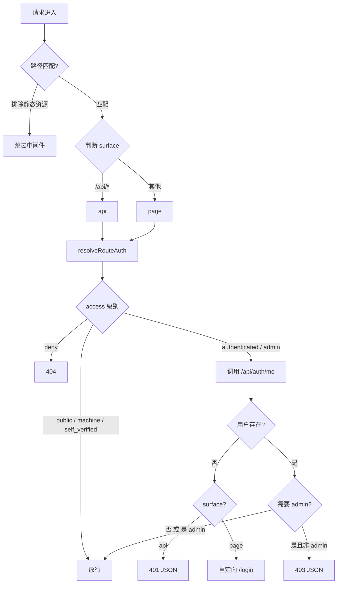

# src — src


# src 模块

## 概述

`src` 模块包含 Next.js 应用的全局入口逻辑，由两个文件组成：

| 文件 | 职责 |
|------|------|
| `src/instrumentation.ts` | Next.js instrumentation 钩子（当前为空占位） |
| `src/middleware.ts` | 全局请求中间件，负责路由级认证与授权 |

---

## `src/instrumentation.ts`

```ts
export async function register() {
  // Feishu long-connection runs in a dedicated standalone Node process.
}
```

Next.js 在应用启动时调用 `register()`。当前函数体为空——飞书长连接已拆分为独立的 Node 进程运行，不再通过 instrumentation 启动。保留此文件是为了满足 Next.js 对 `instrumentation.ts` 的约定（若存在则必须导出 `register`）。

---

## `src/middleware.ts`

### 职责

在请求到达具体路由处理函数之前，根据路径和 HTTP 方法决定：

1. 该路由是否需要认证
2. 需要什么级别的权限（普通用户 / 管理员）
3. 未通过时如何响应（401 / 403 / 404 / 重定向）

### 认证流程



### 关键逻辑说明

**1. Surface 判定**

```ts
const surface = request.nextUrl.pathname.startsWith('/api/') ? 'api' : 'page';
```

仅以 `/api/` 前缀区分。这决定了未认证时的响应形式：API 返回 JSON 错误，页面则重定向到登录页。

**2. 路由认证解析**

调用 `resolveRouteAuth({ surface, pathname, method })`（来自 `src/lib/auth-routes.ts`），返回一个包含 `access` 字段的对象。`access` 的可能值：

| 值 | 含义 | 中间件行为 |
|----|------|-----------|
| `public` | 无需认证 | 直接放行 |
| `machine` | 机器/服务间调用 | 直接放行（由其他机制保障） |
| `self_verified` | 用户自验证即可 | 直接放行 |
| `deny` | 路由不存在或禁止访问 | 返回 404 |
| `authenticated` | 需要登录 | 检查用户，未登录则拦截 |
| `admin` | 需要管理员 | 检查用户角色，非 admin 则 403 |

**3. 用户信息获取**

中间件通过内部 `fetch` 调用 `/api/auth/me` 获取当前用户：

```ts
const authResponse = await fetch(new URL('/api/auth/me', request.url), {
  headers: { cookie: request.headers.get('cookie') || '' },
  cache: 'no-store',
});
```

- 透传原始请求的 `cookie` 头
- `cache: 'no-store'` 确保每次请求都重新验证，不依赖缓存
- 仅提取 `user.role` 字段用于权限判断

**4. 未认证响应**

- **API 请求**：`401` + `{ error: 'Authentication required' }`
- **页面请求**：302 重定向到 `/login?next=<原路径>`，登录成功后可回跳

### 匹配规则

```ts
export const config = {
  matcher: ['/((?!_next/static|_next/image|favicon.ico|fonts/).*)'],
};
```

排除 Next.js 静态资源（`_next/static`、`_next/image`）、`favicon.ico` 和 `fonts/` 目录下的所有文件。其余所有路径均经过中间件处理。

---

## 与代码库的连接

```
middleware (src/middleware.ts)
  └── resolveRouteAuth (src/lib/auth-routes.ts)   ← 路由→权限映射表
  └── /api/auth/me (API 路由)                      ← 用户会话验证
```

- **`src/lib/auth-routes.ts`**：维护路径模式到 `access` 级别的映射。新增受保护路由时，需在此文件中注册。
- **`/api/auth/me`**：实际的会话验证逻辑（解析 cookie、查询用户）。中间件不直接操作数据库，而是委托给该 API。
- **测试**：`tests/auth-users.test.ts` 中的 `main` 函数直接调用 `middleware` 进行集成测试。

---

## 注意事项

- 中间件运行在 Edge Runtime（Next.js 默认），不能直接访问 Node.js 特有 API（如 `fs`、`crypto` 的部分方法）。
- `fetch` 调用 `/api/auth/me` 是中间件中唯一的 I/O 操作，性能敏感场景下可考虑缓存策略（当前为 `no-store`，每次请求都验证）。
- `deny` 级别返回 404 而非 403，目的是不暴露路由的存在性。