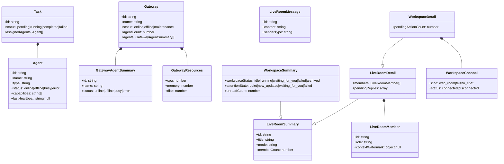

# src — types


# src/types — 类型定义模块

## 模块概述

`src/types/index.ts` 是前端应用的**领域模型类型定义层**，集中声明了所有与后端 API 交互的 TypeScript 接口。该模块不包含任何运行时逻辑，纯粹作为类型契约，供组件、状态管理和 API 层引用。

所有类型均为 `interface`（非 `type`），支持声明合并（declaration merging），便于后续扩展。

---

## 类型关系总览



---

## 核心实体

### `Agent`

智能体的完整表示，是系统中所有"可执行工作单元"的基础模型。

| 字段 | 类型 | 说明 |
|------|------|------|
| `id` | `string` | 唯一标识 |
| `name` | `string` | 显示名称 |
| `runtimeAgentId` | `string?` | 运行时层面对应的 ID（与平台 ID 解耦） |
| `type` | `string` | 智能体类型标识 |
| `location` | `string?` | 部署位置描述 |
| `capabilities` | `string[]` | 能力标签列表 |
| `status` | `'online' \| 'offline' \| 'busy' \| 'error'` | 当前状态 |
| `lastHeartbeat` | `string \| null` | 最近心跳时间（ISO 格式）；`null` 表示从未心跳 |
| `gatewayId` | `string?` | 所属网关 ID |
| `createdAt` / `updatedAt` | `string` | 时间戳 |

**设计要点：**
- `lastHeartbeat` 使用 `string | null` 而非 `string | undefined`，明确区分"从未心跳"（`null`）和"字段未返回"（`undefined`）。
- `runtimeAgentId` 与 `id` 分离，支持同一平台智能体在不同运行时中有不同标识。

### `Gateway`

网关是智能体的**部署和连接层**，一个网关可托管多个智能体。

| 字段 | 类型 | 说明 |
|------|------|------|
| `id` | `string` | 唯一标识 |
| `name` | `string` | 显示名称 |
| `url` | `string?` | 网关 API 地址 |
| `ip` | `string?` | 遗留字段（旧版使用 IP 直连） |
| `status` | `'online' \| 'offline' \| 'maintenance'` | 网关状态 |
| `resources` | `GatewayResources?` | 资源用量 |
| `agentCount` | `number?` | 托管智能体数量 |
| `hasToken` | `boolean?` | 是否已配置认证令牌 |
| `hasOpenClawToken` | `boolean?` | 是否已配置 OpenClaw 令牌 |
| `agents` | `GatewayAgentSummary[]?` | 智能体摘要列表 |
| `createdAt` / `updatedAt` | `string` | 时间戳 |

### `GatewayAgentSummary`

网关视角下的智能体**精简表示**，仅包含列表展示所需的最小字段。与完整 `Agent` 的区别在于省略了 `capabilities`、`lastHeartbeat`、`location` 等详情字段。

### `GatewayResources`

网关资源用量快照：

```typescript
interface GatewayResources {
  cpu: number;    // CPU 使用率（百分比）
  memory: number; // 内存使用率（百分比）
  disk: number;   // 磁盘使用率（百分比）
}
```

### `Task`

任务模型，将工作分配给一个或多个智能体。

| 字段 | 类型 | 说明 |
|------|------|------|
| `id` | `string` | 唯一标识 |
| `name` | `string` | 任务名称 |
| `description` | `string?` | 任务描述 |
| `status` | `'pending' \| 'running' \| 'completed' \| 'failed'` | 任务状态 |
| `assignedAgents` | `Agent[]` | 被分配的智能体（完整对象） |
| `result` | `Record<string, unknown>?` | 执行结果（结构不固定） |
| `error` | `string?` | 失败时的错误信息 |
| `startedAt` / `completedAt` | `string?` | 执行时间 |
| `createdAt` / `updatedAt` | `string` | 时间戳 |

**注意：** `assignedAgents` 内嵌完整 `Agent` 对象而非 ID 引用，意味着任务详情接口会返回智能体的完整数据，前端无需额外请求。

---

## 实时房间（Live Room）体系

实时房间是系统的**多智能体协作对话空间**，支持多成员、多话题、多消息类型的实时交互。

### `LiveRoomSummary`

房间的**列表级摘要**，用于房间列表页展示。

| 字段 | 类型 | 说明 |
|------|------|------|
| `id` | `string` | 房间 ID |
| `title` | `string` | 房间标题 |
| `description` | `string?` | 描述 |
| `currentTopic` | `string?` | 当前讨论话题 |
| `mode` | `string` | 房间模式 |
| `status` | `string` | 房间状态 |
| `createdBy` | `string` | 创建者 |
| `currentSpeakerMemberId` | `string?` | 当前发言者 ID |
| `currentSpeakerName` | `string?` | 当前发言者名称 |
| `memberCount` | `number` | 成员数量 |
| `lastMessagePreview` | `string?` | 最后一条消息预览 |
| `lastMessageAt` | `string?` | 最后消息时间 |

### `LiveRoomDetail`

继承自 `LiveRoomSummary`，增加**房间内部详情**：

| 新增字段 | 类型 | 说明 |
|----------|------|------|
| `sourceTask` | `{ id, name } \| null` | 关联的源任务（房间可能由任务创建） |
| `pendingReplyCount` | `number?` | 待回复总数 |
| `pendingReplyTargetNames` | `string[]?` | 待回复目标名称列表 |
| `pendingReplies` | `PendingReply[]?` | 待回复详情数组 |
| `members` | `LiveRoomMember[]` | 完整成员列表 |

#### `pendingReplies` 元素结构

每个待回复项包含：

| 字段 | 说明 |
|------|------|
| `memberId` / `displayName` | 目标成员 |
| `pendingCount` / `queuedCount` / `runningCount` | 各状态数量 |
| `oldestPendingAt` / `newestPendingAt` | 时间范围 |
| `newestPendingAgeSeconds` | 最新待回复的等待秒数 |
| `lastProgressAt` / `lastProgressAgeSeconds` | 最近进度 |
| `progressLabel` | 进度描述文本 |
| `activeDeliveryId` | 当前活跃投递 ID |
| `backend` / `harnessType` | 后端和框架类型 |
| `interruptSupported` | 是否支持中断 |
| `status` | `'queued' \| 'running' \| 'stalled'` |

### `LiveRoomMember`

房间成员，是系统中**字段最丰富的类型**，承载了成员身份、角色、权限、上下文水位等多维度信息。

**核心字段：**

| 字段 | 说明 |
|------|------|
| `id` / `roomId` | 成员 ID 和所属房间 |
| `memberType` | 成员类型（如 `agent`、`human`） |
| `displayName` | 显示名称 |
| `role` | 角色标识 |
| `roleLabel` | 角色显示标签 |
| `specialty` | 专长领域 |
| `joinStatus` / `presenceStatus` | 加入状态 / 在线状态 |
| `canReply` | 是否可回复 |
| `sortOrder` | 排序权重 |
| `gatewayId` / `gatewayName` | 所属网关 |
| `agentRecordId` | 关联的智能体记录 ID |
| `permissionProfile` / `permissionLabel` | 权限配置 |
| `codexModel` / `codexReasoningEffort` | 模型和推理强度配置 |

#### `contextWatermark`

上下文水位是**智能体上下文窗口使用情况的实时快照**，用于前端展示"上下文快满了"等警告。

```typescript
interface ContextWatermark {
  source: 'provider' | 'unknown' | 'not_applicable';
  usagePercentage: number | null;
  usageStatus: 'light' | 'elevated' | 'high' | 'unknown' | 'not_applicable';
  policyStatus: 'normal' | 'warning' | 'critical';
  policyLabel: string;
  dominantReason: 'provider' | 'messages' | 'events' | 'transcript';
  dominantLabel: string;
  usedTokens?: number;
  contextWindow?: number | null;
  recommendedAction: string;
  messageCount: number;
  eventCount: number;
  transcriptChars: number;
  remainingMessages: number;
  remainingEvents: number;
  remainingTranscriptChars: number;
}
```

**设计要点：**
- `usageStatus` 和 `policyStatus` 分离：前者反映实际使用率，后者反映策略判定（可能因配置阈值不同而不同）。
- `dominantReason` 标识上下文消耗的主要来源（provider 返回、消息、事件、转录），帮助开发者定位问题。
- `remaining*` 字段提供"还能用多少"的直观信息。

### `LiveRoomMessage`

房间消息：

| 字段 | 说明 |
|------|------|
| `id` / `roomId` | 消息 ID 和所属房间 |
| `senderMemberId` / `senderName` / `senderLabel` | 发送者信息 |
| `senderType` | 发送者类型 |
| `content` | 消息内容 |
| `messageType` | 消息类型 |
| `visibility` | 可见性 |
| `topicSnapshot` | 发送时的话题快照 |
| `replyToMessageId` | 回复目标消息 ID |
| `metadata` | 扩展元数据 |

### `LiveRoomCatalogAgent`

房间目录中的智能体条目，用于**房间创建/配置时选择智能体**的场景。与 `Agent` 的区别在于它携带了 `gatewayId`、`gatewayName`、`backend`、`harnessType` 等部署上下文信息。

| 字段 | 说明 |
|------|------|
| `id` | 智能体 ID |
| `agentRecordId` | 关联记录 ID |
| `gatewayId` / `gatewayName` | 所属网关 |
| `backend` | `'platform_local' \| 'gateway_openclaw' \| 'remote_ssh'` |
| `harnessType` | 框架类型 |
| `label` | 显示标签 |
| `agentName` | 智能体名称 |
| `runtimeAgentId` | 运行时 ID |
| `status` | 状态 |

---

## 工作区（Workspace）体系

工作区是**房间的上层抽象**，一个工作区可以关联多个频道（房间或外部聊天），并维护独立的生命周期状态。

### `WorkspaceChannel`

工作区关联的频道：

| 字段 | 说明 |
|------|------|
| `id` | 频道 ID |
| `workspaceId` | 所属工作区 |
| `kind` | `'web_room' \| 'feishu_chat'` — 内部房间或飞书群 |
| `label` | 显示名称 |
| `externalId` | 外部系统 ID（飞书场景） |
| `status` | `'connected' \| 'disconnected'` |

### `WorkspaceSummary`

继承自 `LiveRoomSummary`，增加工作区级别的状态：

| 新增字段 | 类型 | 说明 |
|----------|------|------|
| `workspaceStatus` | `'idle' \| 'running' \| 'waiting_for_you' \| 'failed' \| 'archived'` | 工作区状态 |
| `attentionState` | `'quiet' \| 'new_updates' \| 'waiting_for_you' \| 'failed'` | 注意力状态（驱动 UI 角标/提醒） |
| `unreadCount` | `number` | 未读数量 |
| `lastActivityAt` | `string` | 最后活跃时间 |
| `lifecycleStatus` | `'active' \| 'archived'` | 生命周期状态 |
| `linkedChannels` | `WorkspaceChannel[]` | 关联频道列表 |

**`workspaceStatus` vs `attentionState` 的区别：**
- `workspaceStatus` 描述工作区**正在做什么**（运行中、等待你、失败等）。
- `attentionState` 描述**用户需要关注什么**（安静、有新更新、需要你操作、出错了）。

### `WorkspaceDetail`

继承自 `LiveRoomDetail`，增加：

| 新增字段 | 说明 |
|----------|------|
| `workspaceStatus` | 同 `WorkspaceSummary` |
| `attentionState` | 同 `WorkspaceSummary` |
| `unreadCount` | 未读数量 |
| `lastActivityAt` | 最后活跃时间 |
| `lifecycleStatus` | 生命周期状态 |
| `linkedChannels` | 关联频道 |
| `pendingActionCount` | 待处理操作数量 |

---

## 仪表盘

### `DashboardStats`

仪表盘顶部统计卡片的数据源：

```typescript
interface DashboardStats {
  totalAgents: number;
  onlineAgents: number;
  busyAgents: number;
  offlineAgents: number;
}
```

注意：没有 `errorAgents` 字段，`error` 状态的智能体可能归入 `offlineAgents` 或单独处理。

---

## 设计约定

### 状态枚举

| 实体 | 状态值 |
|------|--------|
| `Agent` | `online` / `offline` / `busy` / `error` |
| `Gateway` | `online` / `offline` / `maintenance` |
| `Task` | `pending` / `running` / `completed` / `failed` |
| `Workspace` | `idle` / `running` / `waiting_for_you` / `failed` / `archived` |
| `WorkspaceChannel` | `connected` / `disconnected` |

### 时间戳

所有时间字段使用 **ISO 8601 字符串**（`string` 类型），而非 `Date` 对象。前端在需要时自行解析。

### 可选字段策略

- 使用 `?` 表示"API 可能不返回该字段"。
- 使用 `| null` 表示"API 会返回该字段，但值可能为 null"（如 `lastHeartbeat`、`contextWatermark`）。
- 两者语义不同：`undefined` 意味着"不知道"，`null` 意味着"明确为空"。

### 继承关系

- `WorkspaceSummary extends LiveRoomSummary` — 工作区摘要复用房间摘要的基础字段。
- `WorkspaceDetail extends LiveRoomDetail` — 工作区详情复用房间详情的成员和待回复信息。

这意味着工作区在数据层面**就是一个房间**，只是额外包装了生命周期和频道管理。

### 命名约定

- 接口名使用 PascalCase。
- 字段名使用 camelCase。
- 枚举值使用 snake_case（如 `waiting_for_you`、`not_applicable`）。
- 带 `Snapshot` 后缀的字段表示"发送/创建时的快照"，不随源数据变化。
- 带 `Label` 后缀的字段是面向用户的显示文本，与对应的标识字段（如 `role` / `roleLabel`）配对。