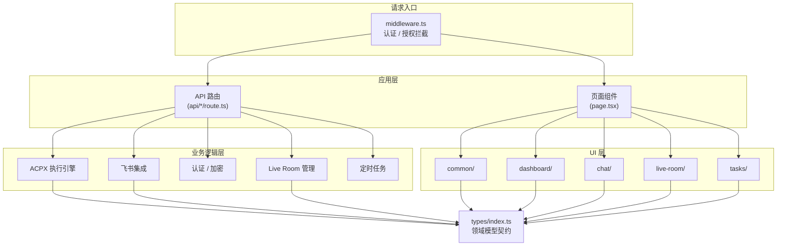

# src

# src

## 模块定位

`src` 是 Agent Platform 的 Next.js 应用源码根目录，按职责分为五个子模块，形成从请求入口到 UI 渲染的完整链路。

| 子模块 | 层级 | 核心职责 |
|--------|------|----------|
| [src/src](src-src.md) | 入口层 | 全局中间件（认证/授权拦截）、instrumentation 钩子 |
| [src/app](src-app.md) | 应用层 | 页面组件 + API 路由，是前后端交汇点 |
| [src/lib](src-lib.md) | 业务逻辑层 | ACPX 执行引擎、飞书集成、认证、加密、定时任务等 |
| [src/components](src-components.md) | UI 组件层 | 按功能域划分的可复用 React 组件 |
| [src/types](src-types.md) | 类型契约层 | 所有领域模型的 TypeScript 接口定义 |

## 协作关系

## 关键跨模块工作流

### 1. 任务执行流

用户通过 Dashboard 或飞书发起任务 → API 路由接收请求 → `lib/acpx` 执行引擎根据 profile 选择后端（本地进程 / OpenClaw 网关 / 远程 SSH）→ harness adapter 启动 AI 会话 → 通过 WebSocket 事件总线实时推送状态 → 前端 `tasks/` 组件更新 UI。

### 2. 飞书集成流

飞书消息到达 → `lib/feishu.ts` 解析命令 → 根据命令类型分发到 `feishu-task-commands`、`feishu-live-room-commands`、`feishu-room-controls` 等子模块 → 操作 Live Room 成员权限、触发 ACPX 执行、或发送审批卡片 → 结果通过 `feishu-api.ts` 回传飞书。

### 3. 认证与授权流

所有请求先经过 `middleware.ts` 的路径匹配和 surface 判断 → API 路由内部调用 `lib/auth-users.ts` 的 `requireCurrentUser` / `requireAdmin` → 验证 session token（`lib/auth.ts` 中的 `verifySessionToken`）→ 未通过时返回 401/403 或重定向到登录页。

### 4. Live Room 协作流

`live-room/` 组件渲染多 Agent 讨论界面 → 用户发送消息 → API 路由调用 `lib/live-room-delivery-execution.ts` → 通过 ACPX 执行引擎分发到各 Agent → 执行结果经 `live-room-process-registry.ts` 追踪 → 可选地通过 `feishu-live-room-relay.ts` 同步到飞书群。

## 设计原则

- **类型先行**：`types/` 作为唯一契约源，所有模块共享同一套接口定义，避免前后端类型漂移
- **中间件前置**：认证逻辑在 `middleware.ts` 做粗粒度拦截，细粒度权限在 API 路由内通过 `lib/auth-users.ts` 完成
- **执行引擎解耦**：ACPX 通过 adapter 模式隔离不同 AI 后端，新增 harness 只需实现 adapter 接口，不影响上层路由和 UI