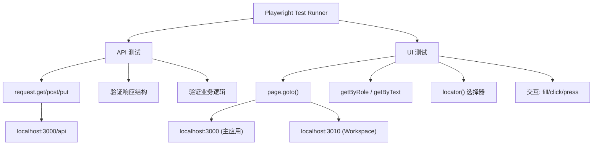

# tests — e2e


# tests/e2e — E2E 测试模块

## 概述

本模块基于 **Playwright** 框架，为 Agent Platform v2 提供端到端测试覆盖。测试分为两大类：

- **API 测试**：通过 `request` fixture 直接调用 HTTP 端点，验证响应结构和业务逻辑
- **UI 测试**：通过 `page` fixture 操作浏览器，验证页面渲染和交互行为

测试目标应用运行在 `http://localhost:3000`（主应用）和 `http://localhost:3010`（Workspace 应用）。

---

## 文件结构

```
tests/e2e/
├── api.spec.ts                  # 核心 API 端点测试
├── chat.spec.ts                 # Chat 页面 UI 测试
├── dashboard.spec.ts            # Dashboard 页面 UI 测试
├── control-plane.spec.ts        # Control Plane 集成测试
├── gateway-health-api.spec.ts   # Gateway 健康检查 API 测试
├── gateway-monitor.spec.ts      # Gateway 监控面板 UI 测试
├── workspace-checklist.spec.ts  # Workspace 完整功能检查
├── workspace-smoke.spec.ts      # Workspace 冒烟测试
├── FEATURE_1_SUMMARY.md         # Control Plane 测试总结
├── FEATURE_2_SUMMARY.md         # Linux Gateway 通信测试总结
└── FEATURE_12_SUMMARY.md        # E2E 框架搭建总结
```

---

## 测试文件详解

### `api.spec.ts` — 核心 API 端点

测试 `http://localhost:3000/api` 下的基础 REST 端点。

| 测试用例 | 方法 | 端点 | 验证内容 |
|---------|------|------|---------|
| Agent 列表 | GET | `/api/agents` | 返回数组，每项含 `id`、`name`、`status`、`type` |
| Gateway 列表 | GET | `/api/gateways` | 返回数组，每项含 `id`、`name`、`url` |
| 聊天房间 | GET | `/api/chat/rooms` | 返回数组 |
| 创建消息 | POST | `/api/chat/messages` | 返回含 `id` 和 `content` 的对象 |
| 单个 Agent | GET | `/api/agents/[id]` | 返回匹配 ID 的 Agent |
| 更新 Agent | PUT | `/api/agents/[id]` | 更新 `status` 字段 |

**关键模式**：`GET /api/agents/[id]` 和 `PUT /api/agents/[id]` 测试采用"先查列表获取有效 ID，再操作单个资源"的两步策略，避免硬编码 ID。

---

### `control-plane.spec.ts` — Control Plane 集成测试

验证 Control Plane 三大核心组件的 API 行为：

```
┌─────────────────────────────────────────────────────┐
│  Control Plane                                       │
│                                                      │
│  ┌──────────────┐  ┌────────────────┐  ┌─────────┐ │
│  │ GatewayClient │  │ GatewayManager │  │ Feishu  │ │
│  │              │  │                │  │ Command │ │
│  │ 单 Gateway   │  │ 多 Gateway     │  │ Router  │ │
│  │ 连接/通信    │  │ 编排/监控      │  │ 命令解析 │ │
│  └──────────────┘  └────────────────┘  └─────────┘ │
└─────────────────────────────────────────────────────┘
```

**GatewayClient 测试**（3 个用例）：
- 类型定义验证：确认 Gateway 对象包含 `id`、`name`、`url`、`status` 字段
- 健康检查模拟：验证响应延迟 < 5000ms
- Token 认证验证：无效 Bearer Token 应返回 200 或 401

**GatewayManager 测试**（3 个用例）：
- 多 Gateway 列表：至少返回 1 个 Gateway
- 状态监控：每个 Gateway 的 `status` 必须是 `online`/`offline`/`maintenance`/`unhealthy` 之一
- Agent 关联：每个 Agent 必须包含 `gatewayId` 字段

**FeishuCommandRouter 测试**（3 个用例）：
- 命令解析：POST `/api/chat/messages` 发送 `/status` 命令
- 广播命令：GET `/api/chat/rooms` 验证可获取多个房间
- 帮助命令：POST `/api/chat/messages` 发送 `/help` 命令

**集成场景**（3 个用例）：
- 完整流程：获取 Gateways → Agents → Rooms → 发送任务消息
- 无效 Gateway：GET 不存在的 Gateway ID，应返回 200 或 404
- 离线 Gateway：向离线 Agent 发送消息不应导致系统崩溃

---

### `gateway-health-api.spec.ts` — Gateway 健康检查 API

测试 `GET /api/gateways/[id]/health` 端点的完整响应结构。

**期望响应格式**：

```typescript
{
  success: boolean,
  latencyMs: number,        // 0 ≤ latencyMs < 10000
  statusCode: number,       // HTTP 状态码
  lastChecked: string,      // ISO 8601 时间戳
  gatewayInfo: {
    id: string,
    name: string,
    url: string,
    status: 'online' | 'offline' | 'maintenance' | 'unhealthy' | 'unknown'
  },
  agents: Array<{
    id: string,
    name: string,
    status: 'online' | 'offline' | 'busy'
  }>,
  resources?: object        // 可选
}
```

**测试覆盖**（10 个用例）：

| 类别 | 用例 |
|------|------|
| 数据结构 | 必需字段存在且类型正确 |
| Gateway 信息 | `gatewayInfo` 包含完整字段 |
| Agents 信息 | `agents` 数组结构正确 |
| 延迟信息 | 多次请求延迟均在合理范围 |
| 错误处理 | 不存在的 Gateway 返回 404 + `success: false` |
| 状态更新 | 健康检查后 Gateway 状态已更新 |
| 时间戳 | `lastChecked` 在 1 分钟内 |
| 响应时间 | API 响应 < 6000ms |
| 边界情况 | 空 ID 返回 400/404 |
| 安全 | 特殊字符 ID 不导致 500 |

**关键设计**：当无可用 Gateway 时，测试使用 `test.skip()` 优雅跳过而非失败。

---

### `gateway-monitor.spec.ts` — Gateway 监控面板 UI

测试 Dashboard 页面上 Gateway 监控组件的渲染和交互。

**测试分组**：

| 分组 | 验证内容 |
|------|---------|
| Component Rendering | 面板渲染、状态统计、刷新时间、手动刷新按钮、自动刷新说明 |
| Status Indicators | Gateway 卡片、状态颜色（绿/红/黄）、延迟显示（`XXXms`）、状态码、最后检查时间 |
| Interactive Features | 手动刷新按钮功能、卡片展开详情、统计数字正确性 |
| Auto Refresh | 30 秒自动刷新间隔验证（等待 35 秒） |
| Error Handling | 空状态和 API 错误（当前 `test.skip()`） |

**选择器策略**：
- 文本匹配：`page.getByText(/Gateway 监控/i)`
- 属性选择器：`page.locator('button[title="手动刷新"]')`
- 类名模糊匹配：`page.locator('[class*="bg-green"], [class*="bg-red"]')`

---

### `dashboard.spec.ts` — Dashboard 页面

测试主 Dashboard 页面的基本渲染和导航。

| 测试用例 | 验证内容 |
|---------|---------|
| 标题显示 | 页面标题匹配 `/Agent Platform/`，heading 匹配 `/dashboard/i` |
| 统计面板 | 显示 "total agents"、"online"、"busy"、"offline" 文本 |
| Agent 网格 | 存在 Agent 卡片元素 |
| 状态颜色 | 存在绿色/黄色/灰色状态指示器 |
| 导航到 Chat | 点击 Chat 链接后 URL 变为 `/chat/` |
| 导航到 Tasks | 点击 Tasks 链接后 URL 变为 `/tasks/` |

---

### `chat.spec.ts` — Chat 页面

测试 Chat 页面的交互功能。

| 测试用例 | 验证内容 |
|---------|---------|
| 页面显示 | 标题和 heading 可见 |
| 输入框 | `textbox` 角色，名称匹配 `/message/i` |
| 发送按钮 | `button` 角色，名称匹配 `/send/i` |
| 消息列表 | 存在消息容器元素 |
| @提及自动补全 | 输入 `@` 后出现下拉列表 |
| 发送消息 | 输入文本 → 点击发送 → 消息出现在列表中 |
| @提及 Agent | 输入 `@Agent` → 选择选项 → 发送 → 验证显示 |

---

### `workspace-checklist.spec.ts` — Workspace 完整检查

针对 `http://localhost:3010` 的 Workspace 功能进行完整验证。

| 测试用例 | 验证内容 |
|---------|---------|
| 页面导航 | `/workspaces` 页面正确显示标题和"新建 Workspace" |
| 工作空间列表 | 存在 `a[href^="/workspaces/"]` 链接，含 topic 和成员数 |
| 状态标签 | 存在 `idle`/`running`/`waiting`/`failed`/`archived`/`needs you`/`updates` 标记 |
| 创建工作空间 | 填写名称和 topic → 点击创建 → 跳转到 `/workspaces/cm[a-z0-9]+` |
| Feishu 标签 | 存在 Feishu 标签，点击后右侧面板显示 Feishu 信息 |
| 归档 UI | "Archived Workspaces" 区域存在且可展开 |
| /rooms 兼容 | `/rooms` 路由仍正常工作 |

**关键验证**：创建后 URL 格式为 `/workspaces/cm[a-z0-9]+`（`cm` 前缀 + 随机字符串），详情页 `h1` 显示名称，`aside` 面板显示 `topic: {topic}`。

---

### `workspace-smoke.spec.ts` — Workspace 冒烟测试

与 `workspace-checklist.spec.ts` 类似的快速验证，侧重核心路径：

1. 页面导航和基本渲染
2. 工作空间列表非空
3. 状态标签存在
4. 创建工作空间并跳转
5. 在工作空间中发送消息（`textarea` + `Enter`）
6. `/rooms` 路由兼容
7. 侧边栏包含 Workspaces 链接
8. Feishu 标签存在

---

## 运行方式

```bash
# 运行所有 E2E 测试
npx playwright test

# 运行特定文件
npx playwright test tests/e2e/api.spec.ts
npx playwright test tests/e2e/control-plane.spec.ts
npx playwright test tests/e2e/workspace-smoke.spec.ts

# 指定浏览器
npx playwright test --project=chromium

# 生成 HTML 报告
npx playwright test --reporter=html
npx playwright show-report

# 调试模式（打开浏览器逐步执行）
npx playwright test --debug
```

---

## 当前状态

| 测试文件 | 通过/总计 | 状态 |
|---------|----------|------|
| `api.spec.ts` | 5/6 | ⚠️ `POST /api/chat/messages` 返回 400 |
| `control-plane.spec.ts` | 8/12 | ⚠️ 消息 API 参数格式问题 |
| `gateway-health-api.spec.ts` | — | 框架完整，依赖 Gateway 可用性 |
| `gateway-monitor.spec.ts` | — | 依赖 UI 选择器匹配 |
| `dashboard.spec.ts` | 1/6 | ⚠️ 选择器不匹配实际 DOM |
| `chat.spec.ts` | 0/6 | ⚠️ 选择器不匹配实际 DOM |
| `workspace-checklist.spec.ts` | — | 针对 3010 端口应用 |
| `workspace-smoke.spec.ts` | — | 针对 3010 端口应用 |

**主要问题**：UI 测试的选择器（ARIA 角色、CSS 类名）与实际 DOM 结构不匹配。API 测试中 `POST /api/chat/messages` 的请求体格式需要与后端对齐。

---

## 测试策略



**选择器优先级**（从高到低）：
1. `getByRole()` — 基于 ARIA 角色，最稳定
2. `getByText()` — 基于可见文本
3. `getByPlaceholder()` — 基于输入框占位符
4. `locator('[data-testid=...]')` — 基于测试 ID（推荐添加）
5. `locator('[class*=...]')` — 基于类名模糊匹配（最脆弱）

---

## 与代码库的关系

- **被测应用**：Next.js 应用，运行在端口 3000（主应用）和 3010（Workspace 应用）
- **API 层**：测试直接调用 Next.js API Routes（`/api/agents`、`/api/gateways`、`/api/chat/*`）
- **Control Plane**：`control-plane.spec.ts` 验证 GatewayClient、GatewayManager、FeishuCommandRouter 的 API 行为
- **Gateway 健康检查**：`gateway-health-api.spec.ts` 验证 `GET /api/gateways/[id]/health` 端点，该端点内部调用 Gateway 的 `/health` 接口并更新数据库状态
- **Workspace 应用**：独立部署在 3010 端口，提供工作空间管理和消息功能