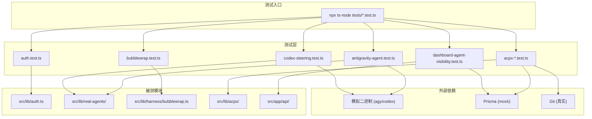

# tests — tests


# tests — 测试模块

## 模块概述

`tests/` 目录是 Agent Platform v2 的测试基础设施，包含单元测试、集成测试、API 测试脚本以及各阶段的验证报告。测试覆盖认证系统、Agent 执行引擎（Antigravity、Codex）、沙箱隔离（Bubblewrap）、Feishu 通信层、Dashboard 数据契约、工作流验证等核心子系统。

测试采用 **Node.js 原生 `assert` 模块** 作为断言库，不依赖 Jest 或 Vitest。每个测试文件是一个独立的可执行脚本，通过 `npx ts-node tests/<name>.test.ts` 直接运行。

---

## 测试分类

### 1. 认证与权限

| 测试文件 | 覆盖范围 |
|---------|---------|
| `auth.test.ts` | 核心认证：管理员凭据验证、操作员/用户会话创建与验证、路由权限解析（`resolveRouteAuth`）、配置加载错误处理 |
| `auth-users.test.ts` | 用户级认证：`verifySessionToken`、`requireAdmin`、Next.js middleware 拦截逻辑 |
| `admin-users.test.ts` | 管理员用户管理 API：用户列表、创建（含密码哈希）、重置密码、删除 |

**关键测试模式**：通过 mock `prisma.user` 方法隔离数据库依赖，使用 `createUserSession` 生成真实格式的 token 进行验证。

```typescript
// 典型模式：mock prisma 方法
const users = prisma.user as unknown as Record<string, (...args: never[]) => Promise<unknown>>;
const originals = Object.fromEntries(['findUnique', 'findMany', 'create', 'update', 'delete'].map((key) => [key, users[key]]));
try {
  users.findMany = async () => [{ id: 'u1', username: 'bob', role: 'user' }];
  // ... 断言
} finally {
  for (const [key, value] of Object.entries(originals)) users[key] = value;
}
```

### 2. Agent 执行引擎

#### Antigravity Agent

| 测试文件 | 覆盖范围 |
|---------|---------|
| `antigravity-agent.test.ts` | 完整执行流程：echo 验证、空输出处理、文本输出、项目绑定（`--project` vs `--new-project`）、沙箱隔离、进度流解析、多 result 事件、敏感信息脱敏 |
| `antigravity-context.test.ts` | 上下文窗口管理：模型别名到窗口大小的映射、使用率计算、过期检测、stream-json 解析 |

**沙箱测试**使用一个模拟的 `agy` 二进制脚本（shell 脚本），通过环境变量 `AGY_TEST_CASE` 切换行为：

```bash
# 模拟 agy 二进制的关键逻辑
case "$AGY_TEST_CASE" in
  sandbox)
    test ! -e "$AGY_OUTSIDE_FILE" || exit 9  # 验证无法访问外部文件
    printf sandboxed > sandbox-write
    ;;
  progress)
    # 输出包含敏感信息的 JSON 事件流，验证脱敏
    printf '{"event":"step_update","step_update":{"step_type":"function_call","function_name":"Bash","arguments":{"command":"cat /var/private/key.pem sk-secret123"}}}\n'
    ;;
esac
```

#### Codex Agent

| 测试文件 | 覆盖范围 |
|---------|---------|
| `codex-steering.test.ts` | 转向（steering）机制：去重、顺序保证、receipt 状态（accepted/rejected/unknown）、进程退出处理、超时、会话恢复 |
| `codex-steering-native.test.ts` | 使用真实 Codex 二进制 + loopback HTTP 服务器验证原生转向（需设置 `CODEX_STEERING_NATIVE=1`） |
| `codex-event-parser.test.ts` | JSON 事件行解析：`item.started`、`exec_command_begin` 等事件类型到工具事件的映射 |
| `codex-home.test.ts` | Codex 主目录准备：符号链接共享配置（auth.json、skills） |
| `codex-member-settings.test.ts` | 成员设置归一化：模型名称、推理力度大小写、注入攻击防护 |
| `codex-telemetry.test.ts` | Token 使用量解析、配额缓存（按 codexHome 隔离）、过期检测、敏感信息不泄露 |

**Codex 转向测试**使用一个 Node.js 脚本模拟 `codex` 二进制，通过 `CODEX_STEER_MODE` 环境变量控制行为：

```typescript
// 模拟 codex app-server 的 JSON-RPC 协议
if (c.method === 'turn/steer') {
  if (mode === 'reject') return emit({ id: c.id, error: { code: -32600, message: 'No active turn' } });
  if (mode === 'race') { complete(); setTimeout(() => reply(c, { turnId: 'turn-1' }), 50); return; }
  reply(c, { turnId: 'turn-1' });
}
```

### 3. 沙箱隔离

| 测试文件 | 覆盖范围 |
|---------|---------|
| `bubblewrap.test.ts` | Bubblewrap 容器化：工作区绑定、只读路径、网络访问控制、符号链接逃逸防护、系统文件只读挂载 |

测试验证了以下安全边界：
- 工作区内可写（`echo ok > project-write`）
- 外部文件不可见（`/etc/passwd`、`/var/run/docker.sock`、父目录/兄弟目录文件）
- 符号链接不能逃逸工作区（`test ! -e ${escape}/secret`）
- 系统文件只读可访问（`/etc/ssl/certs`、`/etc/hosts`、`/sys/devices/system/cpu`）
- `networkAccess: 'enabled'` 时添加 `--share-net`
- `writableRoots` 去重且不包含工作区子路径

### 4. ACPX 运行时

| 测试文件 | 覆盖范围 |
|---------|---------|
| `acpx-harness-options.test.ts` | Gateway 选项派生：用户只能看到自己的节点、admin 可见平台节点、Live Room 成员生命周期（移除/恢复） |
| `acpx-long-file-runtime-context.test.ts` | 长文件检测：git 基线对比、忽略路径（node_modules）、违规文件报告、prompt 注入 |
| `acpx-session-tracking.test.ts` | 参与者会话追踪：同角色匹配、角色回退、权限一致性检查、过期/失败/非完成状态过滤 |

**长文件检测测试**使用真实 git 仓库：

```typescript
const root = await mkdtemp(path.join(os.tmpdir(), 'acpx-long-file-context-'));
const git = (...args: string[]) => execFileSync('git', ['-C', root, ...args]);
// 创建初始提交，然后修改文件使其超过阈值
git('init', '-q', '-b', 'main');
git('add', '.');
git('commit', '-qm', 'initial');
await writeFile(path.join(root, 'large.ts'), 'one\ntwo\nthree\nfour\n'); // 超过 3 行阈值
```

### 5. Dashboard 与 API 契约

| 测试文件 | 覆盖范围 |
|---------|---------|
| `dashboard-agent-visibility.test.ts` | Agent 有效状态计算（心跳新鲜度）、显示标签（从未心跳/未知时间）、`/api/agents` 响应契约、`/api/remote-nodes` 响应契约 |

**有效状态逻辑**：
- 远程 Agent（`gateway_openclaw`）：存储状态为 `online` 但心跳超过 90 秒 → 实际状态为 `offline`
- 本地 Agent（`platform_local`）：保持存储状态语义（无真实心跳源）
- 未知后端：保持存储状态

### 6. 上下文水位

| 测试文件 | 覆盖范围 |
|---------|---------|
| `context-watermark-display.test.ts` | UI 标签生成：provider 使用率、未知来源、不适用场景 |
| `context-watermark-warning.test.ts` | 警告文本生成：阈值判断（<30% 无警告、60% 普通警告、85% 系统警告）、缺少遥测时的措辞 |

### 7. Feishu 通信

| 测试文件 | 覆盖范围 |
|---------|---------|
| `test-feishu-communication.ts` | FeishuAgentRouter 单元测试：@提及解析、消息发送（模拟）、Agent 响应、监听器控制 |
| `test-feishu-communication.ps1` | PowerShell 集成测试脚本 |

### 8. 构建与 API 测试

| 文件 | 用途 |
|------|------|
| `build-test.sh` | 完整构建验证：清理 node_modules → 重新安装 → `npm run build` |
| `api-test.http` | REST Client 格式的 API 端点测试（Agent/Node/Task CRUD + 错误处理） |

---

## 测试架构



---

## 测试约定

### 运行方式

```bash
# 单个测试
npx ts-node tests/auth.test.ts
npx ts-node tests/antigravity-agent.test.ts

# 构建测试
bash tests/build-test.sh

# API 测试（需 VS Code REST Client 或类似工具）
# 打开 tests/api-test.http
```

### 环境隔离

每个测试文件遵循以下模式：
1. **保存原始状态**（环境变量、prisma 方法、globalThis.fetch）
2. **设置测试环境**
3. **执行断言**
4. **finally 块恢复原始状态**

```typescript
const previousEnv = Object.fromEntries(Object.keys(env).map((key) => [key, process.env[key]]));
Object.assign(process.env, env);
try {
  // 测试逻辑
} finally {
  for (const [key, value] of Object.entries(previousEnv)) {
    if (value === undefined) delete process.env[key];
    else process.env[key] = value;
  }
}
```

### 断言风格

- 使用 `node:assert/strict` 的 `assert.equal`、`assert.deepEqual`、`assert.match`、`assert.rejects`
- 不使用 `describe`/`it`（除 `antigravity-context.test.ts` 使用 `node:test` 外）
- 测试失败时通过 `process.exit(1)` 或 `assert` 抛出的异常终止

### 数据隔离

- 使用 `crypto.randomBytes(3).toString('hex')` 生成唯一后缀避免数据冲突
- 使用 `mkdtemp` 创建临时目录
- 测试结束后清理所有创建的资源（`finally` 块中 `deleteMany`）

---

## 与源码的映射关系

| 测试文件 | 主要测试的源码模块 |
|---------|-----------------|
| `auth.test.ts` | `src/lib/auth.ts`（`loadAuthConfig`, `createUserSession`, `verifyAdminCredentials`, `resolveRouteAuth`） |
| `auth-users.test.ts` | `src/lib/auth-users.ts`（`verifySessionToken`, `requireAdmin`）+ `src/middleware.ts` |
| `admin-users.test.ts` | `src/app/api/admin/users/route.ts` + `src/app/api/admin/users/[id]/route.ts` |
| `antigravity-agent.test.ts` | `src/lib/real-agents/antigravity-agent.ts`（`executeAntigravityTask`） |
| `antigravity-context.test.ts` | `src/lib/real-agents/antigravity-context.ts` |
| `codex-steering.test.ts` | `src/lib/real-agents/codex-app-server.ts`（`runCodexAppServer`）+ `src/lib/real-agents/codex-agent.ts` |
| `codex-event-parser.test.ts` | `src/lib/real-agents/codex-event-parser.ts`（`processCodexJsonLine`） |
| `codex-telemetry.test.ts` | `src/lib/codex-telemetry.ts` |
| `bubblewrap.test.ts` | `src/lib/harness/bubblewrap.ts`（`wrapWithBubblewrap`） |
| `acpx-harness-options.test.ts` | `src/lib/acpx/catalog.ts`（`deriveGatewayHarnessOptions`）+ `src/lib/live-room-members.ts` + `src/lib/remote-node-registry.ts` |
| `acpx-long-file-runtime-context.test.ts` | `src/lib/acpx/long-file-runtime-context.ts` + `src/lib/acpx/prompt.ts` |
| `acpx-session-tracking.test.ts` | `src/lib/acpx/session-tracking.ts`（`findLatestParticipantSession`） |
| `dashboard-agent-visibility.test.ts` | `src/lib/agent-effective-status.ts` + `src/lib/dashboard-display.ts` + `src/app/api/agents/route.ts` |
| `context-watermark-display.test.ts` | `src/components/live-room/live-room-workspace-models.ts` |
| `context-watermark-warning.test.ts` | `src/lib/acpx/prompt.ts`（`buildContextWatermarkWarning`） |
| `test-feishu-communication.ts` | `src/lib/feishu-agent-router.ts`（`FeishuAgentRouter`） |

---

## 阶段验证报告

| 文件 | 阶段 | 结论 |
|------|------|------|
| `TEST_RESULTS.md` | Phase 1 | ✅ 全部通过（数据验证、Dashboard、API、构建） |
| `PHASE1_VERIFICATION.md` | Phase 1 | ✅ 功能验证通过，2 个低优先级问题 |
| `FEISHU_COMMUNICATION_IMPLEMENTATION.md` | Phase 3 Feature 2 | ✅ 完成（单元测试 100%，实际发送待验证） |
| `TASK_COMPLETION_REPORT.md` | Phase 3 Feature 2 | ✅ 完成，13/13 测试通过 |
| `CODE_QUALITY_REPORT.md` | 通用 | 代码质量审查指南（TypeScript 类型、组件 Props、API 错误处理） |
| `TEST_PLAN.md` | 通用 | 完整测试计划（功能测试用例、验收标准、测试步骤） |

---

## 已知限制

1. **无测试框架**：不使用 Jest/Vitest/Mocha，每个测试是独立脚本，无法并行运行或按标签筛选
2. **无覆盖率统计**：没有集成 Istanbul 或 c8 覆盖率工具
3. **Prisma mock 脆弱**：通过直接替换 `prisma.user.findMany` 等方法实现 mock，类型安全依赖 `as unknown as` 强制转换
4. **外部二进制依赖**：`codex-steering-native.test.ts` 需要真实 Codex 二进制，`bubblewrap.test.ts` 需要 Linux 环境
5. **Feishu 实际通信未验证**：单元测试通过，但实际 Feishu 消息发送需要 OpenClaw 环境