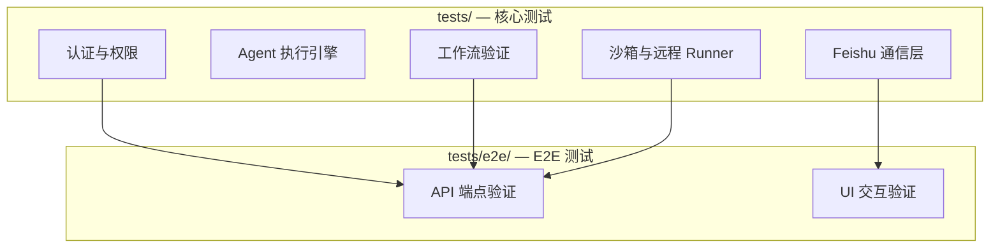

# tests

# tests

Agent Platform v2 的测试基础设施，采用**分层测试策略**，由两个子模块协同覆盖从单元到端到端的完整验证链路。

## 子模块关系

- **[tests](tests.md)**：基于 Node.js 原生 `assert` 的独立可执行脚本，直接调用内部函数并 mock 外部依赖（如 Prisma、HTTP 客户端），覆盖认证、Agent 引擎、Feishu 命令处理、工作流状态机、沙箱隔离等核心逻辑。
- **[tests/e2e](tests/e2e.md)**：基于 Playwright 的端到端测试，针对运行中的应用实例（`localhost:3000` / `localhost:3010`），验证 HTTP 响应契约和浏览器交互行为。

## 协同方式

| 维度 | 核心测试 | E2E 测试 |
|------|---------|---------|
| 粒度 | 函数/模块级 | 应用级 |
| 依赖 | Mock 数据库、网络 | 真实运行中的应用 |
| 典型场景 | `resolveRouteAuth` 权限解析、`validate` 工作流校验、Feishu 命令幂等性 | Dashboard 页面渲染、Workspace 冒烟、Gateway 健康检查 |
| 运行方式 | `npx ts-node tests/<name>.test.ts` | `npx playwright test` |

核心测试中验证的**业务逻辑**（如工作流完成门控、Feishu 消息投递、会话轮换）在 E2E 层被重新验证为**用户可见行为**（如 API 返回正确状态码、页面展示预期内容）。两层测试共同确保：内部逻辑正确 → 外部表现一致。

## 关键跨层工作流

1. **Feishu 命令链路**：核心测试验证命令解析、幂等性、消息格式（`feishu-workspace-command`、`feishu-document-command`）；E2E 验证 Workspace 页面中命令执行后的 UI 反馈。
2. **工作流生命周期**：核心测试覆盖 `workflow-validator` 的标记校验、`workflow-completion-gate` 的 Git 提交门控、`workflow-watcher` 的重复计划检测；E2E 验证 Control Plane 中工作流状态流转。
3. **远程 Runner 部署**：核心测试通过 `startRunner` / `freePort` 模拟 Gateway 部署流程；E2E 验证 Gateway 监控面板的健康状态展示。